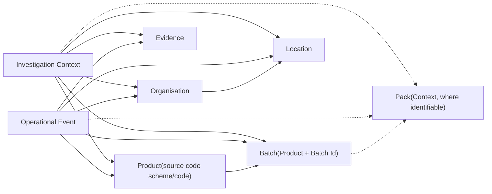

# ADR-005: Operational Information Model

| Attribute          | Value                         |
| ------------------ | ----------------------------- |
| **Document ID**    | ADR-005                       |
| **Title**          | Operational Information Model |
| **Status**         | Draft                         |
| **Version**        | 0.9                           |
| **Classification** | Internal                      |
| **Owner**          | SMVS GmbH                     |
| **Author**         | Reinhold Sojer                |
| **Reviewers**      | TBD                           |
| **Approver**       | TBD                           |

---

# Revision History

| Version | Date       | Author         | Description   |
| ------- | ---------- | -------------- | ------------- |
| 0.9     | 2026-06-26 | Reinhold Sojer | Initial draft |

---

# Context

SMVS Operations integrates information delivered by multiple Information Sources across the medicines verification ecosystem. Terminology follows [GLO-001](GLO-001%20Operational%20Investigation%20Glossary.md): Source System identifies delivery, while Source Authority identifies responsibility for originating or maintaining particular information. This terminology alignment does not approve this draft model or its identity rules.

Current and planned Information Sources include, but are not limited to:

- Swiss NMVS
- EMVS AMS Hub
- Swissmedic
- VerifyIt
- Future operational information sources

Each Information Source has its own information model, terminology, identifiers and operational purpose. Furthermore, the completeness and granularity of the available information differ considerably between sources.

The Daily Snapshot delivers EMVS-originated Product and Batch/Lot information held in NMVS for the national market, alongside locally maintained SSR Local Organisation and Location context. Delivery through NMVS does not make these one authority domain. NMVS holds individual Serial Numbers, but the Daily Snapshot does not expose them or individual Pack records.

Without a common information model, every analytical capability would need to interpret each Information Source individually, leading to duplicated integration logic, inconsistent interpretation and reduced maintainability.

A common conceptual representation of the operational domain is therefore required before analytical processing can take place.

The platform does not own operational information. It maintains an integrated operational representation of information delivered by Operational Information Sources, preserving the distinction between delivery and original authority.

---

# Decision

**SMVS Operations shall maintain a source-independent Operational Information Model based on common business entities and contextual investigation concepts.**

SMVS Operations shall establish a unified **Operational Information Model**.

The Operational Information Model provides the common conceptual representation of the medicines verification ecosystem independently of individual Information Sources.

The model distinguishes between:

- persistent Business Entities representing stable operational concepts;
- contextual investigation entities established from operational events and available evidence.

Information obtained from Operational Information Sources shall first be transformed into the Operational Information Model before becoming available to Operational Intelligence.

Business Entities shall be defined independently of implementation details, source-specific schemas and physical database structures.

The Operational Information Model shall provide the common information foundation for all Intelligence Domains and Decision Support capabilities.

---

# Persistence and retention principles

SMVS Operations is not a historical replica, data warehouse or shadow copy of NMVS. NMVS remains the authoritative source for detailed NMVS source data; this does not erase the distinction between its delivery role and the upstream or local Source Authorities defined in GLO-001. Persistence follows operational value and retention purpose, not the volume of information exposed by a source.

SMVS Operations is also not merely an analytical copy or extension of NMVS data. NMVS provides medicines verification and relevant source information. SMVS Operations complements it with operational management capabilities: investigations, assessments, contractual oversight, eligibility review, decisions, actions and follow-up. These capabilities combine NMVS/EMVS-derived information, other authoritative external information, SMVS/NMVO-owned context and information created by operational work; they are not capabilities attributed to NMVS itself.

The common progression is **Source Evidence → Observation / Relevant Change → context from one or more sources → assessment → decision → action → outcome / follow-up**, with Decision Support informing human decisions. Not every use case needs every stage. It serves Alert/Investigation Management, MAH/contractual/financing oversight and end-user eligibility without requiring an Alert to initiate operational work. Human decision responsibility and existing NMVS read-only boundaries remain unchanged. Assessments and decisions remain distinct from source observations, even though the platform retains both.

For Alert/Investigation Management, NMVS Exception/transaction information contributes to context, assessment, decision and action/follow-up/closure. The complete SMVS investigation, including assessments, communications where applicable, decisions, actions and outcomes, is not simply an NMVS record.

For example, a Product Code/version and its reported MAH/OBP may reveal a previously unseen MAH. Comparison with local contractual/registration context can lead to no action when a contract is established, or to a potential contractual mismatch for review. “Free rider” is a potential assessment requiring verification, not an automatic legal conclusion. Missing or unresolved identity/contract evidence must remain distinguishable from confirmed absence of a contract. A valid NMVS Product record may therefore still raise a contractual oversight question when combined with SMVS/NMVO-owned information. No contract database or matching rules are prescribed here.

End-user eligibility is another cross-source use case: NMVS Local Organisation/Location context is compared with appropriate authoritative establishment-existence or authorisation/status information, leading to review of a mismatch, changed status or unresolved match and operational follow-up where required. “End-user eligibility” here concerns participant establishment eligibility, not identification of the physical end-user defined in GLO-001. Swiss GMDP is a concrete historical example used by the previous solution, not an approved integration: no API, synchronisation, local replica, schema, identifiers, matching algorithm or automatic deactivation is prescribed. Coverage of every Location type is not assumed. A missing match does not establish ineligibility. Applicable authorities, participant categories and decision rules require later domain/source analysis.

Source System identifies delivery; Source Authority identifies responsibility for a fact. NMVS/EMVS-derived information can establish source-reported Product/version visibility, Batch, participant or Exception context; an establishment authority may establish existence/licensing status; SMVS/NMVO-owned information may establish contractual or internal operational status. SMVS Operations records first observations, classifications, contextual relationships, reviews, assessments, decisions, actions and outcomes. Provenance must distinguish these contributions rather than assign them one generic source.

## Current context and compact change history

Current context can answer which Swiss NMVS-visible Products/versions and Batches relate to an MAH, their reported pack aggregates and current operational/contractual status. This does not require daily historical copies of every Product, Batch or MAH state. Generic persistent Business Entity terminology does not require complete state history or a complete European multi-market Product master.

Retain Relevant Changes such as first-observed MAHs, Product Codes or Product Code Versions; reported MAH/OBP association changes; potential transfers; and relevant new Batch uploads where supported by source semantics. A Product Code can stay the same across versions: version 1 associated with MAH A/OBP X and version 2 with MAH B/OBP X or MAH A/OBP Y may warrant review. Not every version change is an MAH transfer. Preserve code scheme, version and source-qualified party identifiers; names do not resolve identity and EMVS MAH/OBP identifiers are not NMVS Organisation identifiers.

A retained Relevant Change records what was detected, when observed, involved objects, why relevant, supporting context/evidence and links to resulting assessments, decisions and actions (including no action where applicable). It does not require every intermediate source state. First observation is not market-entry time, exact upload time or the legal/effective date of a transfer. No event table or change-log schema is prescribed.

Daily Snapshot can supply current source state. Delta Snapshot is another source mechanism for change detection/retrieval; its detailed contract remains to be established. Neither defines the desired historical business model. Reprocessing or repeated acquisition must not itself imply a new business change; relevance and identity rules remain domain design concerns.

## Retention categories

| Category | Persistence principle |
| --- | --- |
| Transient / processing data | Raw artifacts and staging serve acquisition, validation and bounded replay. Preserve exact bytes while retained; define a purpose-based period before disposal is implemented. No indefinite default is required. |
| Current Operational Information | Keep context required for current work; replacement does not mandate a complete historical copy. Preserve separately selected changes and required evidence. |
| Detailed Exception operational working data | Purpose-bounded, configurable rolling policy. Approximately three months is a working assumption for validation, not an approved fixed period; operational needs, verified re-retrieval capabilities and analytical requirements determine the policy. |
| Relevant Operational Change History | Keep compact changes with relevance and provenance under an explicit operational retention policy; no automatic full Product/Batch history. |
| Case / decision / action history | Retain investigation context, findings, assessments, decisions, actions and required evidence under their own policy, independently of source expiry. |
| Longitudinal Alert/Exception analytical information | Retain the minimum derived information necessary for required longer-term analysis under a separate purpose-based policy; detailed-source expiry must not limit the analytical horizon. Representation remains undecided. |
| Audit / accountability evidence | Retain for at least five years; any documented stronger requirement prevails. Audit captures accountable activity and explanation, not a replica of source data. |
| System-wide historical metrics | Deliberately selected Swiss NMVS-wide series: Product count, Product Version count where meaningful, Batch count, reported Number Of Packs and Number Of Active Packs. No automatic per-MAH/Product/Batch/Organisation/Location histories. |

The Exception working-set duration itself, as well as its calendar-day/month convention and age reference, requires approval before enforcement. Durations for other categories remain policy decisions; the audit minimum does not impose five-year retention on all source data. Case information must not disappear when Exception source details expire. Information/evidence required by active or retained Cases must remain available even when an investigation outlasts the normal working-set window. Case, longitudinal analytical and audit policies are independent of that window; no evidence-preservation mechanism is prescribed here.

For example, “How many A7 Alerts occurred per Location during the last year?” requires longitudinal analytical capability, not a one-year copy of complete Exception records. Retain the minimum derived information needed for the validated question. Later use-case and source-data analysis must determine whether pre-aggregated metrics, reduced Alert/Exception observations or another representation is sufficient; no dimensions, fields, aggregation levels or tables are selected here. This is distinct from the narrow system-wide snapshot metrics category and does not introduce per-MAH historical counts.

Metrics require documented scope, grain, source time/Observation Time, completeness and aggregation rules. Changes in reported pack aggregates do not prove that exactly that number of Packs was uploaded. Product/Batch totals must not be added together without establishing non-overlapping semantics. No individual Pack or Serial Number is inferred.

## Explainability after source expiry

Retain, where relevant, Source System, Channel/report/API, acquisition and Observation Times, source report/snapshot identity, Processing Run, parser/transformation/mapping/rule versions, source-qualified identifiers, relevant values or selected evidence, derived result and linked assessment/decision/action. Missing source identities or times must be explicit rather than invented. Record who acted or approved, what changed, when, and which automated process/version produced a result. Provenance must explain the conclusion even when complete source content is no longer local.

Prefer retrieval of older detailed source information from its relevant Source System where the particular report/API supports it, including NMVS for NMVS detail. Existing date-based lookup does not guarantee arbitrary historical availability, retention duration or exact reproduction. Before discarding source detail, ensure required explanations and evidence remain available independently of an unverified retrieval promise. If reconstruction is unavailable or incomplete, disclose that limitation; a checksum or remote locator alone is not sufficient evidence of the reasoning.

SMVS-created assessments, investigation results, decisions, actions, classifications, review evidence and contextual relationships may exist nowhere else. Retain required records under their own operational, case and audit/accountability policies; they cannot be assumed reconstructable from NMVS or another external source. Multi-source provenance records the contributing authorities and relevant assertions as well as the internal reasoning/execution and outcome. Source re-retrieval is not a substitute for retaining required SMVS-created records.

This is a conceptual target. It does not approve physical domain design, implement retention/deletion, or change the current technical foundation's storage behavior.

---

# Rationale

The Operational Information Model establishes a stable conceptual foundation for the platform.

Rather than modelling individual operational systems, the platform models the business entities and investigation concepts required to support operational investigations.

This architectural approach separates information integration from analytical interpretation and enables all Intelligence Domains to operate on a common representation of the operational environment.

## Independence from Information Sources

Business Entities remain conceptually stable even when new Information Sources are introduced.

The introduction of additional operational systems therefore primarily affects the Information Integration Layer while preserving the Information Model and the Intelligence Domains built upon it.

---

## Separation of Integration and Intelligence

Information integration and operational analysis represent distinct architectural concerns.

The Information Integration Layer is responsible for acquiring, validating, transforming and correlating information delivered by multiple Information Sources.

Operational Intelligence operates exclusively on the consolidated Operational Information Model and remains independent of source-specific implementation details.

---

## Support for Contextual Investigations

Not all operational information is available at the same level of granularity.

For example, Products and Batches are persistent Business Entities, whereas Pack Context is typically established only when sufficient identifiers are available through operational events such as Alerts, Exceptions or Audit Trail records.

The Operational Information Model therefore supports both persistent Business Entities and contextual investigation entities without requiring complete pack-level information for every operational investigation.

---

## Extensibility

The Operational Information Model provides a stable conceptual foundation for future evolution.

Additional Information Sources, Business Entities and analytical capabilities can be incorporated without fundamentally changing the architecture or the existing Intelligence Domains.

## Separation of Conceptional and Physical Models

The Operational Information Model is a conceptual model. It does not prescribe the physical analytical data model used for implementation.

The implementation may use an analytical schema, such as a star schema with fact tables and dimensions, to support reporting, analytics and investigation queries. Such implementation-specific data modelling decisions shall be documented in the Software Design Specification.

# Business Entities and Investigation Concepts

The Operational Information Model distinguishes between persistent Business Entities and contextual investigation concepts.

Persistent Business Entities represent stable operational concepts that may exist independently of a specific investigation.

Contextual investigation concepts are established from operational events and available evidence. They may depend on the completeness and granularity of the information available in a specific investigation.

---

## Persistent Operational Entities

| Entity           | Description                                                  | Typical Identifier |
| ---------------- | ------------------------------------------------------------ | ------------------ |
| **Product**      | Source Product concept represented by EMVS/NMVS information; preserve Product Code Scheme and Product Code. It is not automatically a regulatory preparation or Swissmedic authorisation. | Source Product Code Scheme + Code               |
| **Batch**        | A production Batch (Lot) associated with a Product; Batch Id alone is not a global identity. | Source Product identifier + Batch Id    |
| **Organisation** | Generic legal or operational participant; broader than SSR Local Organisation. MAH, OBP and manufacturer roles do not establish identity with Local Organisation. | Source-qualified identifier    |
| **Location**     | SSR instance of an actor entitled/required to verify medicinal packs, owned by a Local Organisation; not necessarily a postal address. | Source-qualified Location Id        |

---

## Contextual Investigation Concepts

| Concept                   | Description                                                  | Typical Identifier                                           |
| ------------------------- | ------------------------------------------------------------ | ------------------------------------------------------------ |
| **Pack Context**          | Context relating to an individual pack. Pack Context is established only when sufficient identifiers are available. Pack Context represents an investigation concept rather than a persistent business entity. | Source Product identifier + Serial Number, with Batch Id and Expiry Date where available |
| **Event**                 | An Event represents an operational occurrence observed within the medicines verification ecosystem.Examples include:- Alerts- Exceptions- Transaction Events- Audit Trail Events- Future Field Intelligence Events | Source-specific identifier, Transaction ID or Event ID       |
| **Evidence**              | Evidence consists of objective information collected during an investigation.Evidence remains distinguishable from Intelligence, Risk Assessment and Decision Support. | Platform-generated identifier                                |
| **Investigation Context** | Contextual representation of an operational investigation established in accordance with ADR-004. | Platform-generated identifierPlatform-generated identifier   |

Pack-level information is not generally available from all Information Sources.

The Daily Snapshot exposes no individual Serial Numbers or Pack records. Its `Number Of Packs` and `Number Of Active Packs` values are aggregates and cannot reconstruct Pack Context. This report limitation does not imply that NMVS lacks serial-number holdings. Other information would be needed for conditional Pack Context; no source or implementation is approved here.

A Snapshot Observation can describe state, context, relationships or measures without being an Event. Differences between Observations do not by themselves establish a causal Event, its time or actor.

The model therefore treats Pack Context as conditional. It can enrich an investigation where sufficient identifiers are available, but it is not required for all operational analyses.

---

# Conceptual Information Model

The following diagram illustrates the conceptual relationship between persistent Business Entities and contextual investigation concepts.

It does not represent a physical database model.

Dashed relationships indicate conditional relationships that depend on the availability of sufficient identifiers.

---

# Entity Identification

The Operational Information Model uses stable business identifiers wherever possible.

| Entity or Concept | Source identifier context                                           |
| ----------------- | ------------------------------------------------------------ |
| **Product**       | Source Product Code Scheme + Code                                                         |
| **Batch**         | Source Product identifier + Batch Id                                              |
| **Organisation**  | Source-qualified identifier                                              |
| **Location**      | Source-qualified Location Id                                                  |
| **Pack Context**  | Source Product identifier + Serial Number, with Batch Id and Expiry Date where available |
| **Event**         | Source-specific identifier, Transaction ID or Event ID       |
| **Evidence**      | Platform-generated identifier                                |
| **Investigation** | Platform-generated identifier                                |

These source identifier descriptions are conceptual, not approved canonical identity rules or database keys. `Organisation Id`, `EMVS MAH Id`, `OBP Id` and manufacturer names are separate namespaces; names alone do not resolve identity. EMVS MAH is not automatically Swiss regulatory MAH. Product Version is a source attribute, not a Mapping Version or Snapshot Revision.

Where source systems provide different identifiers or incomplete information, the Information Integration Layer is responsible for mapping and correlating the available information into the Operational Information Model.

# Consequences

## Positive

- Provides a common conceptual information model across all Information Sources.
- Establishes a stable foundation for all Intelligence Domains.
- Separates source-specific integration from analytical interpretation.
- Supports Product-, Batch-, Organisation-, Location- and Event-based investigations.
- Enables Pack-level investigations where sufficient identifiers are available.
- Reduces duplication of mapping and interpretation logic.
- Improves consistency of terminology throughout the platform.
- Supports future integration of additional Information Sources.
- Supports future evolution of the Investigation Context and Decision Support capabilities.

---

## Negative

- Information from different sources must be mapped and correlated before it can be used consistently.
- Source-specific semantics may require additional transformation logic.
- Entity resolution may become complex where identifiers are incomplete, inconsistent or source-specific.
- Some investigations may remain limited by incomplete information.
- Pack-level context cannot be assumed for all investigations.

---

# Related Documents

This Architecture Decision Record is based on the conceptual principles defined in:

- ARCH-001 Conceptual Reference Architecture

It provides the conceptual basis for:

- ADR-006 Operational Intelligence Layer
- ADR-007 Operational Risk Intelligence
- ADR-008 AI-assisted Decision Support
- URS-001 User Requirements Specification
- Functional Requirements Specifications
- Software Design Specifications
- Validation documentation

---

# Future Evolution

The Operational Information Model is expected to evolve as additional Information Sources, Intelligence Domains and operational use cases are introduced.

Future extensions may include:

- additional business entities
- additional contextual investigation concepts
- additional relationships between existing entities
- improved entity resolution
- enhanced correlation across Information Sources
- additional pack-level investigation capabilities where sufficient identifiers are available
- additional Operational Information categories

Such extensions shall preserve the distinction between persistent Business Entities and contextual investigation concepts.

The conceptual principles established by this ADR shall remain unchanged unless the underlying operational investigation model changes fundamentally.

