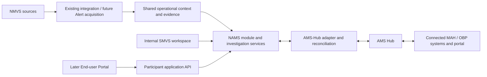

# NAMS within SMVS Operations — Architecture Proposal

Status: Discussion draft, 2026-11-04. No replacement decision, external integration, API implementation or cutover is authorised by this document.

## Intent

Consider replacing NMVS Alerts with a National Alert Management System (NAMS) integrated with SMVS Operations and connected to AMS Hub. Provide an application API for a later lean End-user Portal supporting root-cause investigation and collaboration. Reuse AMS-Hub capabilities where its verified contract supports the required workflow.

Working designation: **SMVS NAMS**. Product naming is independent of identifiers, API paths and architecture. Candidate names include **SMVS AlertLink**, **SMVS AlertConnect** and **SMVS AlertDesk**. These are brainstorming options; trademark, domain and product-name availability have not been checked. Swiss Alerts is not selected.

## Recommended boundary

Implement a bounded NAMS module in the existing platform first, with separate domain services and an explicit application API. A separate deployment is not required by this proposal. The portal should use this API rather than recreate investigation or Hub-integration logic. Internal SMVS tools may share domain services while exposing different permissions and views.

The NMVS arrow describes information consumption, not medicines-verification writes. The MAH connection illustrates the collaboration route described by EMVO, not a new direct interface implemented here.

## Responsibilities

| Component | Proposed ownership |
| --- | --- |
| Shared Operations foundation | Source-qualified identities, current context, selected changes, evidence/provenance, internal assessment and audit |
| NAMS domain | National Alert work queues, participant contributions, case links, responsibilities and permitted workflow commands |
| Participant API | Purpose-limited Alert/case views and submission commands; organisation/location access checks; versioned contracts |
| End-user Portal | Alert view, guided investigation/root-cause submission, allowed evidence/messages, status/progress display |
| AMS-Hub adapter | Contract-specific exchange, identity/status mapping, delivery tracking and reconciliation |
| AMS Hub / MAH-side tooling | Reuse supported cross-party collaboration and exchange; do not recreate a general MAH portal by default |

Daily Snapshot supplies context, not an Alert feed or participant investigation history. Alert acquisition must be specified independently. An Alert, a participant investigation and an internal case are separate concepts; correlation does not require a one-to-one relationship.

## Workflow example

1. Acquire an Alert through the verified source interface, deduplicate its identity and attach available Product/Batch/Location context.
2. Authorise the relevant End-user to view the permitted Alert and submit their investigation result, supporting evidence and proposed root cause.
3. Preserve the submitting actor, organisation/location, time and version. A submitted cause remains attributed evidence until the applicable review/workflow establishes its meaning.
4. Publish only information approved for sharing using the supported AMS-Hub contract. Preserve local submission, delivery and acknowledgement as distinct states.
5. Incorporate MAH-side contributions received through the Hub without overwriting independent local findings or treating an external status as an internal case decision.
6. Apply agreed closure/reopening rules and retain evidence independently of the detailed-source window. Exact commands, codes and sequencing require contract validation.

## API design criteria for later specification

- External identity and explicit organisation/location entitlements; service-account and human delegation recorded separately. Local NMVS identity does not itself grant portal access.
- Purpose-limited views of permitted Alerts and contributions. Never expose generic staging, internal risk assessments or confidential SMVS notes by default.
- Distinguish shared messages, internal notes, evidence visibility and intended recipient. MAH permissions must not be inferred merely from Product names or uncertain party matches.
- Versioned investigation submissions and concurrent-update handling. Repeated requests reuse a durable command identity rather than creating duplicate external actions.
- Durable outbound commands, acknowledgement tracking, bounded retries, failure queues and reconciliation. Keep requested, locally accepted, sent, acknowledged and failed states distinguishable.
- Preserve external identifiers, origin, timestamps and contract versions. Suppress inbound/outbound echo loops and handle delayed or conflicting updates.
- Evidence attachment lifecycle, allowed media, access and retention need explicit specification. Do not assume Hub attachment capabilities.
- No concrete endpoints, synchronisation direction, webhook support, codes or authentication protocol are assumed in this proposal.

## Hub reuse and evidence boundary

EMVO's public descriptions state that connected NAMS participate in end-to-end collaboration through AMS Hub and that connected-system actions need not be repeated manually. They describe exchange including statuses, investigations and messages. These are capability-level descriptions, not a tested interface contract for this project.

Before implementation, obtain the applicable NAMS integration specification and access/onboarding requirements. Verify supported directions and operations, status/root-cause vocabularies, actor/participant roles, message and attachment semantics, source identity, corrections, acknowledgement, replay/recovery, limits, environments and certification/conformance expectations where applicable. Build a capability matrix showing which requirement is fulfilled by the Hub, locally, or remains unsupported.

Public references consulted 2026-11-04:

- [EMVO — EAMS landscape and connection to EMVS](https://help.emvo-medicines.eu/en/articles/6820772-eams-what-does-the-eams-landscape-look-like-and-how-is-eams-connected-to-the-emvs)
- [EMVO — Actions in connected NAMS and EAMS](https://help.emvo-medicines.eu/en/articles/6244382-eams-as-some-nmvos-have-their-own-nams-will-actions-executed-in-their-nams-be-automatically-updated-in-the-eams-or-will-the-action-have-to-be-executed-in-both-systems)

The search index supplied the public capability descriptions; direct retrieval failed during preparation. Recheck the pages and use the actual technical specification before relying on detailed integration behaviour.

## Existing scope conflicts to resolve

DOC-001 currently limits use to internal SMVS personnel, calls the platform observational, excludes replacement of EMVS AMS and excludes operational actions on behalf of MAHs/OBPs/End-users. ARCH-001 and URS-001 describe a complementary internal platform.

A national module replacing NMVS Alerts differs from replacing AMS Hub or NMVS verification, but it still expands the present boundary: participant access and permitted external Hub actions must be made explicit. Update DOC-001, ARCH-001, glossary, URS and relevant FRS together after the scope decision. Do not remove NMVS read-only protections. Define participant responsibility versus platform transmission rather than treating all actions as SMVS decisions on behalf of another actor.

## Delivery and replacement readiness

The agreed product direction is **Shared investigation**, with the **End-user
collaboration pilot before AMS-Hub integration**. The integrated CRM supplies
organisation, contact and SPOC relationships. See the
[Shared investigation and CRM proposal](Shared-Investigation-and-CRM-Proposal.md)
for decision ownership, access and CSV migration boundaries.

1. Prepare the minimal organisation/contact/SPOC directory and Investigation services.
2. Build the End-user shared workspace and internal NMVO assessment/closure workflow,
   using scoped passwordless access and an attributed Action Log.
3. Validate shared findings, open questions, closure proposals and evidence visibility
   with representative End-users. The NMVO owns the final closure decision.
4. Verify the Hub contract and add supported MAH/OBP exchange, acknowledgement,
   retries and reconciliation through the adapter and application API.
5. Plan migration from NMVS Alerts: inventory open cases, identity links, history/evidence
   availability, participant onboarding and support ownership. Establish one writer
   per workflow during parallel operation; rehearse reconciliation and cutover.

A pilot must demonstrate that no Alerts/actions are lost or duplicated, participants see only permitted information and internal evidence remains explainable. Replacement is not assumed feasible solely because the Snapshot importer exists. No migration, external write or cutover occurs as part of this documentation work.
