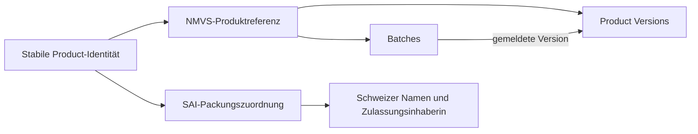

# Product Versions, Produkttransfer und Batch-Zuordnung

Prüfstand: 4. November 2026. Dokumentenprüfung und Anpassung des Entwurfs;
Dokumentenbefunde als Grundlage für die anschließend implementierte Mapping-Schicht.

## Quellen und Geltungsbereich

Geprüft wurden die vom Nutzer bereitgestellten Fassungen:

- **EMVO-00122, EMVS Master Data Guide**, v10.0, genehmigt 15.10.2025,
  insbesondere S. 7, 12, 28 und 36 (Anhang 7).
- **EMVS0647, EMVS European Hub Functional Specification, SR1.16**, v18.0,
  Status Approved, Copyright 2024; bereitgestellt unter der Bezeichnung EMVO-00582.
  Insbesondere §§5.1.4–5.1.5, S. 26–30; §7.1.1, S. 40–41;
  §7.2.1, S. 72–76 und 88–89; §7.2.2, S. 91–95.

Seitenangaben beziehen sich auf die aufgedruckten Seitenzahlen. Die Prüfung
bestätigt die Aussagen dieser Fassungen, nicht den aktuellen Implementierungsstand
aller Hub-/NMVS-Releases oder einen bisher nicht vorliegenden Snapshot-Vertrag.
Die relevanten Seiten wurden vollständig textuell geprüft; die zentralen
Datenmodelle und Regeln zusätzlich visuell kontrolliert.

## 1. Ergebnis

Ein Produkttransfer kann mit neuen Product Versions zusammenhängen, aber die
Versionsnummer allein beweist weder einen Transfer noch einen MAH-Wechsel.
Die Hub-Spezifikation beschreibt einen eigenen Transferprozess, der Eigentümer-,
Eskalations- und gegebenenfalls Batch-Recaller-Zuordnungen verändert. Das Anlegen
einer neuen Product Version ist dort kein zwingender Prozessschritt.

Product Versions sind eigenständiger fachlicher Kontext. Die bisherige
Modellierung als bloßes Attribut einer aktuellen Product-Zeile reicht für
versionsbezogene Batch- und spätere Alert-/Zuständigkeitsfragen nicht aus.

## 2. Wann entstehen neue Versionen?

Der Master Data Guide erklärt in Anhang 7, S. 36:

- Der erste Upload ohne vorgegebene Version erzeugt Version 1.
- Ohne Versionsvorgabe wird bei passenden bereits gespeicherten Daten der
  Zeitstempel aktualisiert; bei nicht passenden Daten wird eine neue Version
  mit erhöhter Versionsnummer angelegt.
- Bei expliziter Versionsvorgabe versucht der Hub die betreffende PMD-Version
  zu aktualisieren.

S. 7 nennt das Hinzufügen eines neuen Markts als Anlass für eine neue PMD-Version.
Die Hub-Spezifikation §7.2.1, S. 73–75 und 88–89 beschreibt die Zuordnung der
Versionsnummer und ausdrücklich auch das Überschreiben bestehender
versionsbezogener Stammdaten mit Audit-Nachweis.

Daraus folgt: **Neue Versionsnummer ist kein eindeutiger Transferindikator;
unveränderte Versionsnummer bedeutet nicht unveränderte Stammdaten.**
Eine Product Version ist keine unveränderliche vollständige historische Revision.
Ein beobachteter Versionswechsel ist ein prüfbarer Quellbefund; Ursache und
wirksamer Zeitpunkt benötigen weitere Belege.

## 3. Was passiert beim Transfer?

§7.2.2, S. 91–95 beschreibt Divestitures and Acquisitions mit zwei Szenarien:

| Gegenstand | Belegter Unterschied |
| --- | --- |
| Produkt-Eigentümer | Product Organisation ID wird auf den Acquirer gesetzt |
| Szenario 1: Escalation Transfer | Eskalationszuordnung geht abhängig vom Eskalationsdatum an den Acquirer; Batch Recaller wird für betroffene Versionen entsprechend umgestellt |
| Szenario 2: Escalation Retention | Eskalationszuordnungen werden nach den beschriebenen Regeln geleert; vorhandene Versionen können dem Transferor zugeordnet bleiben |
| Neue Product Version | Kein zwingender Anlageschritt im beschriebenen Ownership-Transferprozess |

S. 73, Fußnote 3 ergänzt: Nach einem Transfer kann jede Product Version eine
eigene besitzende Organisation haben; nur der Product-Eigentümer darf neue
Versionen anlegen. Das erklärt, warum Product-Eigentümer und Eigentümer älterer
Versionen auseinanderfallen können.

S. 92 beschreibt das Eingabefeld TransferDate in dieser Fassung lediglich als
Referenzangabe. Daraus darf kein technisch durchgesetzter, universeller
Wirksamkeitszeitpunkt abgeleitet werden. Eskalationsdatum und Beobachtungszeit
sind ebenfalls getrennte Angaben.

Der anschließende Upload neuer/angepasster PMD durch einen Acquirer kann nach
den PMD-Regeln eine neue Version erzeugen. Das ist eine mögliche Kombination
zweier Prozesse, kein Nachweis, dass jeder Transfer automatisch inkrementiert.

## 4. Product, Product Version und Batch sind getrennte Konzepte

Die logischen Modelle und Tabellen auf S. 26–30 unterscheiden:

- Product: umgebungs-, Code-Scheme- und Code-bezogene Grundidentität.
- Product Version: versionsbezogene Daten mit eigener Versionsnummer,
  Zeitinformationen und Zielmarkt-Kontext.
- Batch: eigener Datensatz mit ProductCodeVersion-Bezug, Herstellerkontext,
  BatchExpiryDate sowie separater Recaller-Zuordnung.

Der Batch-Aggregatschlüssel auf S. 29 verwendet Umgebung, Product Scheme,
Product Code und Batch Number. Die Product Version ist dabei eine Beziehung,
nicht Bestandteil dieses dargestellten Batch-Identifikators.

§7.1.1, S. 41, Schritt 14: Eine neue Batch wird gegen die aktuelle Product
Version angelegt, die dem anfragenden Teilnehmer gehört. Das ist nach Transfers
nicht zwangsläufig die global höchste oder allein im aktuellen Snapshot
sichtbare Versionsnummer.

**Die Zuordnung ist nicht grundsätzlich unveränderlich:** §7.2.1, S. 75,
Schritt 15.12 beschreibt für einen PMD-Upload ohne Versionsvorgabe ein Umhängen
vorhandener Batches auf die neue Version mit Audit-Nachweis für alte/neue Version.
Das darf nicht auf jeden Update- oder Transferfall verallgemeinert werden.

## 5. Einordnung unseres vorhandenen Snapshots

Die bereits durchgeführte Datenprüfung ergab:

- 5.690 Products, jeweils eine Zeile pro Quell-Produktcode im geprüften Bestand.
- 49.496 Batches mit vorhandener Product-Zuordnung.
- Bei 22.443 Batches unterscheidet sich die gemeldete Product Version von der
  Product-Zeile im selben Snapshot.

Die Dokumente machen diese Unterschiede fachlich plausibel und zeigen, weshalb
wir sie erhalten müssen. Sie beweisen **nicht**, dass diese 22.443 Batches aus
Produkttransfers stammen. Mögliche Update-/Ownership-/Verteilungsabläufe müssen
für konkrete Fälle aus geeigneten Quellen untersucht werden.

Ein Join mit der Bedingung „Batch-Version = Version der einzigen aktuellen
Product-Zeile“ wäre für unsere Anzeige falsch: Er würde diese Batches ausblenden.
Ebenso falsch wäre es, die Batch-Version durch die Product-Version zu ersetzen.

## 6. Änderung des Product-/Batch-Entwurfs

Zusätzlich zu den bisher vorgeschlagenen Tabellen wird **`product_versions`**
vorgesehen:

| Element | Entwurfsregel |
| --- | --- |
| Identität einer Version | Quell-Produktreferenz einschließlich Namensraum + Product Version Number |
| `product_source_records` | Liefert den aktuell beobachteten PMD-Kontext und verweist auf die dort gemeldete Product Version |
| `batches` | Behält die stabile Produkt-/Batchidentität und verweist zusätzlich auf die tatsächlich gemeldete Product Version |
| Version nur in Batches vorhanden | Referenzdatensatz mit Status `batch_reference_only`; keine erfundenen historischen PMD-Attribute |
| PMD-Details vorhanden | Status `pmd_observed`, mit konkret zugehörigen Quellwerten und Provenienz |
| Eigentümer/Eskalation/Recaller | Getrennte quellbelegte Rollen; fehlende Details bleiben unbekannt |
| Schweizer Namen / MAH-Anzeige | Weiterhin aus SAI; nicht als historische EMVS-Ownership-Aussage verwenden |

Eine reine Referenz auf eine alte Version bedeutet nicht, dass deren vollständige
Stammdaten bekannt sind. Eine aktuelle SAI-Zulassungsinhaberin darf nicht als
frühere Hub-Eigentümerin oder als Empfängerin eines historischen Alerts eingesetzt
werden. Das Routing zukünftiger NAMS-Fälle braucht die entsprechenden
Ownership-/Eskalationsbelege und den geprüften AMS-Hub-Vertrag.

Es wird kein vollständiges Hub-Historienmodell kopiert. Wir erhalten beobachtete
Versionsidentitäten und ausgewählte benötigte Informationen. Änderungen an
versionsbezogenen Attributen oder Batch-Zuordnungen werden nach einer expliziten
Relevanzregel behandelt, mit Beobachtungszeit und ohne erfundenen Effective Time.

## 7. Unterschiede zwischen den bereitgestellten Fassungen

Diese Punkte verhindern eine unkritische Übernahme als neue Implementierungsregeln:

1. **Versionsvorgabe 0:** Der Guide 2025, S. 36, Fußnote 11 behandelt 0 wie eine
   fehlende Versionsvorgabe. Die Hub-Spezifikation 2024, S. 74 und 88–89 führt für
   0 einen eigenen Zweig zur Erhöhung der aktuellen Versionsnummer auf. Die
   Gleichsetzung mit dem gesamten Vergleichs-/Umhängeverhalten ohne Versionsvorgabe
   ist damit nicht widerspruchsfrei belegt.
2. **Nachträgliche Märkte:** Der Guide formuliert auf S. 7/36 eine neue Version
   beziehungsweise Ablehnung beim Hinzufügen zu bestehenden Versionen. Die
   Hub-Spezifikation kennt auf S. 73 und 87 Ausnahmen für Märkte mit zugelassenen
   retrospektiven Uploads. Die konkrete Markt-/Release-Konfiguration ist aus
   diesen allgemeinen Aussagen allein nicht bestimmt.
3. **Snapshot-Umfang:** Beide Dokumente beschreiben Hub-Prozesse, aber nicht die
   vollständige Auswahl-/Versionslogik des konkreten SSR Daily Snapshot. Die
   Product-Zeile wird daher als beobachteter Snapshot-Kontext behandelt, nicht
   als Beweis, dass alle anderen Versionen im NMVS fehlen oder ungültig sind.

Für unseren lesenden Mapper gilt: vorhandene Versionsnummern unverändert
übernehmen, keine Hub-Upload-Versionierungslogik nachbauen und keine Transfers,
Zuständigkeiten oder Batch-Umhängungen aus Versionsnummern allein erzeugen.

## Nächster Umsetzungsschritt

Den Arbeitsmodell-Entwurf um die Versionsentität und die getrennten Beziehungen
ergänzen, bevor die erste fachliche Migration entsteht. Die Product-/Batch-Ansicht
zeigt Product-Version und Batch-Version getrennt; für nur indirekt bekannte
Versionen fehlen Stammdetails ausdrücklich. Zusätzliche historische PMD- oder
Ownership-Daten sind eine spätere, gesondert zu prüfende Quellintegration.
