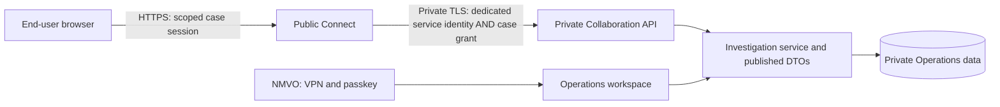

# Shared Alerts Management: End-user pilot and MAH extension

Date: 2026-11-10. Status: **proposal for product-owner review**, not an implemented
workflow or an approved deployment. Develop locally, test, commit, push and release
an identified commit under the [checkpoint process](../deployment/STATUS-2026-11-10.md).
No public endpoint, grant, notification or production record is created by this proposal.

**Authoritative investigation baseline:** the supplied EMVO-00306 best practice
is the owner-designated gold standard. See the [EMVO mapping and SMVS closure
policy](EMVO-Alert-Handling-Alignment.md) for section-level traceability, timing,
wholesaler routing, closure gates and the explicit NMVO-only closure choice. This
mapping takes precedence over simplified examples below and product manuals.

## 1. Product decision

Use an **Investigation** as the shared unit of work, entered through Exceptions in
Operations. A case joins available evidence, specific open questions, participant
contributions, agreed actions and the NMVO decision. Several reviewed alerts may
belong to one case. A participant investigates the case, not a duplicate form for
every affected pack.

Phase 1 involves the SMVS NMVO and a verified End-user organisation, initially
pharmacies and wholesalers. Phase 2 adds MAHs, preferentially through the AMS Hub
where its contract supports the required exchange. Retain one internal case and
participant-specific views rather than launching a second investigation product.

The distinction is a collaborative, evidence-guided process. NMVS Alerts itself
already describes collaboration, passwordless one-time links, attachments, batch
actions, participant statuses and an Action Log. Do not claim these as novel.

## 2. Source review and differences from the manuals

The supplied manuals describe a product, not SMVS policy or the applicable legal
requirements. Their versions differ substantially:

| Supplied document | Identity | Useful sections / PDF pages |
|---|---|---|
| `NMVS_Alerts_End_User_Manual.pdf` | NMVSAMS-505, version 1.0, 2022-05-20; 16 pages | Access including unique links: p.4. Participant inspection: pp.9-13. Action Log and stakeholder statuses: pp.14-16. |
| `NMVS_Alerts_NMVO_User_Manual.pdf` | TCK-QM-DOC-08-143, NMVO Release 5.1, document version 1.0, effective 2025-12-22; 92 pages | End-user input / visibility: pp.41-43. NMVO responsibility / IMT: pp.44-46. Batch actions: pp.51-52. Notifications and one-time links: pp.53-56. Hub reason and history: pp.58-60. Onboarding and organisation scope: pp.67-68. |

Source fingerprints:

- End-user PDF SHA-256: `15a65ad159a52f800490773fec8005e1998505ee39b8bb12e5af695edff2be87`.
- NMVO PDF SHA-256: `0e95d90a1c4e1b42ec36044888c2a928b2672a2e0c15188948079de6131a6660`.

The manual wording is not completely uniform: the older End-user manual and
NMVO p.55 describe a link becoming invalid after a change, whereas NMVO p.56
specifies one write followed by read-only access. These are reference behaviours,
not a specification to reproduce. Implement one explicit access policy of our own.

| Reference behaviour | Proposed SMVS behaviour |
|---|---|
| Separate End-user, NMVO and MAH inspection areas with several statuses | One case summary, directed questions, attributed conversation and a clear next action; retain participant attribution. |
| End-user technical/procedural/other boxes and comments | Ask what was checked and observed first; suggest a cause classification from that evidence without requiring the End-user to determine the root cause. |
| A one-time link permits one save | A single-use invitation establishes an expiring session. Several contributions are permitted during valid access; saving an answer does not consume the investigation. |
| NMVO can enter information on behalf of the End-user | Support telephone/email contributions, explicitly recorded by NMVO staff with the original source and time. Never impersonate an End-user. |
| NMVO and MAH can close in the reference tool | Only the responsible NMVO makes the SMVS decision. Participant readiness is input, not a status-changing privilege. |
| Batch-level inheritance of comments/markings; p.52 says the audit does not distinguish single from batch | Show the reviewed membership and scope; record one bulk operation ID and the exact per-alert decisions. A common batch alone is insufficient. |
| Broad stakeholder notifications, with grouping | Notify approved case recipients on explicit requests or substantive updates; one case-level request instead of one email per pack. |
| Contact data is hidden from selected stakeholders | Do not expose End-user identities/contact data to future MAHs by default; publish a case-specific permitted projection. |

The supplied EMVO best-practice document is the controlling technical content
reference, not merely background reading. The product owner has explicitly chosen
NMVO control and closure, using the general NMVO route in section 3.11 and excluding
its optional MAH/End-user closure permissions. Track all further national deviations
explicitly; do not derive investigation requirements from product screenshots.

## 3. Phase 1 user journey

1. **Triage in Operations.** The NMVO opens an Exception/RCA tab. Intelligence
   assembles the pack sequence, upload coverage, related observations and known
   CRM software/context. Evidence gaps stay visible. The NMVO may resolve local
   work without opening an external investigation where the evidence supports it.
2. **Prepare an investigation.** Select a single alert or explicitly reviewed
   similar alerts, identify the responsible End-user organisation/location, and
   choose only the outstanding questions. Imported SPOC/Alert contact assignments
   suggest recipients; staff verify affiliation and scope before inviting them.
3. **Review what will be shared.** An End-user preview shows the exact fields,
   timeline excerpts, questions, selected attachments and recipient list. Internal
   notes, raw reports and risk indicators are excluded by default. Opening an
   investigation or selecting contacts does not publish or send anything.
4. **Invite the End-user.** The internal outbox sends a dedicated SendGrid template
   with a case reference, clear request and Connect link. Use a new investigation
   template, not the registration-confirmation template. Each recipient receives
   an individual access token even when contacts share a mailbox.
5. **Contribute through Connect.** An explicit Continue action exchanges the
   invitation for a session. The mobile-friendly case page explains the event,
   requests the relevant checks and accepts findings, questions and approved
   evidence. Display what SMVS already knows so it need not be retyped.
6. **Review together.** SMVS receives a Review required item in Operations. Staff
   can ask a follow-up, revise the shared summary or propose a resolution. Shared
   summaries identify their NMVO author and supporting contributions; they do not
   silently rewrite what the End-user reported.
7. **Decide and follow up.** The End-user can indicate that nothing remains open,
   request more clarification or disagree with a particular proposal. The NMVO
   records its decision and rationale. A prevention task can remain open after
   local alert work is resolved. Reopening retains prior contributions/decisions.

Participant routing requires a reviewed End-user and location link. Cases with
uncertain market responsibility stay in internal triage. Use the rules below
for foreign-initiated and Liechtenstein intermarket cases.

### Intermarket responsibility and investigation scope

| Scenario | SMVS role | Alert Desk and RCA |
| --- | --- | --- |
| A Swiss pack is scanned abroad and an alert is raised | The NMVO responsible for the market that initiated the transaction leads the investigation and owns closure. SMVS can support it with Swiss-side evidence or findings. | Show the responsible NMVO and the SMVS support scope in Operations. SMVS may mark its support work complete locally. The responsible NMVO decides whether to close the alert. |
| An EU pack is scanned by an End User in Liechtenstein and an alert is raised | SMVS investigates the Liechtenstein End-user side. This is an IMT case because Liechtenstein scans EU packs. | Request findings from the linked Liechtenstein End User and summarise them in the RCA. The SMVS investigation scope is End User only. MAH feedback is out of scope and is not counted as an outstanding response. |

Determine responsibility from the initiating transaction and the confirmed
location. Keep it separate from the product market, the IMT flag and the final
**Origin** of the cause. If the initiating market or location is unclear, review
the case before routing it or offering closure. Apply the same responsibility
and participant-scope checks to each case in a batch closure.

## 4. A simple End-user page

Use one responsive page rather than reproduce the full Operations navigation:

- **Overview:** what happened, relevant product/pack context, what is already
  established, and a prominent next-action summary.
- **Your checks:** a few conditional questions; existing answers remain visible.
  Saving a draft is distinct from submitting a contribution to SMVS.
- **Conversation & history:** approved shared messages, evidence and actions in
  time order, with organisation/author attribution and a visible current proposal.

Primary actions are **Submit findings**, **Ask SMVS** and, when a proposal exists,
**Nothing further to add** / **Further clarification needed**. There is no End-user
**Close alert** or generic status-management form. Use **Technical**, **Procedural**,
**Unclear** and **Other finding** as lightweight, optional assessment aids. A bare
“Not on my side” does not replace the checks performed and what remains unknown.

Application-owned text stays English for the pilot under the existing UI policy.
Source messages remain untranslated. DE/FR participant localisation can be a
separate reviewed increment. Apply the documented typography, field hierarchy,
button and timeline conventions; use a smaller public shell, not the core menu.

### Pharmacy and wholesaler guidance

Question selection depends on actual operation/error and available evidence, not
organisation type alone. A wholesaler may act for a manufacturer/MAH. Keep those
roles and hypotheses explicit rather than infer responsibility from its name.

| Scenario | Ask only for missing information |
|---|---|
| Pharmacy scan / dispensing workflow | What operation was intended? Is the physical pack available? Do printed identifiers match transmitted values? Was the pack handled/scanned again? If scanner behaviour is suspected, compare with the relevant local check. |
| Wholesaler / automated system | Intended operation (including Export, Destroy, Sample, Stolen or another supported operation); own workflow or on behalf of whom; automatic retries, bulk job, software/robotics and job/device evidence if actually available. |
| A7/A99 repeated same-operation pattern | Evidence-led NMVO triage first. A well-supported same-location repeat can be resolved locally without an End-user questionnaire; notify the End-user about prevention. Automatic execution requires an approved, versioned rule. Same-location repetition alone does not prove a benign cause. See the routine A7 / A3-A2 priority decision below. |
| A2 Batch not found | Reuse Snapshot/upload results and their time coverage. Missing search results are not proof the batch was never uploaded. In the Swiss voluntary-serialisation context, use monthly reporting as a prevention supplement, while preserving timely case-specific investigation/progress feedback under the EMVO mapping; do not ask every End-user to chase every MAH. Ask the End-user when submitted batch/scanner context needs checking. |
| A3 / A68 | Guided comparison of provided, stored and printed identifiers, pack availability, scanner/software checks and related location history. A remaining discrepancy requires deeper review. |
| A52 expiry discrepancy | Compare transmitted, stored and printed expiry; preserve the exact source error/operation. Consider scanning/date parsing and serialisation-quality hypotheses without deciding automatically. |

Never suggest that an End-user repeat a failed decommissioning operation merely
to generate evidence. Record pack handling/availability separately from cause and
closure. A resolved case does not itself authorise dispensing or establish pack
authenticity. Operational pack instructions come from the approved case guidance.

## 5. Case, participant work and resolution are separate

| Dimension | Proposed values / meaning |
|---|---|
| Internal case lifecycle | Draft, Awaiting participant, Review required, Resolved locally, Escalated. The waiting party is explicit. |
| Participant task | Open, In progress, Submitted, Further information requested, Completed. Completion means that task is done. |
| Cause assessment | Unknown, Working hypothesis, Confirmed by NMVO; evidence references and relevant unresolved checks retained. |
| Response to a resolution proposal | Nothing further to add, Further clarification needed; tied to a specific proposal revision and published alert membership. |
| External Alert/Hub state | Observed external state and, later, queued/sent/confirmed/failed Hub exchange. Never inferred from local case status. |
| Prevention action | Owner, due date, action and effectiveness review; can remain open after local resolution. Formal CAPA/CANEA handling is separate. |

Silence is not consent; the End-user also has no universal veto. The NMVO records
whether participant input is required, what was received, unresolved concerns and
why it decides to resolve or escalate. A substantive proposal, evidence or membership
change invalidates the earlier readiness response and requires reassessment.

Phase 1 must distinguish **Resolve locally** (work-list disposition) from **Close
investigation** (the documented NMVO closure decision, under the EMVO criteria).
The objective is NMVO-controlled alert closure, not merely hidden Exceptions.
Maintain Under investigation / Closed - falsification ruled out / Suspected
falsification independently of local work status. Until an external adapter is
live, show Not connected rather than claim that an NMVS/AMS Hub status changed.
Later adapter commands/acknowledgements implement the same NMVO decision externally;
no public command can invoke local resolution or closure. Missing cooperation keeps
investigation open. Suspected falsification requires prompt review; monthly
reporting is not an escalation substitute.

## 6. Grouping, evidence and audit

- Initially one End-user organisation per public case. Several locations are
  permitted only when each recipient has explicitly reviewed location coverage.
  Different organisations do not receive a common End-user conversation.
- Candidate grouping uses source namespace, product scheme/GTIN14, exact batch
  roles, operation, error, initiating/fulfilling context, verified location and time
  window. The reviewer selects and freezes the actual Alert IDs. New matches do
  not silently enter an existing published case or inherit a closure response.
- Preserve original exceptions and source evidence. Store references to the
  versions/hashes used for triage, publication and decisions. A changed source
  observation may require renewed internal review and a new publication revision.
- Label facts, participant reports, NMVO assessments and Intelligence suggestions.
  Do not copy reviewer confirmation or completed checks to other packs merely
  because they share a batch. Bulk decisions have a batch operation ID and exact
  affected members; reopen remains available per case/member.
- Append attributed events for invitations, revocation, publication, contribution,
  corrections, proposal response, local resolve/reopen, group decisions and later
  Hub transmission. Shared history is an audience-filtered view of the internal
  journal. Telephone/email evidence is marked as recorded by NMVO on behalf of
  the source, not as authenticated participant input.
- Monthly End-user reports can later reuse recurring confirmed patterns and open
  prevention actions. Geographic transaction context is not physical movement;
  Exceptions alone cannot establish patterns of successful verification scans.

## 7. Recommended Connect / Operations boundary

For the first pilot, **retain a stateless Connect application with a separate,
capability-scoped Collaboration API**. All authoritative case/publication/session
state, evidence, grants, outbox and audit remain private. This continues the
registration deployment principle, but is a new protocol and trust boundary.

The public runtime holds no MySQL credentials, NMVS tokens, core encryption key,
CRM read interface or complete investigation catalogue. No generic reverse proxy,
query interface or ORM serialisation is introduced. Its allowlist package contains
only its UI, protocol client, explicitly shared schema and public assets. The
existing registration service continues independently.

Two authorisation layers are required:

1. **Service identity:** a dedicated Collaboration client credential, preferably
   mutual TLS with its own certificate/rotation, in addition to verified server
   TLS. Separate listener/process, schema and credential from registration port
   8443; a candidate new private port is 8444. Firewall permits only the actual
   Connect application source. Do not expand VPN portal access or trust arbitrary
   forwarded source headers. Possession of this service identity cannot list cases,
   issue invitations or manufacture a participant session.
2. **Case authorisation:** the private service validates an opaque participant
   session against an active grant on every request: organisation, allowed
   locations, case, publication/audience, permitted action, expiry and revocation.
   A machine credential, a guessed case ID, a matching email domain or a CRM role
   is never sufficient. Inaccessible object requests reveal no case details.

Proposed bounded commands, not a generic CRUD API:

| Command | Authority and limits |
|---|---|
| Exchange invitation | Service identity + valid single-use invitation; only the pre-issued grant can become a session. |
| Read published case | Service identity + active case session; returns a versioned field allowlist for that participant, never internal notes/raw reports. |
| Submit contribution | Same session + allowed task; constrained answer/message schema, publication revision and idempotency key. Organisation/actor are derived from the grant, not accepted from the browser. |
| Respond to closure proposal | Same session + exact proposal/member revision; records a participant response only. |
| Log out / request a fresh link | Revoke the browser session; generic re-entry response that sends only to a previously verified, still-authorised recipient. No address substitution or public account enumeration. |
| Upload/retrieve an authorised attachment | Optional later command with its own size/storage/inspection budget; case grant required on every download as well. |

The NMVO-only workspace issues invitations, publishes snapshots, changes audiences,
revokes access and makes decisions. None of these are public API commands. Private
API errors and bounded response DTOs must not reveal database queries or raw input.
Contributions commit with the internal audit in one transaction before acknowledging;
a timeout may be retried under the same idempotency key. Stale revisions produce a
visible refresh/merge step, not silent overwrites or automatic root-cause confirmation.
Email delivery uses an internal durable outbox; accepted-by-SendGrid is not receipt,
mail opens are not consent, and retries must not create duplicate messages.

### Trade-off and the earlier outbound-only proposal

The 2026-11-09 architecture document also proposed a separate public projection
store with **only outbound exchanges initiated by Operations**. That option remains
valid and removes inbound Collaboration connectivity into the private network. It
requires another store, synchronisation, deletion/revocation propagation and a
carefully limited copy of published case data on the public side.

The stateless recommendation instead keeps persistence and immediate revocation
private, reuses the established registration pattern and avoids another public
case database. It still exposes a tightly bounded private API to a public service:
this is a deliberate trade-off, not equivalent to having no inbound access.
Compromise of Connect can expose data visible in active sessions, misuse observed
session tokens and inject participant statements. Private grant checks, field
minimisation, isolated credentials and NMVO review limit but do not remove this risk.

**Architecture approval is needed before implementation.** Do not silently replace
the earlier outbound-only proposal or claim either design is absolutely secure.

## 8. Access, CRM identity and privacy

- Phase 1 uses case-specific Magic Links without passwords or Operations accounts.
  A CRM contact/registration, imported exact match or SPOC role suggests a recipient;
  it does not grant access. Staff verify affiliation to the source-scoped NMVS
  organisation/location and record that review. A verified email alone proves
  mailbox control, not affiliation, identity or entitlement to every branch.
- Suggested configurable starting values, subject to pilot approval: invitation
  72 hours, browser idle timeout 30 minutes, absolute session lifetime 8 hours,
  case grant 14 days. Renewal must use the still-valid grant and verified mailbox;
  no arbitrary forwarding/new recipient. Revoke or expire the grant independently
  of the case's record retention. A session never outlives its grant.
- Use high-entropy single-use tokens stored hashed, HTTPS, an explicit POST
  exchange, no state change on link GET, no-referrer/no-store responses, strict
  origin/CSRF controls and host-only Secure/HttpOnly/SameSite cookies. Remove URL
  token fragments before further navigation; avoid third-party tracking/assets.
  Disable SendGrid click/open tracking for access links. Browser prefetch or an
  email scanner must not redeem access merely by following a link.
- Every recipient has a distinct grant. Shared/team mailboxes remain explicitly
  attributed to that mailbox; a self-entered name is not verified identity. For
  sustained named-user attribution, offer a later optional public-origin passkey
  associated with the affiliation and the same grants. Do not give an End-user an
  internal PortalUser merely to support the pilot.
- Contact email/affiliation changes, archive or deletion must revoke affected
  grants/sessions atomically before a replacement recipient is invited. The
  existing CRM deletion feature does not yet implement this future integration;
  add that lifecycle hook before grants become live. Retained audit identities
  follow the agreed retention/pseudonymisation policy.
- Display only allowed case facts. Product names/Swiss MAH labels stay SAI-based;
  preserve original provided/stored identifiers and leading zeros. A complete transmitted serial is necessary for the participant to compare the
  specific case against its physical pack; include it only in the explicitly
  published, authorised case for that recipient. No serial list, raw barcode export,
  report download, batch-wide pack catalogue or public pack-search oracle.
- Do not include full serials, findings or sensitive contact data in notification
  email or URL parameters. Ask for information in Connect. Internal risk indicators,
  unrelated locations, scanner investigations and other organisations' contributions
  are not released by inference from a shared batch.

## 9. Pilot scope and later extensions

Start with a useful **text-first vertical slice**: selected evidence, guided answers,
conversation, proposal response, NMVO local resolution/reopen and full audit. Pilot
with one pharmacy and one wholesaler using synthetic cases before external users.
Do not automatically contact every End-user for every A2 or harmless-looking repeat.

Photo evidence is a separately gated increment, especially for A3/A68. Initially
allow only a small number of JPEG/PNG images, e.g. three files at 5 MiB each as a
proposed limit. Quarantine privately outside the webroot; verify file signatures,
size and decoded dimensions, inspect safely in a constrained worker, strip metadata
and release only permitted safe renditions after checks succeed. Rejected/pending
files are not downloadable. No executables, HTML/SVG, office files or public upload
URLs; authenticated downloads recheck audience/case permission. Ask participants
to exclude patient-identifying labels. Final malware/content handling and storage
retention must be agreed before enabling external uploads.

Other later increments: a list of explicitly authorised investigations, delegation
to another verified colleague, monthly prevention reports and optional passkeys.
Delegate through reviewed grants; forwarding a URL is not delegation. A full CRM,
NMVS account administration, self-declaration forms and unrestricted AI prompts do
not belong in this public investigation interface. Intelligence may propose checks
and evidence summaries; it cannot establish authorisation or approve closure.

## 10. Minimal domain additions

Reuse CRM and evidence records; introduce no parallel organisation directory.

- `Investigation` + `InvestigationAlert`: internal case, exact alert membership,
  membership revision, responsible NMVO, lifecycle and source evidence references.
- `InvestigationParticipant`: reviewed contact/organisation/location role, audience
  and affiliation check; supports additional MAH roles later.
- `InvestigationPublication`: recipient/audience allowlist DTO and content version;
  separate from the mutable internal assessment and full evidence.
- `InvestigationTask` / `Contribution`: requested check, supplied observation,
  author/source, corrections, draft/submission status and idempotency ID.
- `InvestigationGrant`, `Invitation`, `ParticipantSession`: opaque public access,
  scoped permissions, expiry, verification, usage and revocation. No core roles.
- `ResolutionProposal` / `ParticipantResponse` / `ResolutionDecision`: exact proposal,
  readiness response and authenticated NMVO decision with reason/evidence versions.
- `InvestigationEvent` + notification outbox: attributed domain history and explicit
  delivery states; new shared events complement existing local review history.

Define immutable publication/event payloads and bounded API schemas before adding
endpoints. Existing ExceptionReview remains local review state; do not infer a
shared investigation or a participant response from its current Resolved flag.

## 11. MAH phase 2

Add MAHs as participants on the same internal investigation, while preserving End-user
privacy and explicit message audiences. Prepare an AMS Hub adapter only after the
applicable API/security/business contract is supplied and reviewed. The NMVS Alerts
manual describes its own integration; it is not the Hub interface specification.

Prefer Hub-supported MAH/OBP exchange to duplicate portal conversations. If a MAH
uses Connect for a supported local use case, give it its own affiliation/grants and
publication. Contract status with SMVS, SAI holder identity, OBP identity and Hub
party identifiers remain separate facts. Neither a parent-company link nor the
same batch grants another MAH access. A new participant does not automatically see
old End-user messages/attachments; staff explicitly release an appropriate summary.

Maintain one external-authority state and correlate local proposals, transmitted
messages, responses and acknowledgements. Deduplicate Hub/Connect updates; never
have two uncontrolled systems writing formal closure. End-user readiness can feed
an NMVO-reviewed Hub message, but must not become an automatic Hub close command.

## 12. Delivery order and acceptance

1. Apply the [EMVO/SMVS mapping](EMVO-Alert-Handling-Alignment.md), including the
   versioned investigation paths, two-working-day feedback monitoring and explicit
   NMVO closure gate. Review this product/security concept, especially the stateless API vs outbound
   projection choice, recipient attribution, TTLs and initial upload policy.
2. Locally implement case/participant/publication models and a read-only End-user
   preview from an Exception. Prove data minimisation and location scope first.
3. Add the dedicated Collaboration protocol, scoped invitations/sessions and audit.
   Exercise real browser flows locally with synthetic recipients; no production
   mail or NMVS access during normal tests.
4. Implement the guided contribution/conversation slice and proposal response;
   connect it to NMVO local resolve/reopen and a prevention action. Protect CRM
   archive/delete and notification lifecycle at this point, not after rollout.
5. Run adversarial and workflow tests; commit/push a reviewable release. Deploy
   only the explicit public package and dedicated private listener/credentials.
   Check RAM headroom before adding services: 512 MiB was previously insufficient
   during a multi-service restart. Do not run a heavy upload scanner in that node's
   web process or claim the proposed 2 GiB has already been provisioned.
6. Perform a controlled HTTPS/SendGrid pilot with a pharmacy and wholesaler; test
   no-account re-entry, multiple contributions, shared mailboxes, contact changes,
   explicit group membership and reopening. Enable photos only after their gate.
7. Add MAH/Hub participation in a separately reviewed second release.

Acceptance tests must cover:

- Machine identity alone cannot list/read cases; a valid grant for A cannot read,
  post to or download from B, even with guessed IDs or another location's pack.
- No request can inject an organisation/author/audience, close a case, invoke an
  import or execute a general core operation. API response allowlists prevent leaks.
- Link GET/prefetch causes no state change; tokens are single-use and race safe.
  Expired/revoked grants, email changes and contact deletion invalidate access.
- Duplicate/replayed submissions cause one contribution/audit event; uncertain
  delivery and stale revisions never silently lose or duplicate work.
- Internal notes stay absent from payloads/HTML/history; adding a participant does
  not republish earlier messages. Complete transmitted serials are limited to explicitly published authorised cases; notification emails and logs contain none.
- Group resolution covers only approved members; source/evidence changes and new
  members require reassessment. Participant response cannot close a case and is
  invalidated by a substantive new proposal.
- Real NMVO actor, mailbox/named participant and staff-entered phone/email statement
  are distinguishable. Archive/deletion retain only the permitted audit identity.
- Failures of mail, core/API, quarantine or worker produce a truthful pending/error
  state. Retry, revoke and reopen preserve the investigation history.

## Design principle: effective, efficient RCA and organisational learning

Owner decision, 2026-11-10: collect **as little input as possible and as much as
necessary**. A participant should complete a routine, well-supported contribution
in a few meaningful clicks. Success means establishing a defensible finding and
preventing recurrence, not merely obtaining a completed form or hiding alerts.
This requirement applies to the future contribution workflow; the present preview
remains read-only.

### Minimal input through evidence reuse

- Retrieve and present available case facts, accepted audit evidence, upload
  coverage and relevant known issues. Never ask the End-user to retype identifiers,
  timestamps or evidence already held. Mark source facts, system suggestions and
  participant confirmations separately; a prefilled suggestion is not confirmation.
- Ask only the checks needed for this alert, intended operation, participant role
  and remaining uncertainty. Keep advanced/source details available on demand.
  A routine case need not traverse scanner, software, MAH and photo questions
  when the applicable branch is already explained.
- Prefer short, plain-language choices and confirmation of a specific observed
  sequence. Allow **Not known**, **Does not match our findings**, **Need assistance**
  and **Investigation in progress**. Expand additional questions when findings
  conflict, evidence is missing or handling involves another location.
- Require short free text or an attachment only where it fills a material evidence
  gap. Do not demand a generic Findings & Evidence paragraph after a participant
  has confirmed an adequate structured finding with linked evidence.
- Allow draft, resume and amendments. Show a concise summary and audience before
  submission; acknowledge success explicitly. Completing a participant response
  means **Submitted to SMVS**, not that the participant has closed the alert.
  The responsible NMVO retains the decision and its evidence requirements.

### A short path from investigation to prevention

For a supported repeated-operation case, the candidate happy path is:

1. Review the observed successful operation and rejected repeat; confirm whether
   the suggested explanation matches the local process or software findings.
2. Select an appropriate action, or link an existing known issue/action that
   already applies. Briefly explain only a new or exceptional finding.
3. Review and submit the finding and action to SMVS.

This is a design target, not a forced three-click limit: uncertainty or risk takes
precedence over speed. The UI must never preselect a benign cause just to shorten
completion. Evidence may already be sufficient for NMVO review without a new
external request; do not generate unnecessary participant work.

CAPA means supporting corrective and preventive action proportionately. Record
what explains the event, what corrects it, what prevents recurrence, and how the
organisation will check that the change worked. Offer relevant action choices
such as staff guidance, process adjustment, scanner configuration, software
supplier investigation or an existing issue reference. Do not propose repeat
decommissioning simply as an effectiveness test.

For a recurring, systemic or otherwise significant issue, support an action owner,
planned date, implementation status, effectiveness check and outcome. Reuse the
same issue/action across related cases, with reviewed scope and per-case evidence;
do not require a new CAPA form for each affected pack. A known issue is not an
exemption from investigation and does not prove that every similar alert has the
same cause. The organisation owns its improvement work; SMVS coordinates and
reviews follow-up. Link an external organisational CAPA reference where available;
Operations need not duplicate the organisation's quality-management system.

### Separate case completion from improvement follow-up

An NMVO may make a reasoned case decision when its closure criteria are met while
an associated improvement action remains open. Conversely, completing an action
or asserting **Root cause on my side** does not automatically satisfy case closure.
Show the investigation outcome and improvement status separately. New conflicting
evidence, failed effectiveness checks or recurrence prompt review; they must not
silently rewrite the original decision or automatically classify a falsification.
Preserve attributed contributions, action versions, evidence references, decisions
and reopening history.

Monthly End-user reports should turn confirmed recurring causes into concrete,
role-appropriate prevention advice and show action progress. Distinguish facts,
suggestions and unresolved cases; use reviewed recipients and organisation scope.
Measure both effort and quality: required entries, completion time, abandonment,
requests for clarification, decision/reopening quality and recurrence after action.
Use a stable transaction denominator and data coverage where reporting rates;
missing Exceptions are not proof of successful transactions or effective prevention.

## Related documents and security references

- [Authoritative EMVO mapping and SMVS closure policy](EMVO-Alert-Handling-Alignment.md)
- [Historical Shared Investigation / CRM proposal](Shared-Investigation-and-CRM-Proposal.md)
- [Core/public boundary and earlier outbound-store option](Operations-Core-and-Collaboration-Portal.md)
- [Evidence-guided investigation](Evidence-Guided-Alert-Investigation.md)
- [Current registration architecture](../integration/end-user-registration.md)
- [OWASP authorisation guidance](https://cheatsheetseries.owasp.org/cheatsheets/Authorization_Cheat_Sheet.html): deny by default and recheck access for each request.
- [OWASP URL-token guidance](https://cheatsheetseries.owasp.org/cheatsheets/Forgot_Password_Cheat_Sheet.html): single-use, bounded-lifetime tokens and leakage controls, adapted here to invitations, not password resets.
- [OWASP file-upload guidance](https://cheatsheetseries.owasp.org/cheatsheets/File_Upload_Cheat_Sheet.html): constrained types, sizes, storage and inspection before release.

## First local preview increment — 2026-11-10

The first read-only projection is implemented at
`/exceptions/{id}/participant-preview`, linked from RCA and restricted to NMVO or
Administrator identities. It renders a separate participant-content template using
an explicit primitive DTO, with SAI names and the full case-specific transmitted serial for pack comparison. Raw errors, full
source payloads, contact identifiers and local RCA notes are excluded. The existing
accepted same-location A7 evaluator can supply a bounded two-step chronology.

Pharmacy/wholesaler questions are versioned and cite the supplied EMVO steps.
Internal staff context flags market responsibility and a changed assessment basis.
This increment deliberately precedes persistent case/participant/publication tables,
working-day deadline calculation, answer collection and external invitations. A
preview is neither a saved investigation nor a grant. No public Connect endpoint,
mail delivery, source-system operation or server deployment was added. Wide/mobile layouts are inspected with synthetic data; automated checks cover access, projection and read-only behaviour.

## Follow-up decisions — serial comparison, A7 confirmation and NMVO guidance

See [NMVO guidance comparison and Swiss decisions](NMVO-Guidance-Comparison.md)
for the Austrian glossary, Irish/German comparison, batch-field storage findings,
participant confirmation of procedural/technical causes, independent known-issue
tracking and the explicitly deferred successful-Verify pattern-analysis work.
The full serial in a case is needed for comparison; a length/format match is not
proof of authenticity. This clarification supersedes earlier blanket masking.

## ADAM operational guide follow-up — 2026-11-10

The newly supplied AMVS-UG-1015 v2.0 fills the earlier End-user guide gap.
The [ADAM comparison](NMVO-Guidance-Comparison.md#austria-adam-end-user-user-guide-amvs-ug-1015-v20)
records exact source sections, audiences, workflow limits and derivations.
Adopt the potential-cause-to-guided-check approach while preserving uncertainty
and disagreement. Use composable role/operation checks with existing evidence,
not a copied questionnaire per code. Add resume/amendment history rather than
ADAM's documented one-pass restriction. Participant findings default to End-user
and SMVS; onward MAH publication remains explicit. Mobile uploads and multi-location
delegation are later scoped capabilities, not permissions implied by a case link.
Measure prevention against a stable operation baseline and track decision quality;
a lower visible open count is not evidence of fewer alerts. No implementation or
deployment is triggered by this reference review.

## Local automatic pre-checks — 2026-11-10

The RCA and staff participant preview now start with a shared, read-only pre-check
projection (`investigation-prechecks-1`). It compares provided/stored batch exactly,
finds the exact observed provided batch in the current source-matched Snapshot,
measures the transmitted serial without normalisation, and checks its length only
against a usable range for that exact batch. Batch length is checked where present.
Raw format codes remain uninterpreted. Results are **Discrepancy detected**,
**Consistent with reference**, **Observed** or **Not established**, never a root-cause
confirmation or authenticity verdict. The Snapshot reference date is shown; a
current match does not establish the contents at alert time.

Existing exact-pack audit evidence and an accepted same-location A7 sequence are
reused. **Prepare pack evidence** is an explicit, same-origin NMVO/Administrator
POST with a source-version check. It queues the existing asynchronous pack-report
service; GET requests never contact the source. Repeated preparation reuses a
queued/running or retained report. A retained report is not refreshed automatically;
its source coverage and retrieval date remain visible for review.

Initial source-request recommendations:

- Local CH/LI cases only, with an explicitly non-IMT flag and supported pack key.
  IMT, unknown responsibility or unsupported identifiers require NMVO review.
- A serial-length discrepancy goes to physical-pack comparison first, to avoid
  requesting reports for possibly misread serials.
- A2 goes to the existing upload-history view first. No pack report is queued
  solely because a batch is absent; report lookback remains the upload workflow.
- A3/A7/A24/A52/A68 can use an exact-pack report to clarify creation, prior handling
  or discrepancies. Other codes have no automatic request recommendation yet.

This policy recommends an evidence step and supports one explicit preparation
request; it is not an import-time bulk report-fetching policy. The existing report
worker must be running to process the durable queue. The original manual pack-report
page remains available for a reasoned exceptional request/refresh. No production
report request, automatic investigation confirmation, participant contribution or
closure was performed while implementing/testing this increment.

The existing detailed local RCA remains available. This first stage does not yet
replace it with the future short participant submission/CAPA flow. Where a repeat
is already documented, the participant guidance asks what explains it instead of
asking for the same technical sequence again. Case scope/publication, persisted
answers/actions and NMVO decision validation are subsequent increments.

## Origin and predefined improvement actions — owner clarification 2026-11-10

The short investigation needs a clear **Origin** field and predominantly predefined
corrective/preventive actions. This is a design specification for the next persisted
contribution increment; the existing preview and local RCA do not yet store these
new fields.

### Keep cause, origin, contributor and action owner distinct

| Field | Meaning | Example |
| --- | --- | --- |
| Cause type | Nature of the established problem | Procedural / Technical / Upload or data issue / Not established |
| Origin | Party or system where the cause arose | IT Supplier |
| Reported by / contribution actor | Who supplied the finding | Wholesaler contact |
| Action owner | Who will implement the selected improvement | Reviewed software supplier contact |
| Decision owner | Who controls the investigation outcome | Responsible NMVO |

Use **Origin** in the familiar NMVS Alerts sense of cause attribution, distinct
from an AMS Hub Reason code and from the requesting/source market. The supplied
NMVS Alerts NMVO R5.1 manual, page 45, states that Suspected reason was renamed
Origin to avoid confusion with the Hub Reason, and describes predefined comments.
It does not establish our proposed enum or action taxonomy: these are SMVS choices,
not a claimed exact copy of its dropdown catalogue or an EMVO standard.

Proposed compact Origin values: **Not established** (default), **End User**,
**MAH**, **IT Supplier**, **NMVS / Hub**, and **Multiple parties**. Where relevant,
link the actual reviewed CRM organisation/location/supplier or SAI-identified MAH;
a bare role does not identify a concrete organisation. For a supported shared
cause, record contributing parties without forcing one unsupported attribution.
Do not require a new organisation/contact to be created just to submit progress.

Pre-checks can suggest an Origin but must not confirm it. A Technical finding does
not automatically mean IT Supplier: scanner configuration may be End-user-side,
a reproducible software defect may be supplier-side, or a service incident may be
NMVS/Hub-side. An A2 does not automatically establish MAH responsibility. The fact
that an End User initiated the transaction is not causal attribution. A participant's
**Root cause on my side** is an attributed contribution, not permission to assign
another party or decide the final Origin; NMVO reviews and confirms attribution.
Changes, disputed findings and unknown responsibility remain explicit and auditable.
Origin indicates the evidenced source of a problem, not a legal-liability finding.

### Proposed initial action catalogue

Use stable action codes and short labels rather than mandatory free-text prose.
Allow several actions when genuinely relevant, linked to the finding and its Origin.

| Code | Suggested label | Typical applicability |
| --- | --- | --- |
| `staff_guidance` | Brief staff on the correct operation | Confirmed handling/repeated-operation error |
| `process_adjustment` | Adjust the process to prevent repeated requests | Confirmed process deficiency, bulk/robot workflow |
| `scanner_check` | Check and correct scanner configuration | Observed discrepancy requiring configuration checks |
| `software_investigation` | Refer to the IT Supplier for investigation | Suspected software/interface defect; diagnosis still pending |
| `software_correction` | Apply the confirmed software correction | Verified defect and applicable supplier fix |
| `upload_review` | Ask the MAH to review upload timing and outcome | Missing/late/rejected data requiring MAH investigation |
| `upload_correction` | Correct the confirmed upload or data issue | Confirmed issue, authorised responsible party |
| `existing_action` | Link an existing issue or improvement action | Recurrent case within the reviewed issue scope |
| `monitor_effectiveness` | Check whether the corrective action prevents recurrence | Implementation complete; effectiveness follow-up |
| `other` | Other action | Brief explanation needed |
| `no_additional_action` | No additional action required | Reasoned NMVO review, not the default for an unknown cause |

These are activity templates, not assertions that an action has already happened.
Record status separately: proposed/planned, in progress, implemented, effectiveness
verified. Where relevant, capture owner, planned date and a referenced effectiveness
check; do not demand these fields for a simple progress response without a defined
action. A preselected recommendation cannot silently become a participant-confirmed
completed measure. Do not execute NMVS transactions, notify third parties or send
messages just because a template was selected.

For a routine confirmed repeat the participant can confirm the supported finding,
select **Staff guidance**, **Process adjustment** or an existing applicable action,
and submit. Text is needed only for a material gap, exception or contradictory
finding. A technical case can select **Refer to IT Supplier** without claiming
that the supplier has already confirmed the defect. NMVO can subsequently refine
Origin when evidence arrives. The contribution and CAPA follow-up remain distinct
from NMVO case closure.

Maintain the catalogue centrally with versioned codes, active/retired entries,
applicability guidance and short explanatory text. The first catalogue may be
code-defined; later administrative configuration must preserve old submitted
labels/versions and audit changes. Do not send our local Origin/action codes to
the AMS Hub without a separately verified explicit mapping. Monthly reports can
aggregate confirmed causes and Origin, selected measures and their effectiveness;
keep suggested/disputed attribution out of confirmed-responsibility statistics.

## Simplified End-user action confirmation — owner decision 2026-11-10

This clarification supersedes a mandatory measure-selection/CAPA form in the
standard End-user contribution flow. After the supported finding, a single unchecked
checkbox is sufficient: **Corrective measures will be taken**. The participant
need not select an action template, describe the measure, provide an owner/date or
complete a separate effectiveness questionnaire to submit the routine response.
Additional details and an existing issue/action reference remain optional.

Store the explicit commitment with the contribution actor, timestamp and submitted
version. An unchecked box means no commitment was recorded; it does not mean
measures were rejected, unnecessary or completed. Never preselect it or infer it
from **Root cause on my side** or a known issue. A checked box records a commitment,
not implementation or verified effectiveness, and does not establish the cause or
close the investigation. Origin and cause assessment remain separate.

Keep organisation improvement and CAPA support available to SMVS for proportionate
follow-up of recurrent/systemic or otherwise significant issues. Those cases can
receive targeted follow-up outside the routine contribution instead of making
all End-users complete the extended action catalogue. NMVO closure criteria still
apply; neither the presence nor absence of this checkbox alone decides closure.
Future monthly reports can remind organisations of their recorded commitment
without representing it as a completed or effective corrective action.

## Participant input boundary — final clarification before checkpoint

Alert investigation is not an audit of the participant organisation or its quality
management system. Do not require an organisational CAPA record, proof of internal
training, an action-owner/date questionnaire or a formal effectiveness audit from
the End User. The routine finding and explicit corrective-measures commitment
remain sufficient input for NMVO review where its evidence requirements are met.
Our own audit trail records contributions, changes and NMVO decisions.

Offer two optional text fields: **Additional findings** and **Corrective measures /
comments**. Neither is mandatory to submit the ordinary structured response; use
them for information the participant wishes to add. These labels and the minimal
input boundary supersede any earlier mandatory extended participant-action form.
Further case-specific questions remain possible where evidence is insufficient;
they must support the alert investigation, not become a routine organisational
audit. The new participant fields remain specified, not implemented in the local
read-only preview.

## Owner decision: routine A7 handling and A3/A2 priority — 2026-11-10

This decision supersedes the earlier assumption that every accepted A7 repeat
must enter an End-user confirmation workflow. Shared Investigation is for missing
information; it must not create work solely to repeat evidence already held.

### Routine same-location A7

The decisive context is a repeated operation at the **same exact reported
location**, supported by consistent product/pack identifiers, operation/state
facts and available history. Compare stable source identifiers in their namespace,
not display names or market alone. Distinguish an exact serial match from a mere
length/character-pattern match. Missing or contradictory evidence remains visible.

An NMVO may assess this evidence and resolve the case locally without requesting
an End-user RCA first. A later approved, versioned rule may perform the same local
resolution automatically when all its explicit conditions hold. Do not broaden the
currently implemented Export/Destroy evaluator silently to other operations.
The organisation should receive a concise prevention notice asking it to address
repeated calls/process or software problems. A participant response or corrective-
measures checkbox is not a prerequisite for this routine local resolution.

Record the evidence references, rule/version or human decision, rationale,
actor and time, affected cases and subsequent reopening in the Operations audit.
Show whether the decision was automatic or manual. Notification delivery has its
own status and retry history; it is not proof corrective measures were completed.
Local resolution and formal external alert closure remain distinct until the
appropriate integration and NMVO authority checks are implemented.

### Shared Investigation priority: A3 first, A2 where evidence is needed

Reuse automatic checks and retain their source/time coverage rather than asking
staff or participants to re-enter findings. Keep two focused participant paths:

- **MAH:** Was this exact pack uploaded? Supply available serial-level creation/
  upload evidence and timing, or explain the missing upload. Product or batch
  upload evidence provides context but does not prove this individual pack exists.
- **End-user:** Provide a legible pack photograph for comparison of printed and
  scanned identifiers, and indicate whether relevant scanner/software issues have
  been checked. Reuse known location/software history to focus the question; keep
  additional findings and corrective-measures comments optional.

Useful Intelligence observations include serial length against the exact batch
reference, provided/stored/printed batch comparison, and earlier uploads of other
batches of this product. Label unavailable references explicitly. A prior product
upload combined with no matching upload for this batch is an investigation lead,
not proof the batch was never uploaded; disclose checked periods and coverage.
A matching serial length does not establish authenticity or serial-level upload.

A3 deserves individual discrepancy review. For A2, use existing upload evidence
and the Swiss voluntary-serialisation context to decide whether a specific MAH
query adds value; monthly MAH reporting remains the broader prevention route.
Do not infer responsibility from an error code or request a full RCA for every A2.

Implementation sequence: first present a compact internal evidence/decision card
for routine A7; then build the focused A3 participant contribution and pack-photo
path, with A2 upload questions reusing the same evidence components. MAH external
access remains the second participant phase; its evidence request can initially
be managed internally. This documentation does not enable automatic resolution,
send notifications, publish case data or deploy the preview.

### Operation-code refinement — 2026-11-10

Alert type supplies the investigation family, not a complete interpretation.
Refine it using the exact operation code, API version/source context, attempted
operation, state and IMT facts. Reuse reviewed source messages and explicitly
separate their plain-language explanation from Intelligence observations and
participant assessments. VerifyIt-Guides CH API 3.1 contains finer variants such
as 41020001 versus 41020010 within A3; the latter adds length/format mismatch and
a possible technical issue. Multi-alert codes such as 51320801 require operation
context. Missing/contradictory context falls back to neutral explanation.

An unknown-serial response already records a failed lookup for the submitted
identifiers, including IMT where evidenced. The investigation asks **why** it
failed, not whether the same lookup should be repeated. Compare printed and
reported identifiers and check technical issues; then request exact-pack upload
evidence from the MAH if it adds missing causal information. Do not display a
coordination task as “In progress” without an actual recorded task.

### Historical specification review of A2 and A3 — 2026-11-10

See [A2/A3 validation and IMT analysis](A2-A3-Verification-and-Intermarket-Analysis.md)
for source versions, section/step locators, contradictory historical wording and
proposed FR-INV-CTX-01–08. This refines earlier generic statements: A3 does not
prove an IMT took place or every NMVS was searched; it can arise in missing-batch
non-IMT-eligible validation. A2 also covers distribution failures for known Hub
batches. A returned Pack Not Found label can hide a Batch Not Found condition,
but the numeric final API alert mapping must be confirmed, not assumed. Batches
can span multiple uploads and individual pack errors, so batch existence does not
prove exact serial inclusion/acceptance. No current-release code mapping or live
behaviour was changed by this review.

## Agreed investigation layout and next design decisions — 2026-11-11

Use the current `/columns` preview as the End-user investigation design baseline.
The alert title identifies the source result. Pack details and contacts occupy
one third on desktop. The other two thirds show concise Intelligence, available
pack history and the highlighted contribution card. Use plain language for the
End User and show evidence dates and sources on request. Retain the short Yes/No
checks, one explicit finding, optional comments and the own-side corrective
commitment. Use the same layout for different alert paths.

### Connect alert overview and account enrolment

Proposed default view is **Action required**, with **All alerts** and **Resolved**
for history. List alert, date, product, batch, location where authorised, and
status or next action. Open the investigation to view serials and evidence.
Notifications link back to the relevant case behind Connect sign-in.

SMVS invites a named, reviewed contact by a short-lived, single-use link. The
recipient enrols a passkey on `connect.smvs-gmbh.ch`, then uses it to return to
Connect. The invitation records the intended role and scope before enrolment.
Keep individual accounts for colleagues and a reviewed recovery/revocation process.
Use WebAuthn with Connect's own relying party ID and verify its expected origin.
See [WebAuthn Level 3](https://www.w3.org/TR/webauthn-3/).

On the server, check active membership and case visibility for each list, case,
attachment and submission. End Users see cases for their assigned organisation
and locations. MAHs see cases explicitly published to their organisation after
its SAI identity has been mapped to an approved CRM entity. Apply the same scope
to search, counts and exports. A named contact, a matching product name and a
passkey are each insufficient to grant case access. Review invitation redemption,
credential recovery, revocation, cross-organisation access and attachment access
before making the overview public.

### Recurrent A2/A3 and monthly MAH reporting

Start with a rule preview for reviewed high-volume locations such as Farmamondo
or Emergee. Use exact location identifiers, relevant operation codes and the
observed product/batch context. Assess the batch upload search with its covered
period and distribution evidence where available. Upload reports at batch level
provide batch context. They cannot establish the presence of the individual serial.
A location's volume or an empty search alone cannot establish a benign cause.

Propose **Deferred by rule** as a reversible local work status for a validated
recurring pattern. It takes the case out of the action queue for a stated period
and remains visible in All alerts. Keep rule version, rationale, evidence, expiry
and a manual return to the queue. Expiry, new contradictory evidence or a risk
signal returns the case for review. Use **Automatically resolved** for a future
rule that genuinely records a final local resolution. Formal Hub closure follows
its own authority and process.

Keep deferred events in the MAH monthly A2/A3 report. Show counts, affected
batches and whether the cases were deferred, reviewed or still open. The existing
internal report draft queries A2/A3 by SAI holder and period. When adding triage
status, verify counts are preserved and describe upload evidence with its date.
Case-specific escalation remains available for suspicious or unresolved cases.

### Alert paths to prioritise

| Path | Primary evidence and participant question |
| --- | --- |
| A2/A3 | Use the agreed layout. Compare batch/serial, then seek upload or distribution evidence from the MAH where needed. |
| A7 | For a supported same-location repeat of the same operation, show the decision and prevention follow-up. For other cases, compare previous and attempted state, operation, location and time. |
| A24 | Explain why the requested change could not be applied, using the operation code and current state. For a different-location case, ask whether the End User can confirm the pack source and whether they can rule out local process and technical errors. SMVS checks the prior system event and reviews the findings. |
| A52/A68 | Reuse the identifier-comparison layout. Highlight the expiry date for A52 or batch number for A68 and compare printed, submitted and stored values where available. |
| A32 | For the recurring A32 cases observed by SMVS, follow-up belongs to the OBP and EMVO. The pilot has no End-user or MAH investigation template for this path. |
| A54 and unmapped cases | Triage internally first. The current upload view identifies A54 as insufficient serial number randomisation. Confirm context before selecting a MAH or other follow-up. Use the original message and NMVO review for unmapped codes. |

### Structured participant findings and CAPA status

The Connect preview uses closed questions for routine End-user and MAH findings.
For A24 at another location, the participant confirms whether they can identify
the physical source of the pack. They also assess local process and technical
errors separately. The source confirmation records no supplier name or delivery
details and does not determine responsibility. SMVS reviews the reported state
change and distinguishes the reported location from the physical supply chain.

Where a participant identifies a cause on their side, the CAPA status is
**Implemented**, **Planned** or **Not yet planned**. This supersedes the earlier
commitment checkbox for this preview and also supports follow-up of the resolved
A7 repeat. The status is self-reported. The organisation keeps its internal CAPA
records and can contact SMVS separately. SMVS retains the closure decision.

### End-user form rules and source validation

1. Ask one alert-specific question about the pack or operation. The
   printed-to-submitted comparison has Yes, No and Not checked. An optional
   packshot can support the comparison. Earlier local transactions and the optional
   pack-source confirmation are evidence for review.
2. Use the observation to show a short next check. A match can direct SMVS to
   upload or stored data. A mismatch can suggest local input and scanner checks
   and a packshot. For state alerts, focus on the attempted operation and
   handling history. These observations leave the available findings unchanged.
3. Ask once what the End User found. Offer own-side process, technical and other
   causes, followed by a visually separate **Root cause not on my side** and
   **Still investigating** in the same single-select group. An other cause
   enables an optional comment. Own-side findings enable CAPA status.

The End User selects the finding explicitly. SMVS assesses it and determines
the next action or closure.

**Source validation.** EMVO-00306 v2.2 sections 3.2–3.4 distinguish
participant feedback, comparison or conditional manual verification, and
investigation of procedural, scanner and IT causes. The result of a pack
comparison can change the recommended checks. Making the comparison
independent of the selectable finding is a Connect design decision. Apply
the pack-handling and manual verification guidance for the relevant scenario.
The NMVS Alerts End User Manual section 4.2 records confirmed technical and
procedural causes and supports additional evidence. ADAM End-user Guide
v2.0 sections 4.3.3, 4.3.8 and 4.4.1 use alert-specific guidance and show submitted
and stored pack values. The illustrated yes path uses a packshot and a handling
instruction. The Connect preview uses a short conditional hint and optional
evidence. AMVO-005 v2.0 sections 7.2.1–7.3 distinguish investigation
from its outcome, including own-side findings and corrective actions for
OBP/MAH/RPC. Connect uses optional comments and a short CAPA status for routine
feedback. SMVS retains closure.

| Form | Evidence and assessment |
| --- | --- |
| Open A2, both A3 examples, A52, A68 | Compare the relevant printed data. Show the relevant next check and record a single finding. |
| Open A7 | Ask whether local records show an earlier successful Destroy for the same pack. Check what triggered the later request and record a single finding. |
| Both A24 examples | Optionally confirm the pack source. Show the relevant next check and record a single finding. |
| Resolved A7 / deferred A2 | Optional prevention follow-up / informational status. |
| MAH A2 / both A3 examples | Retain upload, distribution and serial-acceptance checks. A negative result allows an explicit own-side finding or an interim update. |
| Operations participant preview and earlier Connect design variants | The Operations preview shows read-only guidance. The earlier Connect alternatives are retained for design comparison. The agreed response rules apply to the two-column Connect form. |

### Root cause analysis and closure in Operations

The RCA tab shows the latest participant finding, its date and reported CAPA
status per applicable role. Details show the retained answers and comments.
The Pack Audit Trail and Upload History stay available through links. Packshot
capture in the design preview is simulated and needs a live evidence upload
before a submitted image can appear in the RCA.

The NMVO chooses **Origin** as **End User**, **MAH**, **Both**, **NMVS**,
**Other** or **Undetermined** and may add a closing note. Liechtenstein's
End-user-only review offers **End User** and **Undetermined**. The audit records
the decision, reviewer, time and IDs of the latest applicable findings.

**Close case** publishes the closure status to the Alert Desk and retains
any existing pack-handling instruction. For foreign-led cases, **Mark support
complete** records the end of SMVS support in Operations. NMVS and AMS Hub
closure remain external to this workflow.

**Close cases by batch** previews counts and case links for matching open
cases. Candidates share product, error, operation, initiating market,
location, organisation and business process. Reported and stored batch
values identify each selectable group. The preview excludes cases with a
pending follow-up. Confirmation rechecks the cases and findings before saving
the selected decisions together.

### Response deadlines and reminders

In **Settings → Alert Desk**, administrators set the response deadline for new
requests. The default is three working days, counted Monday to Friday in
Europe/Zurich. Operations retains the calculated date on each individual
End User or MAH request. An organisation invitation does not start a deadline.
A finding or progress update submitted after the request satisfies it. SMVS can
request a new follow-up. Liechtenstein cases only allow End User requests.

**Exceptions → Configure view** supports **Case status**, **Waiting for**,
**Response due** and **Response status**. To review MAH deadlines, combine
**Response party = MAH** with **Response status = Overdue** under **Report scope**.
Response filters consider all source alert dates. The RCA shows each party's own
deadline and whether a contact or invitation is missing.

Use **Actions → Review overdue reminders** on a selection of cases to review one
message per eligible Alert SPOC address. Sending is explicit and confined to
the local test mailbox. The preview reports skipped cases, and a request
successfully reminded today is excluded from another reminder on the same day.
Participants need a valid Alert Desk invitation or session to open case links.

## Personal comment templates — requested 2026-11-26

The owner requests user-owned reusable comments, as experienced in NMVS Alerts.
Recorded as CHG-020 / URS-122; not yet implemented. Beside an available free-text
Comment field, use **My templates**, **Insert**, **Save as template** and
**Manage templates**. Saving asks for a name. Manage permits rename/edit/delete.
Insert copies plain text into the editable draft at the insertion point or appends
it; existing draft text must not be silently replaced. Validate the combined text
against the destination limit. Submission remains an explicit separate action.

Persist templates server-side under a verified owner identity and authorisation
scope, surviving case changes, renewed invitations and device/browser changes.
Internal users can use PortalUser identity. Participant access already resolves a
verified CRM contact within an organisation/role; define ownership using that
context rather than accepting an owner ID in the command or owning templates by
an expiring case/session token. A shared mailbox remains a shared authenticated
contact identity; it does not prove an individual person. No public or organisation-
wide template sharing is implied.

Currently the participant Comment field is shown only for Other issue. The next
iteration should review allowing an optional free-text comment for all findings,
while retaining the structured finding, pack checks and CAPA as separate answers.
Template text does not select an answer, make a finding or close a case. Published
comments remain an immutable text snapshot when their source template is changed
or deleted. Plan mutation/usage attribution under the existing audit requirements.
Plain text is the first scope; no macros/placeholders or AI generation are required.

### Implemented local increment — 2026-11-26

The general comment field and personal library now exist for verified End-user/MAH
organisation access, including the local synthetic workspace. Ownership is derived
from the contact, role and CRM organisation, with current access checks. Names/text
are stored in schema 0055; management and draft insertion retain transactional event
snapshots. Legacy case-only links do not provide a verified personal template owner;
NMVO closing notes remain separate. The library has no effect on actual submitted
comments or case status until the participant explicitly submits a finding. Dynamic
placeholders, organisation-wide sharing and AI generation remain outside this scope.
This is local pilot functionality, not an approved/production Alert Desk release.
