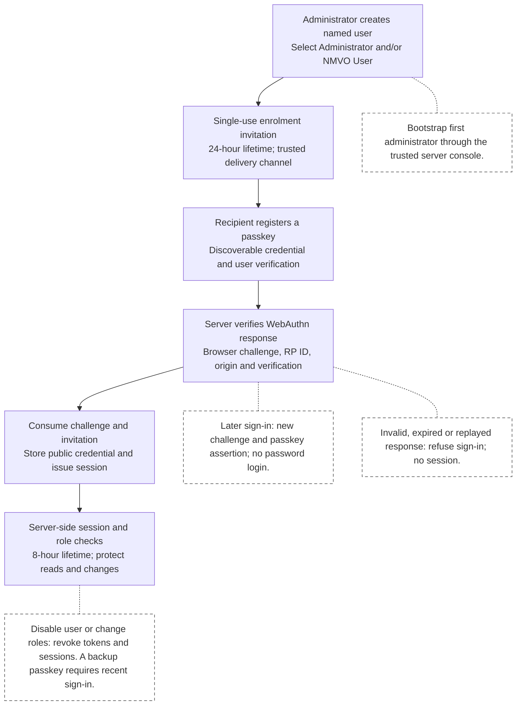
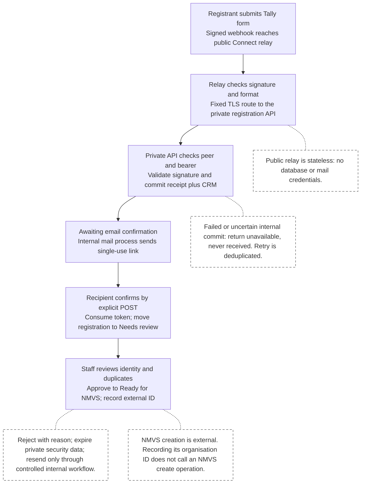
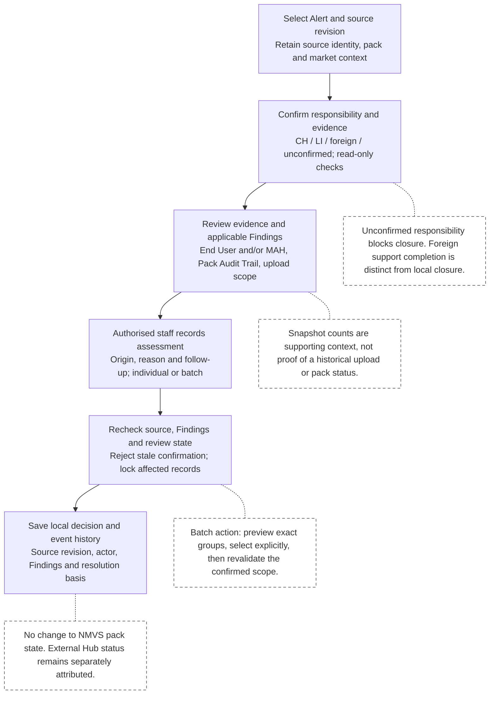
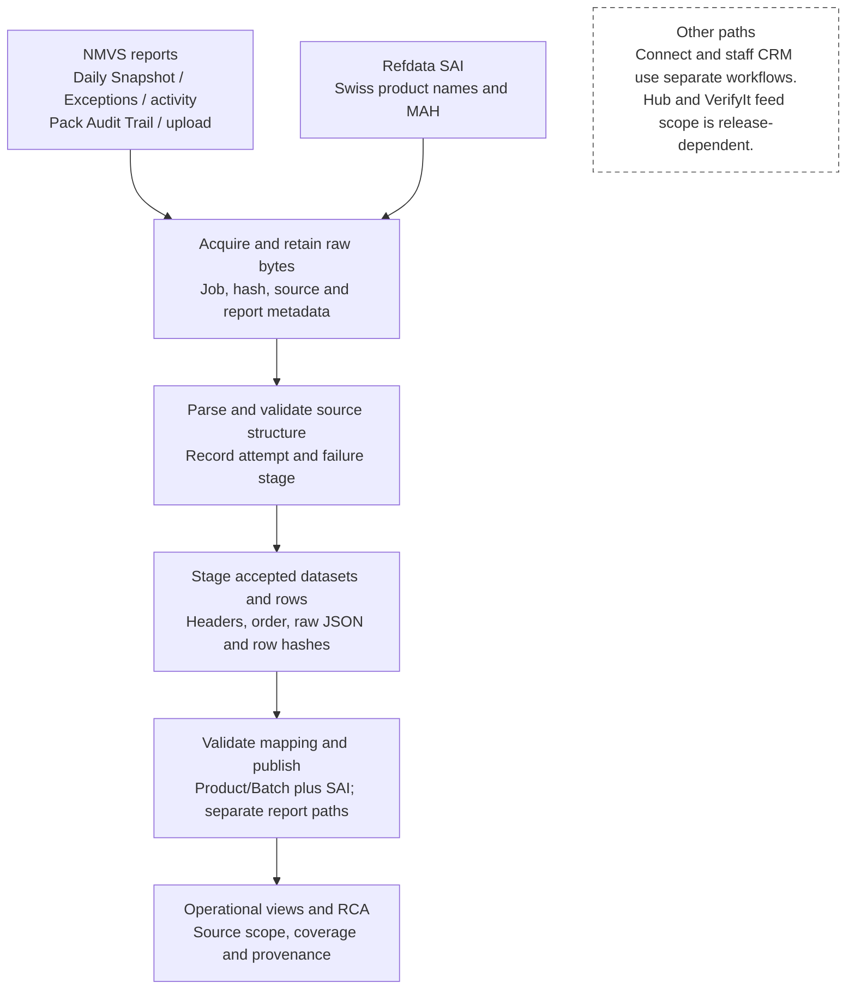
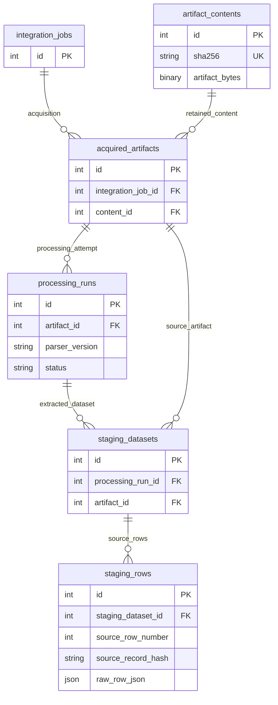
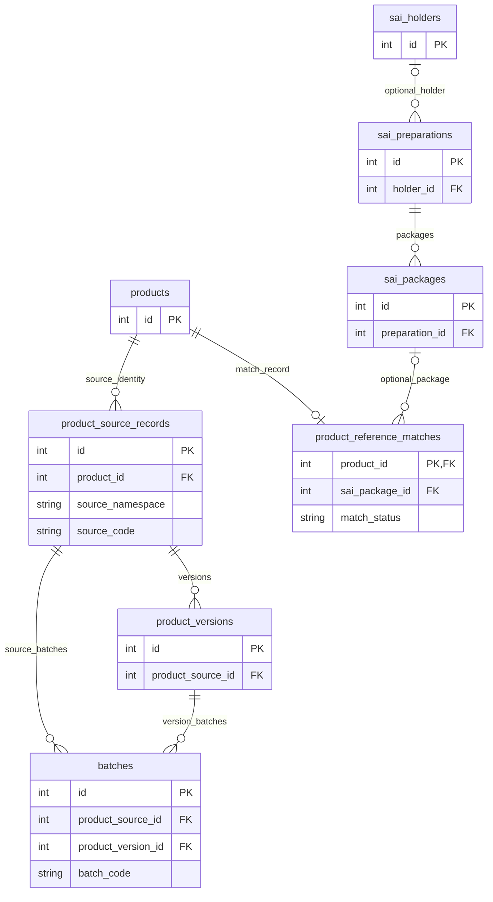

# SMVS Operations FRS diagram sources

Figures 1 to 4: solid arrows show processing or data flow; dashed links without arrowheads associate explanatory notes. A standalone scope/legend box is not a process node. Figures 5 and 6 show selected physical relationships: the PNG arrows run from parent to child, while Mermaid uses ER cardinalities. These are alternative layouts of the same selected relationships, not full schema exports.

Figure 6 context: mapping_runs references the selected Snapshot and SAI processing_runs; current_publications selects the accepted Product/Batch mapping. Participant and other report publications have separate transaction boundaries.

Copy each Mermaid block separately into your Mermaid editor. The source is editable; final layout depends on the renderer.

## Figure 1 passkeys

## Figure 2 connect

## Figure 3 rca

## Figure 4 information flow

## Figure 5 staging model

## Figure 6 product model

