# SDS-002: Operational Information Data Model - Analysis

| Attribute | Value |
| --- | --- |
| **Document ID** | SDS-002 |
| **Title** | Operational Information Data Model - Analysis |
| **Status** | Draft |
| **Version** | 0.2 |
| **Classification** | Internal |
| **Owner** | SMVS GmbH |
| **Author** | Reinhold Sojer |
| **Reviewers** | TBD |
| **Approver** | TBD |
| **Assessment date** | 2026-09-25 |

## Revision History

| Version | Date | Author | Description |
| --- | --- | --- | --- |
| 0.1 | 2026-09-25 | Reinhold Sojer | Initial read-only assessment of the existing SMVS database |
| 0.2 | 2026-09-25 | Reinhold Sojer | Consolidated Daily Snapshot Reporting API acquisition and source-fidelity analysis |

## 1. Purpose and Assessment Method

This document assesses the locally available existing SMVS MySQL database as input to the SMVS Operations data architecture. It is an analysis document only. No database object or row was created, altered, updated or deleted.

The assessment used read-only queries against `information_schema` and bounded aggregate queries against the application tables. Exact row counts were obtained with `COUNT(*)`. Samples were limited and used only to understand structure; production-derived personal or contact values are not reproduced here. Relationships are labelled as either database-enforced or inferred from field values and naming.

### Architectural source distinction

SMVS does **not** have direct access to the underlying NMVS database. The existing SMVS database is therefore not a representation of the NMVS database and must not be described as raw NMVS data. Most NMVS information available to SMVS originates from predefined, parameterisable NMVS reports. The existing tables primarily represent persisted source-provided operational datasets delivered through report, API and reference-data channels.

This distinction matters throughout this document:

- **Source-provided dataset** means information supplied by an external report, API response or reference-data delivery.
- **Source-faithful staging** means preserving that supplied information and its delivery provenance; it does not imply access to the source system's underlying database or raw internal records.
- **Working model** means a future common operational representation derived across reports, APIs and reference sources. It is not a reproduction of the report structure.

## 2. Existing Database Inventory

### 2.1 Database and object inventory

The configured database is `smvs`. It contains one schema, 28 base tables and no database views. The observed server major version was 9. All observed tables use InnoDB and the database default collation was `utf8mb4_0900_ai_ci`.

| Table | Type | Exact rows | Initial classification |
| --- | --- | ---: | --- |
| `CRM_End_Users` | Base table | 54 | CRM master data |
| `CRM_End_Users_Alerts` | Base table | 49 | CRM alert association |
| `CRM_End_Users_SPOC` | Base table | 40 | CRM contact association |
| `CRM_MAH` | Base table | 106 | CRM MAH master data |
| `CRM_MAH_Alerts` | Base table | 303 | CRM alert association |
| `CRM_MAH_SPOC` | Base table | 100 | CRM contact association |
| `MV_SAI` | Base table | 28,719 | Denormalised Refdata SAI-derived product reference |
| `NMVS_API Versions` | Base table | 18 | Legacy local table for a Daily Snapshot API Usage / Security Monitoring dataset |
| `NMVS_Authentication API Versions` | Base table | 21 | Legacy local table for a Daily Snapshot API Usage / Security Monitoring dataset |
| `NMVS_Batches` | Base table | 49,464 | Inferred NMVS Daily Snapshot Batches dataset |
| `NMVS_Exceptions` | Base table | 19,056 | NMVS Exceptions API dataset |
| `NMVS_Identity API Versions` | Base table | 0 | Empty Daily Snapshot API Usage / Security Monitoring dataset |
| `NMVS_Locations` | Base table | 45 | Inferred NMVS Daily Snapshot Locations dataset |
| `NMVS_NMVO Exception API Versions` | Base table | 2 | Daily Snapshot API Usage / Security Monitoring dataset |
| `NMVS_Organisations` | Base table | 58 | Inferred NMVS Daily Snapshot Organisations dataset |
| `NMVS_OrganisationsSummary` | Base table | 55 | Inferred separate NMVS report-derived organisation summary |
| `NMVS_Products` | Base table | 5,689 | Inferred NMVS Daily Snapshot Products dataset |
| `NMVS_Products History` | Base table | 2,456,156 | Persisted product-history dataset derived from repeated NMVS product snapshots |
| `NMVS_Reporting API Versions` | Base table | 0 | Empty Daily Snapshot API Usage / Security Monitoring dataset |
| `NMVS_SystemAccessAuditTrail` | Base table | 200,500 | Inferred separate NMVS report-derived audit dataset |
| `NMVS_UserActivity` | Base table | 21,610 | Inferred separate NMVS report-derived aggregate dataset |
| `NMVS_Verification API Versions` | Base table | 16 | Daily Snapshot API Usage / Security Monitoring dataset |
| `SAI_ADRESSEN` | Base table | 1,363 | SAI organisation/address reference |
| `SAI_ATC_CODES` | Base table | 3,807 | SAI ATC reference |
| `SAI_PACKUNGEN` | Base table | 63,130 | SAI package/product reference |
| `SAI_PRAEPARATE` | Base table | 26,012 | SAI medicinal product reference |
| `SWISSMEDIC` | Base table | 17,888 | Swissmedic Excel-derived product dataset |
| `SWISSMEDIC_MAH` | Base table | 1,394 | Swissmedic Excel-derived MAH/site dataset |

The names `MV_SAI` and `NMVS_OrganisationsSummary` suggest derived or materialised structures, but both are physically base tables in this database. They must therefore be treated as persisted source-derived datasets unless their refresh process is documented elsewhere. Table names alone do not prove report origin or delivery channel.

## 3. Source and Channel Provenance Assessment

The following classification separates physical storage from the external source and acquisition channel. Where the database cannot prove the origin, the classification is explicitly marked **inferred** and requires confirmation from import jobs, report definitions or source owners.

| Source/channel | Current tables appearing to belong to it | Assessment |
| --- | --- | --- |
| **NMVS - Reporting API - Daily Snapshot** | `NMVS_Products`, `NMVS_Batches`, `NMVS_Organisations`, `NMVS_Locations`, `NMVS_API Versions`, `NMVS_Verification API Versions`, `NMVS_Reporting API Versions`, `NMVS_Identity API Versions`, `NMVS_Authentication API Versions`, `NMVS_NMVO Exception API Versions` | **Confirmed by the supplied Reporting API collection, Daily Snapshot retrieval implementation, multi-table parser and analysed 2026-09-25 artifact.** These are source datasets contained in one Daily Snapshot report, even though the legacy importer persists them as separate local tables. |
| **NMVS - Reporting API - Other Reports** | `NMVS_OrganisationsSummary`, `NMVS_UserActivity`, `NMVS_SystemAccessAuditTrail` are not assigned to this Daily Snapshot without separate file/source evidence | **Separate acquisition pattern, not a confirmed classification for these existing tables in this document.** The Reporting API supports other reports, but table membership must be established from their source artifacts or retrieval lineage rather than inferred from names alone. |
| **NMVS - Exceptions API** | `NMVS_Exceptions` | **Supported by the supplied NMVO Exception API v1 specification and schema semantics.** This is a separate API acquisition channel, not an NMVS report. It includes alert IDs, request/pagination fields, transaction IDs and a JSON payload. |
| **Refdata SAI** | `SAI_ADRESSEN`, `SAI_ATC_CODES`, `SAI_PACKUNGEN`, `SAI_PRAEPARATE`, `MV_SAI` | **Supported by table naming and field vocabulary.** These are pharmaceutical reference datasets obtained from Refdata SAI. `MV_SAI` is a persisted denormalised table, not a database view. |
| **Swissmedic** | `SWISSMEDIC`, `SWISSMEDIC_MAH` | **Supported by source naming and supplied-source knowledge.** These originate from a Swissmedic Excel dataset. They substantially overlap with SAI and should not both be assumed to belong in the future working model. |
| **Airtable CRM** | `CRM_End_Users`, `CRM_End_Users_Alerts`, `CRM_End_Users_SPOC`, `CRM_MAH`, `CRM_MAH_Alerts`, `CRM_MAH_SPOC` | **Supported by source context.** These are Airtable CRM datasets. Their inclusion in the future Operational Information Model is a source-to-target decision; existing CRM storage does not imply that every field or relationship is required operationally. |

The database contains no import-job metadata that proves the legacy table-to-artifact lineage. The confirmed Daily Snapshot source model comes from the supplied implementation and analyzed artifact, not from the local table names. The future integration layer must record source, channel, report, import job, delivery artifact, dataset name and parser/mapping version explicitly.

### 3.1 Source and channel terminology

This document uses the following terms consistently:

| Term | Meaning | Example |
| --- | --- | --- |
| **Source** | Authoritative originating system | NMVS |
| **Channel** | Technical acquisition interface | Reporting API, Exceptions API |
| **Report** | Report artifact obtained through a channel | Daily Snapshot, Pack Audit Trail |
| **Dataset** | Logical data section contained in a report | Products, Batches |
| **Local table** | Persistence structure used by the legacy implementation | `NMVS_Products` |
| **Operational entity/domain** | Source-independent representation used by SMVS Operations | Product entity, Alert Investigation, API Usage / Security Monitoring domain |

Report, Dataset and Local table are not interchangeable. In particular, `Products` is the source dataset name, while `NMVS_Products` is a legacy local table name introduced by the importer.

### 3.2 Daily Snapshot acquisition and artifact structure

The confirmed Daily Snapshot source model is:

| Property | Confirmed value |
| --- | --- |
| Source | NMVS |
| Channel | Reporting API |
| Report | Daily Snapshot |
| Acquisition pattern | Retrieval of an already generated / available report |

The existing SMVS implementation retrieves a Daily Snapshot for a requested snapshot day by calculating the date range for that day, then calling `GET /report-requests` with `fromDate`, `toDate` and `reportType=DailySnapshot`. It expects `operationCode=15100000` and a `reports` collection, expects exactly one matching report in the current implementation, reads the report `uri`, and retrieves the report content from that URI. The legacy implementation supports historical retrieval through `days_in_past`, where `0` means the current day, `1` means the preceding day, and so on.

This evidence does not establish that Daily Snapshot is returned by `GET /report-types`; SDS-002 therefore makes no such claim.

The analysed 2026-09-25 Daily Snapshot is a multi-section CSV document. It begins with report metadata:

- `Report Type`;
- `Report Name`;
- `Date Requested (UTC)`.

The initial metadata section is followed by source-named datasets. The legacy parser splits the document using blank-line separators (`\\r\\n\\r\\n`), skips the first section, reads the first line of each following section as the source dataset name, reads the next CSV row as that dataset's column headers, and reads remaining rows as records. When creating local MySQL tables, it prefixes the source dataset name with `NMVS_`.

For example:

```text
Source dataset: Products
Legacy local table: NMVS_Products
```

The `NMVS_` prefix is introduced by the legacy importer and is not part of the source dataset name. The target architecture must retain the complete acquired report artifact, including the initial metadata section. `Date Requested (UTC)` is source provenance and must not be interpreted as the authoritative effective timestamp of the underlying data unless that meaning is separately established.

The parser discovers dataset names from the report itself. The currently observed dataset list is therefore evidence from the analysed artifact, not a rigid parser contract. A dataset present with zero records must remain distinguishable from a dataset absent from the report.

### 3.3 Daily Snapshot dataset classification

The analysed Daily Snapshot contains the following source datasets. This grouping describes intended use within SMVS Operations; it does not claim that NMVS formally uses these functional groupings.

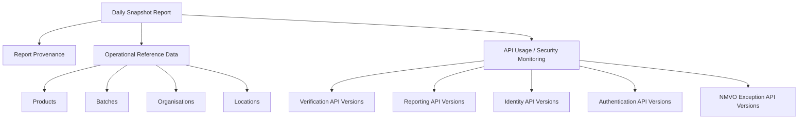

The Operational Reference Data datasets provide Product, Batch, Organisation and Location state/context. The five API-specific datasets are not separate reports and are not part of the initial Alert Investigation Model. They form a separate Operational Monitoring / Security information domain.

### 3.4 Reporting API acquisition patterns

The Reporting API supports multiple report acquisition patterns within one channel:

```text
NMVS Reporting API
    |
    +-- Pre-generated report retrieval
    |      +-- Daily Snapshot
    |
    +-- On-demand report generation/retrieval
           +-- Pack Audit Trail
           +-- Other supported reports
```

The supplied Reporting API Postman collection demonstrates report discovery, report metadata, report request, asynchronous readiness handling, retrieval and deletion for on-demand reports. A not-yet-ready result may return HTTP `409` with operation code `55420000` and ETA/expiry information.

This on-demand asynchronous report-generation lifecycle must not be applied automatically to Daily Snapshot. The current Daily Snapshot integration retrieves an already available report through `GET /report-requests`. Both patterns belong to the NMVS Reporting API channel; they are not separate information sources.

### 3.5 Source delivery patterns

The intended provenance patterns are:

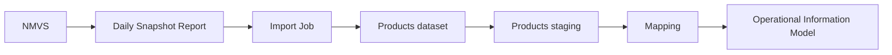

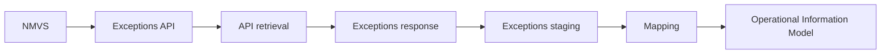

The same pattern applies to separate NMVS reports, Refdata SAI deliveries, the Swissmedic Excel delivery and Airtable CRM extracts, with their own source-channel and delivery metadata.

### 3.6 NMVO Exception API technical reference

The NMVS Exceptions API is not publicly documented. The supplied **NMVO Exception API v1 Swagger specification** is therefore the authoritative technical reference currently available to this project.

| API property | Confirmed basis |
| --- | --- |
| API name | NMVO Exception API |
| Specification version | 1.0 |
| Purpose | Retrieve and query alerts |
| Authentication | Bearer token |
| API version negotiation | `emvs-api-version` request header |

The specification defines the following acquisition patterns:

| Operation | Purpose | Acquisition semantics |
| --- | --- | --- |
| `GET /alerts/details/{uprc}` | Retrieve one alert using its unique alert identifier | Synchronous detail retrieval by alert identifier (`uprc`). |
| `GET /alerts/recent/{alertRecencyValue}` | Retrieve recent alerts from an inclusive recency value | Synchronous or bounded recent-alert retrieval according to the API response contract. |
| `POST /alerts` | Submit a filtered alert query | A successful request returns HTTP `202`. The `Location` response header contains the URL/request ID used to retrieve the result. |
| `GET /alerts/data/{requestId}` | Retrieve results of an existing query | Results support pagination. |
| `POST /alerts/fulldataset/{requestId}` | Escalate an existing truncated query | Requests the full dataset for an existing query. |

The asynchronous query lifecycle supports the previously proposed Information Integration Framework model:

```text
PENDING -> RUNNING -> WAITING -> RUNNING -> SUCCEEDED / FAILED
```

This lifecycle is a documented integration design basis only. It is not implemented yet.

The `AlertQueryFilter` supports filtering by time range, Product Code, Batch ID, Serial Number, Transaction ID, Organisation ID, market, Location ID, Client ID, country, EMVS error codes and operation codes. These filterable fields should remain source/API attributes in staging before any mapping into common Alert, Product, Batch, Organisation or Location concepts.

The API specification also establishes distinct location semantics that must be preserved in the Operational Information Model:

- `sourceLocationID` is the requesting location;
- `packLastUpdateLocationID` identifies the location that last updated the pack;
- `packLastUpdateTimestamp` is the timestamp of that last pack update;
- `packLastUpdateMarket` is the market that last updated the pack.

These fields must not be collapsed into one generic Alert Location. In particular, `sourceLocationID` is not interchangeable with `packLastUpdateLocationID`, and `packLastUpdateTimestamp` is not the Alert occurrence time. A missing source location must remain missing; a Location from another event must not be copied into the Alert record.

### 3.7 Column and type inventory

The following is the compact field inventory for the main operational and reference structures. The complete catalog assessment also recorded nullability, defaults, generated-column metadata and comments for every column.

| Table | Columns and types |
| --- | --- |
| `NMVS_Products` | `Product Code Scheme` varchar(10), `Product Code` varchar(15), `Product State` varchar(255), product names varchar(600), `Product Version Number` int, pack/form/strength attributes, national and Article 57 codes, `Creation Date` datetime, MAH/OBP attributes, withdrawal attributes, batch/pack counts |
| `NMVS_Products History` | `Import Date` datetime, `Product Code` varchar(15), `Product State` varchar(255), `Authorised by Swissmedic` int, `MAH Swissmedic` varchar(100), `ATC` varchar(7), batch/pack counts |
| `NMVS_Batches` | `Product Code Scheme` varchar(10), `Product Code` varchar(15), `Batch Id` varchar(50), expiry text varchar(6), `Batch State` varchar(50), multimarket text, product version, `Creation Date` datetime, manufacturer/recall/markets attributes, serial-number format attributes, pack counts |
| `NMVS_Exceptions` | numeric `id`, alert/transaction identifiers, error and operation codes, organisation/client/API context, product/serial/batch/expiry identifiers, source and last-update location/market/timestamp, business process, pagination fields and JSON `payload` |
| `NMVS_Organisations` | organisation ID/type/subtype/name/status, contact attributes, creation/registration/expiry dates, rate-limiting plan |
| `NMVS_OrganisationsSummary` | organisation ID/type/subtype/name/status, contact and registration attributes, active-location count, product-dataset flag, known-fact question/answer fields |
| `NMVS_Locations` | organisation ID/type/subtype/name, location ID/name, legitimacy and address attributes, equipment count, status, creation date |
| `MV_SAI` | `GTIN`, `GTIN14`, approval number, package/product names, `ATC`, approval state/category, MAH and GLN |
| `NMVS_UserActivity` | activity date, organisation type/ID/name, business process, exceptions count, count, `created_at`, `updated_at` |
| `NMVS_SystemAccessAuditTrail` | UTC timestamp, event/process/transaction identifiers, description, client/user, organisation/location, network and role context, category/severity, user-agent, country/city and coordinates |
| `SAI_PACKUNGEN` | authorisation/sequence/package codes, status and free text, package size/unit, dates stored as text, GTIN industry/GTIN14, descriptions |
| `SAI_PRAEPARATE` | usage, authorisation number, preparation name/form, ATC, holder, status/category, approval dates and flags |
| `SAI_ADRESSEN` | partner number, company name, address, country/postcode/city/language/canton, reference GLN |
| `SAI_ATC_CODES` | ATC code and indication description |
| `SWISSMEDIC` | Swissmedic codes, product/MAH/category/ATC, registration dates, pack and dispensing attributes, composition/indication text |
| `SWISSMEDIC_MAH` | authorisation/holder/site identifiers, address and validity fields, inspection/compliance fields and activity flags |

The API-version tables repeat a similar access snapshot shape: organisation, location, client, user-agent/IP, API version/requested version and last request. Some variants store these as `text` rather than typed fields. The identity and reporting variants are empty in the assessed database.

### 3.8 Keys, indexes and constraints

Declared primary keys are limited to:

- `NMVS_Exceptions.id`.
- Composite primary key `NMVS_UserActivity (Activity Date, Organisation ID, Business Process)`.

Declared unique constraints/indexes include `NMVS_Exceptions.uniqueAlertID`, `NMVS_Exceptions (request_id, page, record_index)`, `NMVS_Products History (Import Date, Product Code)` under two differently named unique indexes, and `NMVS_SystemAccessAuditTrail.Transaction ID`. The remaining indexes are non-unique lookup indexes, notably on product codes, batch IDs, alert timestamps, serial numbers, source locations, organisation names, GTINs, approval numbers, ATC codes and Swissmedic/SAI identifiers.

There are **zero declared foreign keys** and no referential actions. Consequently:

- no relationship between product, batch, organisation, location or exception tables is enforced by the database;
- uniqueness and not-null behaviour should not be assumed beyond the declared keys;
- source-to-target mapping must explicitly define matching, survivorship and reject behaviour.

## 4. Existing Data Model Assessment

### 4.1 Apparent business entities

The strongest business entities supported by the data are:

- **Product**: principally identified by `Product Code` in the NMVS tables, with GTIN, GTIN14, approval and national identifiers present in SAI/Swissmedic structures.
- **Batch**: identified operationally by `Product Code` plus `Batch Id`; batch state, expiry, recall and pack counts are available.
- **Organisation**: identified by `Organisation Id` in NMVS master/snapshot tables; organisation type, subtype and status are available.
- **Location**: identified by `Location Id` and associated with `Organisation Id` in `NMVS_Locations`.
- **Alert**: the future common concept supported initially by `NMVS_Exceptions`, identified by source `uniqueAlertID` and also by the local `id`; transaction, error, operation, product, serial and location context is available.
- **Operational access event**: `NMVS_SystemAccessAuditTrail` has one unique transaction identifier per row and a timestamped event context.
- **Daily user activity aggregate**: `NMVS_UserActivity` has an explicit daily/process/organisation grain.
- **End User**: a current modelling concept involving an NMVS Organisation and its NMVS Locations. It must not be collapsed into a single physical entity until the Organisation/Location semantics and source identifiers are confirmed.
- **Reference product and regulatory data**: SAI and Swissmedic structures provide package, preparation, ATC, MAH, address and regulatory attributes.

### 4.2 Transactional, state and aggregate structures

`NMVS_Exceptions` is the clearest potential alert/event-level fact. It contains timestamps, transaction identifiers, operation/error codes, pack-level identifiers, source location/market and a JSON payload. It is not a complete transaction log: most organisation/client/operation context is null in the observed data, and it should be modelled as an Alert/Event sourced from the Exceptions API rather than as every NMVS transaction.

`NMVS_SystemAccessAuditTrail` appears to have one row per supplied audit-trail record, with a unique `Transaction ID`, but its exact report grain and whether a transaction represents an access event, process event or report record must be confirmed. It is not automatically equivalent to an operational transaction fact.

`NMVS_UserActivity` is an already aggregated daily activity dataset at `(Activity Date, Organisation ID, Business Process)`, not a row-per-event table; its Daily Snapshot provenance is not established by the current evidence and should not be assumed. It must not be treated as equivalent to an individual operational event. The five API Usage / Security Monitoring datasets are Daily Snapshot observations of client/API access context, not merely version inventories and not Alert Investigation events.

The Daily Snapshot reference datasets primarily provide state and context. A snapshot row must not automatically be interpreted as a product-created event, batch event, organisation event or location event. The API Usage / Security Monitoring datasets provide client, organisation, location and recent API activity context for monitoring and security review, not Alert Investigation events.

### 4.2.1 API Usage / Security Monitoring domain

The five API-specific Daily Snapshot datasets are primarily intended for operational and security monitoring of API clients. They can support detection and review of clients that continue to access or authenticate against NMVS interfaces although such access may no longer be authorised. API-version information provides additional technical context, but these datasets are not merely an API version inventory.

Depending on the dataset, the supplied information may provide context about clients, organisations, locations and recent API activity. It may later support client access monitoring, authorisation review, security monitoring rules, notifications and dedicated operational/security investigations. This document does not define those rules or alert thresholds.

Historically, API information was less differentiated. It was subsequently extended into API-specific datasets to provide greater transparency of API usage, including reporting and authentication activity.

These datasets are explicitly outside the Initial Alert Investigation Model. They must not be added to that model merely because they arrive in the same Daily Snapshot report.

### 4.3 Reference and master data

`NMVS_Products`, `NMVS_Batches`, `NMVS_Organisations` and `NMVS_Locations` are legacy local tables populated from the confirmed NMVS Reporting API Daily Snapshot datasets, with operationally useful state/context attributes. The five API Usage / Security Monitoring datasets are also contained in the same Daily Snapshot artifact, but belong to a separate monitoring domain. SAI and Swissmedic tables are reference/master datasets with different vocabularies and identifiers. `CRM_*` tables support relationship and contact management for end users and MAHs, but inclusion in the future Operational Information Model is optional and requires a source-to-target decision. CRM entities must not be conflated with the NMVS Organisation concept without a documented identity crosswalk.

### 4.4 Historical and denormalised structures

`NMVS_Products History` is explicitly temporal: 2,456,156 rows, 5,689 distinct product codes and imports from 2025-03-06 through 2026-09-25. It appears to persist repeated daily product state from the Daily Snapshot product dataset. Its natural candidate grain is `(Import Date, Product Code)`, subject to validation of the duplicate unique indexes and import semantics.

This is a special case and no final replacement is proposed here. Before redesigning it, profiling must determine:

- the number of products per snapshot;
- the number and percentage of products changing between consecutive snapshots;
- which attributes actually change;
- the frequency of changes; and
- whether disappearance and later reappearance must be represented.

Possible future approaches include retaining periodic snapshots, deriving change-based history, or using SCD Type 2 for selected product attributes. The choice must follow the profiling analysis and the required investigation use cases.

`MV_SAI` is a denormalised product reference combining GTIN, approval, package/product names, ATC, MAH and GLN. `NMVS_OrganisationsSummary` duplicates several organisation attributes from `NMVS_Organisations` and adds summary/contact/security-question fields. SAI and Swissmedic tables also repeat product, MAH, approval and location concepts with source-specific identifiers.

The proposed working model should derive common operational concepts across different reports, APIs and reference sources. It should retain source-specific staging representations and map only the attributes required for durable operational analysis. It should not replicate every existing table or report dataset as a working-model table.

## 5. Key Entities and Relationships

### 5.1 Relationship semantics

No cross-table relationship is database-enforced. This is expected for independently supplied report datasets and is not, by itself, a defect in the source data. Four relationship categories must remain distinct:

- **Source-provided identifiers**: identifiers supplied within a dataset, such as `Product Code`, `Batch Id`, `Organisation Id`, `Location Id`, `uniqueAlertID` and `Transaction ID`.
- **Database-enforced relationships**: primary keys and unique constraints present in the existing SMVS database. There are no declared foreign keys.
- **Inferred relationships**: candidate joins based on shared identifiers and domain meaning, requiring validation.
- **Future canonical relationships**: conformed keys and identity mappings established by the SMVS Operations integration layer, with source key, match method, confidence and validity recorded.

The following are reasonable **inferred relationships**, based on repeated identifiers and domain meaning, but must be tested with overlap, uniqueness and reconciliation checks:

| Inferred relationship | Evidence | Required validation |
| --- | --- | --- |
| Product to Batch | `NMVS_Batches.Product Code` matches `NMVS_Products.Product Code`; product and batch code schemes are both predominantly `GTIN` | Verify product-code coverage, code formatting and orphan batches |
| Product to Product History | `Product Code` shared; history has repeated dated imports | Verify one row per product per import and snapshot completeness |
| Product to Exception | `NMVS_Exceptions.productCode` matches product code domain; observed 188 distinct product codes | Confirm code scheme, handling of unknown/retired products and code length differences |
| Batch to Exception | exception provided/stored batch values can match `NMVS_Batches.Batch Id` | Validate both provided and stored batch semantics; do not assume either is authoritative |
| Organisation to Location | `NMVS_Locations.Organisation Id` matches organisation IDs; 36 distinct organisation IDs occur in 45 locations | Check deleted/suspended locations and organisation snapshot timing |
| Organisation to Exception | `NMVS_Exceptions.organisationID` is populated in only 2,327 of 19,056 rows | Treat as optional correlation, not a mandatory dimension key |
| Organisation/location to audit | audit has organisation and location IDs | Validate temporal identity and source-system meaning |
| SAI/Swissmedic to Product | GTIN, GTIN14, approval, ATC, MAH and GLN provide candidate crosswalks | Build source-specific crosswalk and record match confidence; do not assume both sources must be retained in the working model |
| CRM to Organisation/MAH or End User | CRM `GLN`, MAH names, record/link IDs and names provide candidate links | Require business-owned identity mapping; names alone are insufficient and CRM inclusion remains optional |

### 5.2 Conceptual business axes

The initial working-model analysis should start from Alert, Product, Batch and End User. End User currently involves Organisation and Location and must not be collapsed into one physical table. This diagram is conceptual only and is not an approved physical schema.

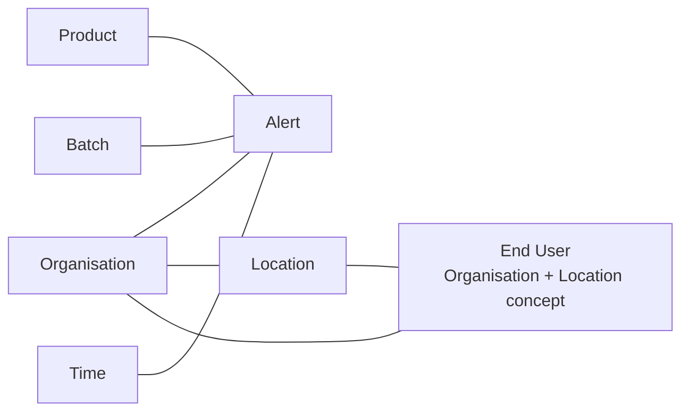

### 5.3 Existing database relationship diagram

The diagram shows inferred links with dashed lines. It does not claim database referential integrity.

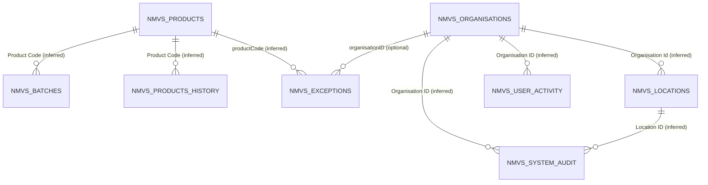

## 6. Data Quality / Modelling Observations

- **Nullability is weakly governed.** Most NMVS snapshot columns are nullable. In `NMVS_Organisations`, all 58 `Expiry Date` values were null and eight registration dates were null. In `NMVS_Products`, 5,687 of 5,689 withdrawal dates were null, which is plausible for active products but must be handled as state-dependent optionality rather than missing-data failure.
- **Blank and sentinel values exist.** Product `National Code` and `Article 57 Code` contain many blank/`NA` values. Batch markets include blank values. These must be normalised to explicit missing/unknown statuses without losing the raw value.
- **Dates are inconsistently typed.** `NMVS_Exceptions.alertDateTime` is varchar while `packLastUpdateTimestamp` is datetime. Batch expiry, exception expiry, and several SAI/Swissmedic dates are text. Staging must preserve raw text and expose parsed date plus parse-status fields.
- **Product snapshots are current-state plus repeated report state.** `NMVS_Products` contains 5,689 product rows, with 5,687 active and two withdrawn at assessment time. History contains approximately 490 observations per product on average, but the actual schedule, change rate and completeness must be profiled before any redesign.
- **Batch identity is not guaranteed by a key.** `NMVS_Batches` has 49,464 rows and 48,506 distinct batch IDs; the natural key likely includes product code and batch ID. Duplicate and reuse rules need testing.
- **Exception context is incomplete but valuable.** `NMVS_Exceptions` has 19,056 unique alert IDs and 18,364 distinct transaction IDs. Organisation/client/operation context is absent in 16,729 rows. Serial numbers are present for all but 33 rows, making the table a useful source for conditional Pack Context.
- **Categorical values are source-specific.** Exception error codes are dominated by A7, A2 and A3; product state is predominantly Active; batch state is predominantly Expired or Active. Code descriptions and controlled vocabularies should be maintained as source reference data rather than hard-coded in facts.
- **Audit data is geographically and operationally rich.** Audit records contain severity, country, organisation/location, process and coordinates, but roles are mostly null and 82,763 location IDs are null. Network/user fields require access control and minimisation in analytical outputs.
- **Aggregates must not be mistaken for events.** `NMVS_UserActivity` has a defined aggregate grain and should not be joined to event facts as if each row were a transaction.
- **Duplicate concepts are present across source deliveries.** Product, MAH, organisation, address, location, approval and ATC concepts occur across NMVS reports, SAI, Swissmedic and CRM. A conformed dimension requires source identifiers, match confidence and survivorship rules; overlap does not mean every source belongs in the working model.
- **Potential schema hygiene issue.** `NMVS_Products History` has two unique indexes with the same visible column pair `(Import Date, Product Code)` under different names. This should be investigated before relying on it as a contract.

## 7. Proposed Source-Faithful Staging Architecture

The staging area should preserve information as supplied by each source channel and delivery. It is the traceability boundary, not the analytical model. It must not be described as access to raw NMVS database data. For report-derived NMVS information, the preserved object is the report delivery or dataset supplied to SMVS.

### 6.1 Logical staging layers

1. **Acquisition metadata**: source, channel, report/API identifier, delivery or request identifier, retrieval time, report type or endpoint, response status, source contract version, checksum, importer version and import-job identifier.
2. **Supplied-object preservation**: the report file, API response, Excel workbook, SAI delivery or Airtable extract as supplied to SMVS, with content type, compression, checksum and retention metadata. Sensitive payload access must be restricted.
3. **Source-specific landing tables**: one structure per delivery contract or dataset, retaining supplied names and types where possible. Examples: `stg_nmvs_daily_snapshot_products`, `stg_nmvs_other_report_user_activity`, `stg_nmvs_exceptions_api`, `stg_sai_package`, `stg_swissmedic_excel_product`, `stg_airtable_crm`.
4. **Validation/quarantine**: row-level validation status, parse errors, rejected values, schema version and reprocessing status. Invalid rows remain traceable to raw object and source row/record position.
5. **Standardised staging**: typed, normalised source records with explicit source keys, parsed temporal fields, raw-value preservation and data-quality flags.

### 6.2 Required lineage fields

Every staged record should carry at least `source_system`, `source_channel`, `source_delivery_type`, `report_or_api_contract`, `dataset_name`, `import_job_id`, `source_object_id`, `source_record_locator`, `source_schema_version`, `ingested_at`, `source_observed_at` where available, `raw_record_hash`, `validation_status` and `mapping_status`. These are platform fields, not fields claimed to exist in the current database.

Staging should preserve supplied report/API deliveries and support reprocessing. Loading must be idempotent using source object/checksum and source natural-key rules. It must not overwrite supplied source records when a later delivery changes interpretation. Report datasets from one Daily Snapshot delivery should retain a common import-job and delivery identity even when stored in separate staging structures.

### 7.3 Daily Snapshot source-fidelity layers

Before business transformation, the target architecture should preserve at least two source-fidelity layers:

1. **Acquired Report Artifact**: the complete Daily Snapshot response as received from NMVS, retained with acquisition provenance, including the initial report metadata section and `Date Requested (UTC)`.
2. **Extracted Source Datasets**: the source-named datasets, source headers and records extracted from the artifact, including explicit presence/zero-record status.

Conceptually:

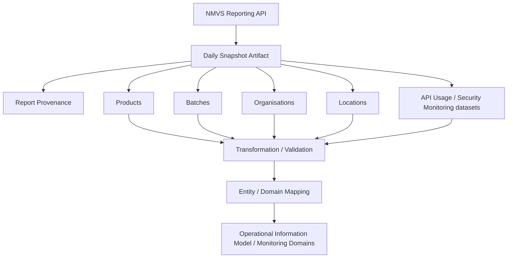

The retained artifact must make it possible to reprocess a previously acquired snapshot with a later parser or mapping version without retrieving the report again.

### 7.4 Current implementation versus target architecture

The following describes the legacy/current implementation and must not be interpreted as the target logical data model:

```text
NMVS Reporting API
    -> retrieve Daily Snapshot
    -> decode report bytes
    -> parse multi-table CSV
    -> create locally prefixed NMVS_* datasets
    -> save directly to MySQL
    -> create selected indexes
```

The current implementation creates indexes including:

- `NMVS_Products`: `Product Code`;
- `NMVS_Batches`: `Product Code` and `Batch Id`;
- `NMVS_Organisations`: `Organisation Name`;
- `NMVS_Locations`: `Organisation Name`.

The target SMVS Operations architecture is:

```text
NMVS Reporting API
    -> Acquisition
    -> Acquired Report Artifact
    -> source-faithful dataset extraction
    -> Transformation / Validation
    -> Entity / Domain Mapping
    -> Operational Information Model and/or Operational Monitoring domain
```

The existing `NMVS_*` MySQL tables are legacy persistence structures, not the target Operational Information Model. No change to the current implementation is proposed by this analysis.

### 7.5 External interface evolution and compatibility principles

The legacy implementation is tightly coupled to the current structure of external NMVS interfaces. The target integration architecture should minimize the impact of Reporting API and report-format changes on downstream processing and the Operational Information Model.

The implementation plan should establish these boundaries:

1. **Acquisition/client boundary**: owns authentication, endpoint calls, request parameters, response status handling, response headers, download/retrieval and acquisition metadata. It records the requested and used API version, such as `emvs-api-version`, where available. It does not expose external API response models directly as Operational Information Model entities.
2. **Artifact boundary**: preserves the original acquired report artifact or API response before parsing or transformation, together with source, channel, report, request/response metadata, checksum, retrieval time and version provenance.
3. **Source extraction boundary**: parses source-specific formats into source-named datasets and retains source headers, records, record locations and unexpected fields where reasonably possible. Source-specific structures remain within this boundary.
4. **Transformation/validation boundary**: normalizes types and identifiers, validates required fields and semantics, records parse and validation outcomes, and preserves raw values alongside derived values. A missing or incompatible required field must produce an explicit observable failure or quarantine outcome; it must not silently produce incomplete or corrupted operational information.
5. **Entity/domain mapping boundary**: maps validated source structures into source-independent entities and domains such as Product, Batch, Alert Investigation, Swiss MAH and API Usage / Security Monitoring. Mapping logic must not require downstream domains to understand external response models.

The target design should tolerate additive source changes where safe: an additional unknown field or dataset field should not automatically break an otherwise valid import. Required fields, required semantics, incompatible types and source-contract violations must still fail explicitly. Unexpected source information should be retained in the artifact or extracted source-dataset layer where reasonably possible so that it remains available for later analysis and reprocessing.

Version-specific adapters should be introduced only when an actual incompatible source change requires one. A generic multi-version adapter framework should not be designed in advance. API release changes are a general compatibility concern, not a current release-specific implementation target.

For the Daily Snapshot specifically, dataset discovery is source-driven. Downstream processing must not depend on a fixed list of dataset sections. The parser should discover dataset sections from the acquired report, preserve the source dataset name and presence/zero-record status, and route recognized datasets to their relevant domain mappings. Unknown or newly added datasets should remain available in the artifact/extracted dataset layer without automatically entering the Operational Information Model.

The component boundaries make a future interface change local where possible:

- an endpoint, authentication, header or request-contract change should primarily affect the acquisition/client boundary;
- a report framing or serialization change should primarily affect the source extraction boundary;
- a source field rename, type change or semantic change should affect the relevant transformation/validation adapter and its tests;
- a business interpretation change should affect entity/domain mapping rather than acquisition;
- additive fields can remain in source-faithful storage until a deliberate mapping decision is made.

The retained artifact and source datasets make it possible to reprocess a previously acquired response after parser, transformation or mapping logic is updated, without retrieving the external report again. This reprocessing capability is a design requirement, not a current implementation claim.

## 8. Proposed Working / Star Schema

The working model should be an extensible star-schema approach with conformed dimensions, role-playing dates and source lineage. Its purpose is to derive common operational concepts across reports, APIs and reference sources, not to reproduce report structure. Unknown or unresolved dimension members should be represented explicitly, not by dropping events.

The initial business axes are **Alert, Product, Batch and End User**. End User currently consists of the Organisation and Location concepts and should reuse separate conformed Organisation and Location dimensions. Other facts such as User Activity and System Access may exist independently and should reuse common dimensions wherever their source data supports it.

### 7.1 Proposed model overview

```mermaid
flowchart TB
    DProduct[Dim Product]
    DBatch[Dim Batch]
    DOrg[Dim Organisation]
    DLocation[Dim Location]
    DDate[Dim Date]
    DTime[Dim Time]
    DError[Dim Exception/Error]
    DOperation[Dim Operation/Business Process]
    DSource[Dim Source]
    DPack[Dim Pack Context]

    FProductSnapshot[Fact Product State]
    FBatchSnapshot[Fact Batch State]
    FAlert[Fact Alert/Event]
    FAudit[Fact System Access Event]
    FActivity[Fact Organisation Activity]

    DProduct --> FProductSnapshot
    DDate --> FProductSnapshot
    DSource --> FProductSnapshot
    DProduct --> FBatchSnapshot
    DBatch --> FBatchSnapshot
    DDate --> FBatchSnapshot
    DSource --> FBatchSnapshot
    DProduct --> FAlert
    DBatch --> FAlert
    DPack --> FAlert
    DOrg --> FAlert
    DLocation --> FAlert
    DError --> FAlert
    DOperation --> FAlert
    DDate --> FAlert
    DTime --> FAlert
    DSource --> FAlert
    DOrg --> FAudit
    DLocation --> FAudit
    DDate --> FAudit
    DTime --> FAudit
    DSource --> FAudit
    DOrg --> FActivity
    DDate --> FActivity
    DOperation --> FActivity
    DSource --> FActivity
```

### 8.2 Candidate facts

The following are initial candidates. They are proposals, not implementation commitments. Each row identifies the source delivery, business identifiers and whether it is an event, state snapshot or aggregate. Not every existing source table is forced into a fact table.

| Fact | Business purpose | Grain | Candidate measures | Dimension references | Source tables | Temporal characteristics |
| --- | --- | --- | --- | --- | --- | --- |
| `fact_product_state` | Analyse product availability and inventory summary as supplied by the Daily Snapshot | One product observation in one Daily Snapshot delivery/import | `Number Of Batches`, `Number Of Packs`, `Number Of Active Packs`, product version | Product, Observation Date, Source, Report Delivery | `NMVS_Products`; repeated product dataset in `NMVS_Products History` | State/context snapshot, not a product event. Product history redesign is deferred pending profiling. |
| `fact_batch_state` | Analyse batch state, expiry, recall and pack counts as supplied by the Daily Snapshot | One product/batch observation in one Daily Snapshot delivery/import | `Number Of Packs`, `Number Of Active Packs`, product version, derived parsing/quality flags | Product, Batch, Observation Date, Expiry Date role, Recall Date role, Source, Market where normalised | `NMVS_Batches` | State/context snapshot, not automatically a batch event. Creation, expiry and recall are separate business dates. |
| `fact_alert_event` | Investigate alerts/exceptions and their product, pack, batch, organisation and location context | One Exceptions API alert record identified primarily by source `uniqueAlertID`; local `id` is a source-row surrogate | `numberOfDispenseAttempts`, `numberOfDecommissionAttempts`, `alertRecencyValue`, intermarket/manual-entry and match-quality flags | Product, Batch where matched, Pack Context where identifiable, Organisation, Location, Error, Operation, Event Date/Time, Source Market, Source Channel | `NMVS_Exceptions` from NMVS Exceptions API | Potential event-level fact. Use parsed `alertDateTime` as event time where parseable; retain pack-last-update time separately. |
| `fact_system_access_event` | Analyse supplied audit/process records | One supplied `NMVS_SystemAccessAuditTrail` record, provisionally identified by unique `Transaction ID` | Event count = 1; no event duration unless supplied by the report | Organisation, Location, Date, Time, Source Report, Event/Process, Severity, Geography | `NMVS_SystemAccessAuditTrail` from an inferred separate NMVS report | Provisional event-level grain. Confirm whether each report row is an access event, process event or another audit record before physical modelling. |
| `fact_organisation_activity_day` | Report activity and exception volumes by organisation and business process | One supplied report aggregate for one organisation, calendar day and business process | `Count`, `Exceptions Count` | Organisation, Date, Operation/Business Process, Source Report | `NMVS_UserActivity` from an inferred separate NMVS report | Aggregated report fact. It must not be expanded or treated as an individual operational event. |
| `fact_api_access_observation` | Monitor API client access, authentication and authorization context | One organisation/location/client observation in one API Usage / Security Monitoring dataset within one Daily Snapshot delivery | Observation count = 1; last request timestamp as a timestamp attribute | Organisation, Location, Source, Daily Snapshot Delivery, API Service/Role where supplied, Client where approved | Five API Usage / Security Monitoring datasets contained in the NMVS Daily Snapshot | Separate Operational Monitoring / Security domain, not part of Initial Alert Investigation. Do not define monitoring rules or thresholds yet. |

An optional future `fact_pack_event` should be introduced only when NMVS Reports/Audit Trails or other sources provide a sufficiently complete event contract. Current Exceptions API records can populate Pack Context conditionally, but they do not establish a complete pack lifecycle.

## 9. Dimension Definitions

| Dimension | Business concept | Business/natural key | Candidate attributes from existing sources | Historical changes |
| --- | --- | --- | --- | --- |
| `dim_product` | Medicinal product identified across NMVS, SAI and regulatory sources | Primary candidate: product code/GTIN; retain source-system identifier and code scheme | Product code scheme/code, names, state, pack type/size, form, strength, national code, Article 57 code, ATC, approval number/state/category, MAH/OBP identifiers and names, GLN | Yes. Product state, names, MAH, pack attributes and regulatory attributes can change. Use SCD2 or source-snapshot validity where analysis requires historical truth. |
| `dim_batch` | Production batch associated with a product | Product code + Batch ID, with source-system key | Batch ID, product code, expiry, state, multimarket, manufacturer, markets, serial-number format/length, recall status/reason | Yes. Batch state, recall and market attributes change. Preserve source observations in fact and optionally SCD2 batch identity. |
| `dim_organisation` | NMVS participant or other organisation | NMVS Organisation ID where present; retain GLN, partner number, CRM and source keys | Type/subtype, name, status, creation/registration/expiry dates, rate plan, GLN, SAI company/address attributes, CRM attributes where linked | Yes. Status, classification, names, contacts and relationships change. Keep source-specific identities and match confidence. |
| `dim_location` | Physical/logical operational location | Location ID; retain organisation ID and SAI/SWISSMEDIC site numbers | Location name, organisation, address/city/postal code, legitimacy, equipment count, status, Swissmedic site/compliance attributes where linked | Yes. Status, address, organisation assignment and compliance change. |
| `end_user` concept | Operational end-user context represented by an NMVS Organisation and one or more NMVS Locations | Organisation ID + Location ID where available; retain both source keys | Organisation type/subtype/status and location name/address/status; source-specific end-user classification where available | Yes. Preserve changing organisation/location assignments. This is currently a business concept, not a decision to create one physical dimension table. |
| `dim_pack_context` | Conditional context for an individual pack | Product code + serial number, optionally batch and expiry; source-specific key retained | Serial number, product, batch provided/stored, expiry provided/stored, last update market/location/state where available | Treat as event-context history initially. Do not create a complete persistent pack master from exceptions alone. |
| `dim_exception_error` | Controlled interpretation of exception/error codes | Source + error code, optionally operation code | Error code, operation code, source business process, message classification, severity/category when authoritative | Yes, if source descriptions or classifications change; retain source version. |
| `dim_operation` | NMVS business process or operation | Source + operation/business-process code or controlled label | Operation code, attempted operation, business process, API channel, source system | Preserve source version and effective dates if mappings change. |
| `dim_date` | Calendar analysis | Calendar date | Day, week, month, quarter, year, reporting periods | Static/calendar-managed. |
| `dim_time` | Intraday event analysis | Time of day or UTC timestamp key | Hour, minute, time bucket, UTC/local representation policy | Static, subject to agreed timezone policy. |
| `dim_source` | Provenance and source channel | Source system + channel + source schema/version | NMVS Snapshot, Reports, Exceptions API, SAI, Swissmedic, VerifyIt; import channel/version | Yes. Retain source-contract versions. |

Contact names, emails, known-fact answers, IP addresses, user-agent values and precise coordinates should not be copied into broad conformed dimensions by default. They should remain in restricted staging or a controlled security/audit model unless a defined operational use requires them.

## 10. Source-to-Target Overview

| Existing physical table/dataset | Source/channel interpretation | Staging treatment | Candidate working-model target | Notes |
| --- | --- | --- | --- |
| `NMVS_Products` | NMVS Daily Snapshot Report - Products dataset | Preserve supplied dataset, delivery and import-job identity | `dim_product`, `fact_product_state` | Current-state report dataset; do not discard supplied values. |
| `NMVS_Products History` | Repeated Daily Snapshot product-state dataset | Preserve every supplied snapshot and import metadata | Possible `fact_product_state` history or future SCD/change model | No replacement decision until the required change-profile analysis is complete. |
| `NMVS_Batches` | NMVS Daily Snapshot Report - Batches dataset | Preserve raw expiry/market/recall values plus parsed fields | `dim_product`, `dim_batch`, `fact_batch_state` | Product/batch relationship is inferred. |
| `NMVS_Organisations`, `NMVS_Locations` | NMVS Daily Snapshot Report - Organisations and Locations datasets | Preserve each supplied dataset under the common Daily Snapshot delivery identity | `dim_organisation`, `dim_location`, End User concept | Organisation and Location remain separate concepts. |
| `NMVS_API Versions` | NMVS Daily Snapshot Report - API Usage / Security Monitoring dataset | Preserve supplied dataset and delivery metadata | Separate API monitoring domain; optional API observation fact/source dimension | Dataset name is discovered from the report; local table name is legacy. |
| `NMVS_OrganisationsSummary` | Separate NMVS report-derived dataset, inferred | Preserve report delivery and dataset identity separately from Daily Snapshot | Possible organisation state/context enrichment | Summary is not automatically authoritative over `NMVS_Organisations`. |
| `NMVS_Exceptions` | NMVS Exceptions API | Preserve API response/payload, request/pagination and source record locator | `fact_alert_event`, optional `dim_pack_context`, error/operation dimensions | Separate acquisition channel; not an NMVS report. |
| `NMVS_SystemAccessAuditTrail` | Separate NMVS report-derived audit dataset, inferred | Restricted supplied-report staging | Candidate `fact_system_access_event` | Confirm actual report grain before physical modelling. |
| `NMVS_UserActivity` | Separate NMVS report-derived aggregate dataset, inferred | Preserve supplied aggregate grain | `fact_organisation_activity_day` | No event reconstruction. |
| Other API-version tables | Verification, Reporting, Identity, Authentication and NMVO Exception API Versions datasets in the same Daily Snapshot Report | Preserve source dataset name, headers, records, presence/zero-record status and common delivery identity | Separate API monitoring domain; optional API observation fact | A present dataset with zero records is distinct from an absent dataset. |
| `SAI_*` | Refdata SAI | Preserve acquired artifact, source dataset names, headers, records and importer-derived normalization metadata | Explicit Product, Authorisation and Swiss MAH mapping | Primary target reference path for Swiss MAH resolution. |
| `MV_SAI` | Legacy derived representation | Preserve only as historical implementation evidence where needed; do not treat as a source dataset | No target entity | Base table, not a database view; must not define the target SAI model. |
| `SWISSMEDIC*` | Swissmedic Excel dataset | Preserve workbook, sheet/row locator and supplied values | Candidate regulatory crosswalks or restricted reference dimensions | Overlaps SAI; do not assume both sources belong in the working model. |
| `CRM_*` | Airtable CRM | Preserve extract, record identity and linked-record provenance | Future source-to-target decision; possible restricted relationship model | Not all CRM information needs to enter the Operational Information Model. |

## 11. Identified Gaps

The current database supports important Product, Batch, Organisation, Location, Alert, audit and aggregate-activity concepts, but it does not fully support the conceptual Operational Information Model or the planned integration framework. It also does not by itself prove the external report/API provenance of each persisted table.

### 11.1 Gaps likely requiring future NMVS Daily Snapshot delivery

- Stable import-run identity, source object identity, checksum and source observation timestamp.
- Consistent versioned snapshots for all entities, including organisation and location changes.
- Explicit source schema/API version and snapshot completeness indicators.
- Reliable typed batch expiry and product/batch effective dates.

### 11.2 Gaps likely requiring NMVS Other Reports / Audit Trails

- Complete operational transaction/event history beyond exceptions.
- Event-level status changes and pack lifecycle transitions.
- Reliable transaction-to-product/batch/organisation/location correlation for all operations.
- Evidence of successful operations, not only exception outcomes.
- More complete serialised pack context and event ordering.

### 11.3 Gaps likely requiring NMVS Exceptions API contract or full payload retention

- Stable authoritative definitions for error, operation, recency and business-process codes.
- Complete organisation/client/location context where current rows are null.
- Contract-level pagination and incremental-watermark semantics.
- A documented distinction between attempted, stored and last-known pack identifiers/states.

### 11.4 Gaps likely requiring Refdata SAI

- Authoritative regulatory product/package crosswalks between GTIN, GTIN14, approval number, package code, ATC and MAH.
- Stable organisation/address identifiers and regulatory status history.
- Typed effective/withdrawal/validity dates and source publication/version metadata.

### 11.5 Gaps likely requiring Swissmedic and VerifyIt

- Swissmedic source publication/version metadata and explicit crosswalk semantics with SAI.
- VerifyIt transaction and verification events not present in the current NMVS data.
- VerifyIt-specific pack/product identifiers and outcomes.
- Source-specific location, user, device and case context.
- Correlation identifiers that support cross-source investigation without relying on names.

### 11.6 Platform-owned gaps

The current database contains no platform-level import jobs, raw-data objects, validation results, mapping versions, source-to-target lineage, evidence records, investigations, assessment results, decisions or case audit trail. These belong in the planned SMVS Operations integration and working layers rather than being retrofitted into the existing source schema.

## 12. Open Design Questions

1. Which current tables are definitively produced by the NMVS Daily Snapshot Report, and which report/API contract produces each other NMVS table?
2. What is the authoritative business meaning and retention policy for each supplied NMVS dataset?
3. Is `(Import Date, Product Code)` guaranteed to be the product-history grain, and why are two unique indexes present for that pair?
4. Is `Batch Id` unique only within a product, within a source, or globally?
5. Which identifier is authoritative for cross-source product matching: GTIN, GTIN14, product code, approval number or a composite?
6. How should product code schemes other than GTIN be supported in the future?
7. Are organisation and location IDs stable across NMVS environments and across time?
8. What is the authoritative relation between `NMVS_Organisations` and `NMVS_OrganisationsSummary`?
9. What do the blank and `NA` sentinel values mean for each source field?
10. Which timezone and business-calendar rules should govern date dimensions and event timestamps?
11. Are `NMVS_SystemAccessAuditTrail` client/user, IP, coordinates and user-agent fields permitted in analytical working data, and under what access controls?
12. What is the retention and masking policy for exception JSON payloads and contact/security-question fields?
13. Should End User remain a semantic concept over Organisation and Location, or is a separate canonical End User identity required?
14. Should CRM entities be conformed to NMVS organisations, or maintained as a separate relationship domain?
15. Which source is authoritative when SAI, Swissmedic, NMVS and CRM attributes disagree, and which overlapping sources should be retained in the working model?
16. What source reports or APIs provide event-level transactions and successful operations, not only alerts/exceptions?
17. What minimum evidence and lineage must be retained for an operational investigation and later decision review?

## 13. Recommended Next Steps

1. Obtain source-contract documentation, report definitions, API contracts and export definitions for every populated NMVS, SAI, Swissmedic and CRM table.
2. Confirm the Daily Snapshot dataset membership and the exact provenance of OrganisationSummary, UserActivity, SystemAccessAuditTrail and API-version tables.
3. Confirm the natural grain and temporal semantics of product history, batches, alerts, audit records and API-version observations with source owners.
4. Profile product history before redesign: products per snapshot, consecutive-snapshot changes, changed attributes, change frequency, and disappearance/reappearance behaviour.
5. Define source-specific identity crosswalks for Product, Batch, Organisation, Location, End User, MAH and package identifiers; store match method and confidence.
6. Define the source-faithful staging contract: supplied-object retention, checksum, report/API delivery metadata, import-job metadata, row locators, schema versions, validation/quarantine and reprocessing rules.
7. Implement a small proof-of-concept mapping for Alert, Product, Batch and End User using only read-only extracts, including unknown-member handling and lineage.
8. Keep audit, CRM and personally sensitive fields in restricted structures until their operational use, retention and access policy are approved.
9. Decide which overlapping SAI and Swissmedic concepts are needed in the working model rather than retaining both by default.
10. Treat the candidate model below as **DRAFT / NOT YET APPROVED** and do not implement physical schema objects until source and grain decisions are approved.

## 14. Initial Alert Investigation Model

**Scope.** This section is limited to the initial Alert Investigation path:

```text
Organisation / Location  <->  Alert  <->  Product / Batch
```

This step uses `NMVS_Exceptions`, `NMVS_Products`, `NMVS_Batches`, `NMVS_Organisations`, `NMVS_Locations` and the relevant Refdata SAI tables. User Activity, System Access Audit Trail, CRM, Swissmedic, Product History and Pack Audit Trail are outside this modelling step.

### 14.1 Source table and grain matrix

| Source table | Observed row count | Exact observed grain | Data kind | Relevant business identifiers |
| --- | ---: | --- | --- | --- |
| `NMVS_Exceptions` | 19,056 | One persisted Exceptions API response record per non-null `uniqueAlertID`; the local `id` is also unique | Potential alert/event-level data from the NMVS Exceptions API | `id`, `uniqueAlertID`, `transactionID`, `productCode`, `providedBatchNumber`, `storedBatchNumber`, `organisationID`, `sourceLocationID`, `packLastUpdateLocationID`, `alertDateTime`, `packLastUpdateTimestamp` |
| `NMVS_Products` | 5,689 | One product state record in the persisted NMVS Daily Snapshot Products dataset | Current/snapshot state, not a product event | `Product Code` with `Product Code Scheme`; product version and product state; `Creation Date` and optional `Withdrawal Date` |
| `NMVS_Batches` | 49,464 | One product/batch state record in the persisted NMVS Daily Snapshot Batches dataset; no declared primary key | Current/snapshot state, not automatically a batch event | `Product Code` plus `Batch Id`; `Product Code Scheme`; batch state; `Creation Date`, batch expiry text and optional `Recall Date` |
| `NMVS_Organisations` | 58 | One organisation state record in the persisted NMVS Daily Snapshot Organisations dataset | Current/snapshot state, not an organisation event | `Organisation Id`; organisation type/subtype/status; `Creation Date`, `Registration Date`, optional `Expiry Date` |
| `NMVS_Locations` | 45 | One location state record in the persisted NMVS Daily Snapshot Locations dataset | Current/snapshot state, not a location event | `Location Id` plus `Organisation Id`; location status; `Creation Date` |

The table names and source contracts indicate the Daily Snapshot tables are separate persisted datasets from one report delivery. The database itself does not store the report delivery or import-job identifier, so the common delivery identity remains an inferred provenance property.

### 14.2 Identifier and cross-reference matrix

| Investigation concept | Source field(s) | Observed evidence | Cross-reference interpretation |
| --- | --- | --- | --- |
| Alert | `NMVS_Exceptions.uniqueAlertID` and `id` | 19,056 rows, 19,056 non-null distinct `uniqueAlertID` values; local `id` is the declared primary key | `uniqueAlertID` is the strongest source alert identifier in this extract. It is unique at the observed row grain. |
| Product | `NMVS_Exceptions.productCode`; `NMVS_Products.Product Code` | All 19,056 exception rows have a non-empty `productCode`; 18,563 rows match a product row | Candidate Product link is exact code equality within the observed code domain. Preserve source code scheme; do not silently call every source code a GTIN. |
| Batch | `NMVS_Exceptions.providedBatchNumber` or `storedBatchNumber`; `NMVS_Batches.Batch Id` with `Product Code` | Provided value plus product matches 17,320 of 19,056 rows; stored value is populated in 16,741 rows and matches all 16,741 | The two exception fields have different semantics. `providedBatchNumber` is an attempted/provided identifier; `storedBatchNumber` is a stored NMVS context value. Both require separate lineage. |
| Organisation | `NMVS_Exceptions.organisationID`; `NMVS_Organisations.Organisation Id` | 2,327 exception rows contain an organisation ID; all 2,327 match an organisation row | Organisation is an optional Alert relationship in the current data, not a mandatory fact key. |
| Source location | `NMVS_Exceptions.sourceLocationID`; `NMVS_Locations.Location Id` | All exception rows have a non-empty source location value, but only 2,327 match a current location row | The field is not a reliable direct current-location join for all alerts. It may contain a source-system or historical identifier not represented by the current Daily Snapshot. |
| Last-update location | `NMVS_Exceptions.packLastUpdateLocationID`; `NMVS_Locations.Location Id` | 16,678 rows contain a value, but only 54 match a current location row | Treat as conditional pack-last-update context, not as the Alert's originating Location. Pack Audit Trail is intentionally not analysed here. |
| Organisation to Location | `NMVS_Locations.Organisation Id` -> `NMVS_Organisations.Organisation Id` | 45 distinct locations are associated with 36 organisation IDs; all location rows have an organisation ID | Candidate one-to-many relationship. Four organisations have multiple locations; 32 have one location in this extract. The join is inferred because no foreign key exists. |
| Product to Batch | `NMVS_Batches.Product Code` -> `NMVS_Products.Product Code` | All 49,464 batch rows match a product code in `NMVS_Products`; 4,289 products have batches; one product has up to 178 distinct batches and the average is 11.53 | Strong empirical support for Product -> Batch in this extract. The future canonical key should still include the source/code scheme and `Batch Id`. |

### 14.3 Empirical relationship results

The following results are from read-only aggregate queries against the current tables. Percentages use the stated denominator; where a field is optional, both availability and match coverage are shown.

| Relationship test | Numerator | Denominator | Result |
| --- | ---: | ---: | ---: |
| Exception Product Code matches `NMVS_Products` | 18,563 | 19,056 exception rows with product code | **97.41%** |
| Distinct exception Product Codes matching products | 146 | 188 distinct exception product codes | **77.66%** |
| Exception Product + provided Batch matches `NMVS_Batches` | 17,320 | 19,056 exception rows with product and provided batch | **90.89%** |
| Exception Product + stored Batch matches `NMVS_Batches` | 16,741 | 16,741 rows with product and stored batch | **100.00%** |
| Either provided or stored Product + Batch matches | 17,328 | 19,056 exception rows | **90.93%** |
| Exception Organisation ID matches `NMVS_Organisations` | 2,327 | 2,327 rows with organisation ID | **100.00%**; organisation ID is available on 12.21% of all exceptions |
| Exception `sourceLocationID` matches `NMVS_Locations` | 2,327 | 19,056 rows with source location value | **12.21%** |
| Exception `packLastUpdateLocationID` matches `NMVS_Locations` | 54 | 16,678 rows with last-update location value | **0.32%** |
| Batch Product Code matches `NMVS_Products` | 49,464 | 49,464 batch rows | **100.00%** |

These results support a minimal Product/Batch correlation, but they do not prove that every exception location field can be conformed to the current location snapshot. The low location match rates must remain visible in the investigation model rather than being hidden by an unresolved dimension member.

### 14.4 Alert ID analysis

`NMVS_Exceptions` contains 19,056 rows, 19,056 non-null `uniqueAlertID` values and 19,056 distinct `uniqueAlertID` values. The observed duplicate excess is zero, and no Alert ID occurs in multiple rows. Consequently, there are no varying fields to analyse between duplicate Alert ID rows in the current extract. `uniqueAlertID` also has a declared unique index, while `id` is the declared primary key.

This supports a provisional one-row-per-alert grain for the current Exceptions API dataset. It does not establish that the API can never deliver multiple records for one business alert under another retrieval mode, pagination contract or future source version. The source contract and ingestion idempotency rules must still use the source alert identifier and delivery/request lineage.

### 14.5 Temporal context

| Timestamp or date | Table | Interpretation for Alert Investigation |
| --- | --- | --- |
| `alertDateTime` | `NMVS_Exceptions` | The strongest candidate for the Alert occurrence/observation time. It is stored as varchar, is populated for all 19,056 rows in this extract, and ranges from 2024-11-06 16:43:51.261000 to 2026-09-23 12:05:13.997000. It requires parsing and a parse-status flag. |
| `packLastUpdateTimestamp` | `NMVS_Exceptions` | A timestamp describing the last known pack update embedded in the Alert context, not necessarily the Alert occurrence time. It ranges from 2022-04-14 15:44:57 to 2026-09-21 09:08:06 and is null for 2,378 rows. |
| `Creation Date` | `NMVS_Products` | Product lifecycle attribute supplied by the Product snapshot. It is not the snapshot delivery time or Alert time; it ranges from 2019-02-16 to 2026-09-24. |
| `Creation Date`, `Recall Date` | `NMVS_Batches` | Batch lifecycle attributes supplied by the Batch snapshot. They are not Alert times. Batch creation ranges from 2019-02-17 to 2026-09-24; Recall Date is populated for only 26 rows. |
| `Creation Date`, `Registration Date`, `Expiry Date` | `NMVS_Organisations` | Organisation lifecycle/registration attributes supplied by the Organisation snapshot. Creation ranges from 2019-02-18 to 2026-09-14; registration is null for eight rows and expiry is null for all rows. |
| `Creation Date` | `NMVS_Locations` | Location lifecycle attribute supplied by the Location snapshot, ranging from 2019-03-14 to 2026-09-23. It is not an Alert or snapshot delivery timestamp. |

The five tables do not contain a common Daily Snapshot delivery timestamp. A future staging layer must supply the report delivery/import timestamp so that current-state reference rows can be associated with the correct source delivery without misusing entity creation dates.

### 14.6 Minimal candidate conceptual model

The following is a minimal conceptual model for the initial Alert Investigation only. It is not a physical schema proposal and does not introduce a combined Organisation/Location table.

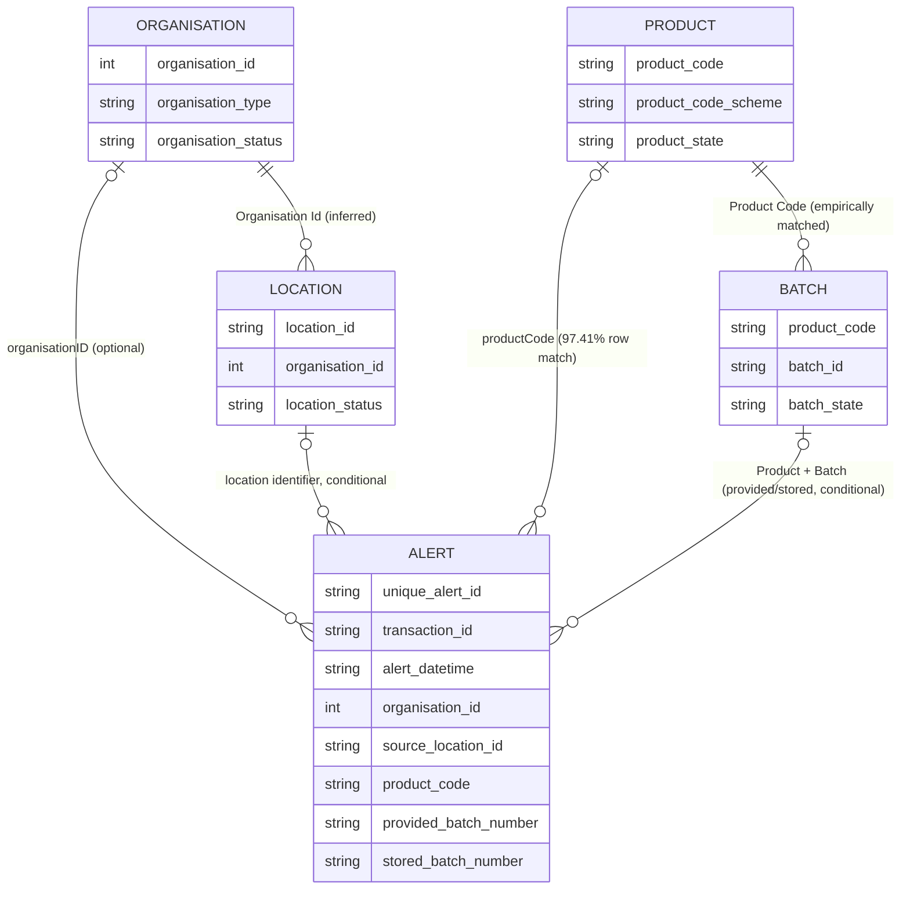

Interpretation:

- `Alert` is the event-oriented centre of the investigation, sourced from `NMVS_Exceptions`.
- `Product` and `Batch` are snapshot-derived context, not Alert events.
- `Organisation` and `Location` are snapshot-derived context and remain separate business concepts.
- The Alert-to-Organisation and Alert-to-Location relationships are optional/conditional because the available identifiers and current snapshot coverage differ.
- Product-to-Batch is the strongest tested relationship. Alert-to-Batch must retain whether the link came from the provided or stored batch value.

### 14.7 Unresolved questions for this model

1. Does `uniqueAlertID` remain one-row-per-business-alert across all Exceptions API retrievals, or can later API/report versions repeat an alert with changed payload or status?
2. What is the authoritative meaning of `sourceLocationID` when it does not match the current `NMVS_Locations.Location Id` domain?
3. Why do 16,678 Alerts contain `packLastUpdateLocationID` values while only 54 match current locations? Are these historical, external-market or different identifier values?
4. Is `organisationID` intentionally absent for most Alerts, or is organisation context recoverable from transaction/client/location information supplied elsewhere?
5. Should an Alert be linked to the provided batch, stored batch, or both when the values differ?
6. Is `Batch Id` unique only within Product Code, and are product/batch rows current-state records or one row per snapshot delivery?
7. What report delivery timestamp should be used to version Products, Batches, Organisations and Locations in the investigation context?
8. Which source-provided identifier should become the future canonical Organisation and Location key across report deliveries?
9. What evidence is required to resolve an Alert with no conformed Organisation or Location without inventing a relationship?
10. What Alert-specific pack history is available from Pack Audit Trail? This is intentionally deferred to the next investigation step.

### 14.8 Marketing Authorisation Holder (MAH) extension

#### Business distinction

The initial Alert Investigation model has two different organisation roles:

- **End-user Organisation / Location**: the NMVS participant and operational location associated with the Alert, where the available identifiers support that relationship.
- **Marketing Authorisation Holder (MAH)**: the organisation responsible for the medicinal product.

These roles must not be collapsed into one generic Organisation concept. `NMVS_Organisations` and `NMVS_Locations` describe the end-user side of the Alert. They do not, by themselves, establish the Swiss MAH for the Product.

`NMVS_Products.MAH Name` is retained as an NMVS-supplied Product attribute, but it is not treated as the canonical Swiss MAH relationship. The observed comparison below demonstrates why: its value is a source-provided name and can differ from the Swiss MAH resolved through Refdata SAI because of encoding, legal-name, jurisdiction or corporate-relationship differences.

#### SAI source and grain matrix

| SAI table | Observed row count | Observed grain | Relevant MAH relationship |
| --- | ---: | --- | --- |
| `SAI_PACKUNGEN` | 63,130 | One SAI package/packaging record, identified by package/product codes and approval number | `GTIN14` and `GTIN_INDUSTRY` are product/package identifiers; `ZULASSUNGSNUMMER` is the intermediate approval number. `GTIN14` is the direct field matching the 14-character NMVS Product Code in this database. |
| `SAI_PRAEPARATE` | 26,012 | One SAI preparation/medicinal-product record per `ZULASSUNGSNUMMER` in the observed data | `ZULASSUNGSINHABERIN` is a partner identifier, not the holder name. It links to `SAI_ADRESSEN.PARTNER_NR`. |
| `SAI_ADRESSEN` | 1,363 | One SAI partner/address record per `PARTNER_NR` in the observed data | `PARTNER_NR` is the holder identifier used by `SAI_PRAEPARATE`; `FIRMENNAME` is the resolved holder/company name. `GLN_REFDATA` is an optional additional identifier and is populated for only 383 distinct partner records. |
| `SAI_ATC_CODES` | 3,807 | One ATC reference record per ATC code/value | No direct MAH relationship. It is outside the Product-to-MAH join. |
| `MV_SAI` | 28,719 | Legacy persisted denormalised product/package/authorisation/MAH convenience row, usually by GTIN/GTIN14 and approval number | Contains `GTIN`, `GTIN14`, `AprovalNumber`, `MAH` and `GLN`, but is not a source dataset and is not the target SAI representation. The target relationship remains `SAI_PACKUNGEN -> SAI_PRAEPARATE -> SAI_ADRESSEN`; `MV_SAI` is retained only as historical implementation evidence. |

The key SAI relationship is therefore:

```text
NMVS_Products.Product Code
    -> SAI_PACKUNGEN.GTIN14
    -> SAI_PACKUNGEN.ZULASSUNGSNUMMER
    -> SAI_PRAEPARATE.ZULASSUNGSINHABERIN
    -> SAI_ADRESSEN.PARTNER_NR
    -> SAI_ADRESSEN.FIRMENNAME (+ optional GLN_REFDATA)
```

This relationship was established empirically from the existing data. It was not assumed from similar column names alone.

#### Product/GTIN to SAI and Swiss MAH results

| Test | Result |
| --- | ---: |
| NMVS Products | 5,689 rows and 5,689 distinct Product Codes; all Product Codes are populated; Product Code Scheme has one observed value, `GTIN`. |
| SAI package GTIN14 | 31,372 non-empty distinct `GTIN14` values across 63,130 package rows; `GTIN_INDUSTRY` has the same observed distinct count and is the 13-digit industry-code representation in the sampled data. |
| NMVS Product Code exact match to `SAI_PACKUNGEN.GTIN14` | 5,333 of 5,689 products, **93.74%**. There were 356 unmatched NMVS Products. No duplicate SAI package row was observed for a non-empty GTIN14 in the package uniqueness test. |
| NMVS Product Code match to `MV_SAI` GTIN fields | 5,323 of 5,689 products, **93.57%**. This is slightly lower than the normalized package path and confirms that `MV_SAI` should be treated as a cross-check/convenience projection rather than the authoritative normalized join. |
| Matched products reaching `SAI_PRAEPARATE` by approval number | 5,333 of 5,333 matched products, **100.00%**. |
| Matched products reaching a SAI holder identifier | 5,333 of 5,333 matched products, **100.00%**. |
| Matched products reaching `SAI_ADRESSEN` by `PARTNER_NR` | 5,333 of 5,333 matched products, **100.00%**. |

The observed resolution rate is therefore **93.74% of current NMVS Products to a SAI-resolved holder/company record** through the normalized path. The remaining 356 Products are unresolved by exact `Product Code = GTIN14` matching in the current SAI package dataset. No fallback by product name, approval-name similarity or NMVS MAH name was used, because those would create weaker and potentially ambiguous relationships. `SWISSMEDIC_MAH` is not required for this target resolution and may only be considered later as an additional reference or validation source.

#### Product to Swiss MAH cardinality

Among the 5,333 NMVS Products that matched SAI `GTIN14` and were traced through the approval number to `SAI_PRAEPARATE` and `SAI_ADRESSEN`:

- every matched Product resolved to exactly one distinct SAI holder identifier;
- no Product resolved to multiple holder identifiers in the observed join;
- the holder relationship is therefore one Product to one Swiss MAH in this extract, subject to source and temporal validation;
- 105 distinct SAI holder identifiers were associated with the matched NMVS Products;
- one holder can own multiple Products: the observed maximum was 1,212 Products for one holder, with an average of 50.79 Products per holder in the matched population;
- SAI contains 1,363 holder/address partner records and 1,241 distinct company names; only 383 holder records have a populated `GLN_REFDATA`.

The one-to-one Product-to-holder result is an observation of the current snapshot, not a permanent business rule. Approval changes, historical ownership, multiple jurisdictions or future source versions could require a temporal Product-to-MAH relationship.

#### Comparison with `NMVS_Products.MAH Name`

For the 5,333 Products resolved through SAI:

- 4,135 Products, **77.54%**, had an exact string match between `NMVS_Products.MAH Name` and the SAI address `FIRMENNAME`;
- 1,198 Products, **22.46%**, had different values;
- case and surrounding whitespace normalization did not increase the match count in this test;
- observed differences include character encoding (`Grünenthal Pharma AG` versus `Grünenthal Pharma AG`), legal-name variants, jurisdiction qualifiers, and corporate relationships such as `NOVARTIS PHARMA SCHWEIZ AG` versus `Sandoz Pharmaceuticals AG`.

This comparison does not establish that the NMVS MAH field is wrong. It establishes that it is not interchangeable with the SAI-resolved Swiss MAH and must remain a separately attributed source value. The future mapping must preserve at least:

- the NMVS-supplied MAH name and source field;
- the SAI holder identifier (`PARTNER_NR` via `ZULASSUNGSINHABERIN`);
- the SAI holder name (`FIRMENNAME`);
- optional SAI `GLN_REFDATA`;
- the matching Product Code, SAI GTIN14, approval number and match method/confidence.

No source value should overwrite another during staging or mapping.

#### Revised minimal conceptual model

The MAH extension adds a distinct Product-responsible organisation role. It does not merge Swiss MAH with the NMVS end-user Organisation or Location.

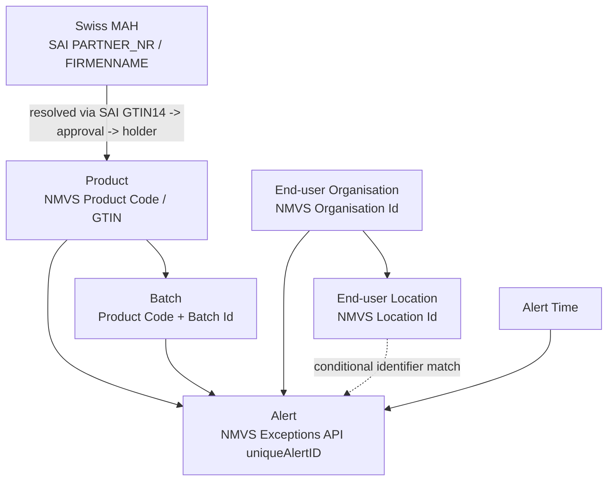

This is conceptual only and remains **DRAFT / NOT YET APPROVED**. The end-user Organisation/Location role and Swiss MAH role must remain separately attributable even when a future conformed organisation identity is introduced.

#### SAI derived-data implementation assessment

This read-only assessment inspected the current database metadata and did **not** execute `refresh_mv_sai`.

##### Legacy procedure definition and refresh behavior

The now-available legacy procedure definition establishes that `refresh_mv_sai` creates `MV_SAI` from a cross-source join:

```text
SAI_PACKUNGEN
    -> SAI_PRAEPARATE
    -> SAI_ADRESSEN
    -> SWISSMEDIC_MAH
    -> MV_SAI
```

The procedure uses these relationships:

- `SAI_PACKUNGEN.ZULASSUNGSNUMMER = SAI_PRAEPARATE.ZULASSUNGSNUMMER`;
- `SAI_PRAEPARATE.ZULASSUNGSINHABERIN = SAI_ADRESSEN.PARTNER_NR`;
- `LEFT(SWISSMEDIC_MAH.Inhaberin, CHAR_LENGTH(SAI_ADRESSEN.FIRMENNAME)) = SAI_ADRESSEN.FIRMENNAME`.

The last join is a legacy prefix/name comparison. It is not an authoritative identity rule and must not be adopted as the canonical Swiss MAH matching rule in the target architecture. The procedure also requires `SAI_PACKUNGEN.GTIN_INDUSTRY IS NOT NULL` and uses `SELECT DISTINCT`.

The refresh process rebuilds the result into `MV_SAI_NEW` and then atomically swaps it with the existing `MV_SAI` table. This explains why `MV_SAI` is a persisted legacy derived/materialized representation rather than a source dataset or view. The current database inspection did not execute `refresh_mv_sai`; the procedure definition was used as supplied legacy implementation evidence.

##### Legacy SAI acquisition and import lineage

The legacy SAI path should be distinguished from the derived MV_SAI refresh:

```text
External Refdata SAI publication/export
    -> acquired SAI artifact
    -> XML source files/datasets
    -> sai_data.py import transformations
    -> local SAI_* tables
    -> refresh_mv_sai legacy derivation
    -> MV_SAI
```

The importer evidence identifies four imported source datasets/tables: `SAI_PRAEPARATE`, `SAI_PACKUNGEN`, `SAI_ATC_CODES` and `SAI_ADRESSEN`. XML-to-tabular conversion and any field construction or normalization performed by `sai_data.py` belong to the legacy import transformation layer, not automatically to the unchanged external SAI source. In particular, authorisation-number normalization, package-code normalization and construction/normalization of `GTIN14` must be treated as importer-derived values wherever the importer performs those operations.

The checked-in workspace does not currently contain `sai_data.py`; therefore this document does not assert specific normalization expressions beyond the supplied importer description. The future source-fidelity design must preserve the acquired SAI artifact and distinguish source-provided XML values from locally constructed or normalized fields before loading source-faithful extracted datasets.

`MV_SAI` is not one of the four SAI source datasets. It is the later legacy derived convenience representation, and its additional `SWISSMEDIC_MAH` dependency must remain explicit in provenance.

##### Physical structure of `MV_SAI`

`MV_SAI` is a physical `BASE TABLE` using InnoDB, not a view and not a native MySQL materialized view. At assessment time it contained 28,719 exact rows. Its columns are:

| Column | Observed type | Index |
| --- | --- | --- |
| `GTIN` | varchar(14) | non-unique |
| `GTIN14` | varchar(15) | non-unique |
| `AprovalNumber` | varchar(32) | non-unique |
| `PackageName` | varchar(255) | none |
| `ProductName` | varchar(255) | none |
| `ATC` | varchar(10) | non-unique |
| `ApprovalState` | varchar(64) | none |
| `Category` | varchar(64) | none |
| `MAH` | varchar(255) | non-unique |
| `GLN` | varchar(20) | non-unique |

The non-unique indexes are on `AprovalNumber`, `ATC`, `GLN`, `GTIN`, `GTIN14` and `MAH`. `MV_SAI` has no declared primary key and no declared unique constraint. Its physical table status establishes that it is a persisted legacy derived/materialized representation, but not how it was generated.

##### Source-table structure and observed joins

The four SAI source tables are also InnoDB base tables. The exact row counts at this inspection were:

| Source table | Exact rows | Relevant indexes |
| --- | ---: | --- |
| `SAI_PACKUNGEN` | 63,130 | non-unique `GTIN14`, `GTIN_INDUSTRY`, `ZULASSUNGSNUMMER` |
| `SAI_PRAEPARATE` | 26,012 | non-unique `ATC_CODE`, `ZULASSUNGSINHABERIN`, `ZULASSUNGSNUMMER` |
| `SAI_ADRESSEN` | 1,363 | non-unique `FIRMENNAME`, `PARTNER_NR` |
| `SAI_ATC_CODES` | 3,807 | non-unique `ATC_CODE` |

The observed cardinalities are:

- `SAI_PACKUNGEN` contains 31,372 non-empty distinct `GTIN14` values. Each observed non-empty `GTIN14` has one authorisation number; no GTIN14 mapped to multiple authorisation numbers in the tested current data.
- Every one of the 31,372 GTIN-bearing package values joined to `SAI_PRAEPARATE` through `ZULASSUNGSNUMMER`, and every one reached a non-empty `ZULASSUNGSINHABERIN`.
- `SAI_PRAEPARATE` contains 26,012 authorisation numbers. Each authorisation number mapped to one distinct `ZULASSUNGSINHABERIN`; no authorisation number mapped to multiple holders in the tested data.
- `SAI_ADRESSEN` contains 1,363 distinct `PARTNER_NR` values. Each partner number mapped to one address row in the tested data; no partner number had multiple address rows.
- `SAI_ATC_CODES` is a separate ATC reference dataset and is not required for the Product-to-MAH join.

These results empirically support the SAI portion of the normalized relationship already documented in SDS-002:

```text
SAI_PACKUNGEN.GTIN14
    -> SAI_PACKUNGEN.ZULASSUNGSNUMMER
    -> SAI_PRAEPARATE.ZULASSUNGSNUMMER
    -> SAI_PRAEPARATE.ZULASSUNGSINHABERIN
    -> SAI_ADRESSEN.PARTNER_NR
    -> SAI_ADRESSEN.FIRMENNAME
```

##### What can and cannot be established about MV_SAI

The current `MV_SAI` rows are consistent with a denormalized projection of the legacy cross-source path:

- all 28,719 MV_SAI rows matched a `SAI_PACKUNGEN` row by `GTIN14` and the corresponding `AprovalNumber`;
- all 28,719 matched the corresponding `SAI_PRAEPARATE` authorisation number and `SAI_ADRESSEN.PARTNER_NR`;
- the legacy derivation also joins through `SAI_ADRESSEN.FIRMENNAME` to `SWISSMEDIC_MAH.Inhaberin` using the prefix comparison above;
- `MV_SAI.GTIN` matched `SAI_PACKUNGEN.GTIN_INDUSTRY` and also matched `GTIN14` with its leading zero removed for all tested MV_SAI rows;
- `MV_SAI` contained no null/blank values for `GTIN`, `GTIN14`, `AprovalNumber` or `MAH`; `GLN` was null/blank for 1,480 rows;
- exact `MAH = FIRMENNAME` agreement occurred for 27,699 rows and exact `GLN = GLN_REFDATA` agreement for 27,239 rows in the tested comparison. These comparisons must not be interpreted as data-consistency tests: `MV_SAI.MAH` is populated from `SWISSMEDIC_MAH.Inhaberin`, while `SAI_ADRESSEN.FIRMENNAME` is the SAI authorisation-holder/address representation.

The current MV_SAI row count is lower than the 31,372 GTIN-bearing package rows: 2,653 GTIN-bearing source rows were not represented by an MV_SAI GTIN. This is a characteristic of the legacy derived projection, not an unresolved prerequisite for the target architecture. The procedure's explicit `GTIN_INDUSTRY IS NOT NULL` condition, cross-source MAH join, and `SELECT DISTINCT` all influence the derived result; no further reverse engineering of the exclusions is required for this analysis.

The available data supports the following cautious interpretation:

- `MV_SAI` materializes a selected, denormalized product/package-to-authorisation/MAH convenience projection;
- its MAH representation is aligned to `SWISSMEDIC_MAH.Inhaberin`, not directly to `SAI_ADRESSEN.FIRMENNAME`;
- it carries a convenient GTIN, approval, product/package, ATC, status/category, MAH and GLN shape;
- it does not retain all source columns from `SAI_PACKUNGEN`, `SAI_PRAEPARATE` or `SAI_ADRESSEN`;
- it does not retain the explicit `ZULASSUNGSINHABERIN` / `PARTNER_NR` holder relationship as a separate field;
- it does not retain source delivery, import, refresh, source-row lineage or match-confidence metadata;
- because there is no primary key or unique constraint, its intended row grain is not enforced by the database.

Consequently, MV_SAI can lose source detail and can collapse the broader source datasets into a selected product/package/MAH projection. The current one-to-one join cardinalities mean that no many-to-one ambiguity was observed in the current SAI source state, but the materialized table still discards source attributes and provenance and may exclude source rows. The legacy Swissmedic name-prefix join is a convenience matching technique, not a canonical identity relationship.

##### Comparison with the existing NMVS-to-SAI finding

The existing SDS-002 finding remains valid: an NMVS Product Code can be matched to `SAI_PACKUNGEN.GTIN14`, then resolved through approval number, holder identifier and SAI address. MV_SAI implements the same SAI package/preparation/address path and then adds a legacy cross-source step to `SWISSMEDIC_MAH.Inhaberin`. It exposes `MAH` from the Swissmedic-derived representation and `GLN` as a convenience projection for the subset it contains.

However, MV_SAI adds denormalized convenience semantics rather than a new business relationship. `MV_SAI.MAH` must not be compared directly with `SAI_ADRESSEN.FIRMENNAME` as though they were the same source value: the former comes from `SWISSMEDIC_MAH.Inhaberin`, while the latter comes from the SAI address/authorisation-holder representation. The table does not preserve the source holder identifier or the legacy match provenance.

##### Target design direction and recommendation

**Recommendation: B.** MV_SAI is a legacy derived convenience/materialized table and should not be retained as the target SAI representation or define the target Operational Information Model. It remains useful as implementation history only.

The target design should:

- preserve the SAI source datasets and acquired source artifact;
- model the SAI relationships explicitly;
- perform explicit transformation and entity mapping;
- resolve Swiss MAH primarily through SAI using `GTIN14 -> ZULASSUNGSNUMMER -> ZULASSUNGSINHABERIN -> PARTNER_NR -> FIRMENNAME`;
- preserve NMVS-supplied MAH information separately from the SAI-resolved Swiss MAH;
- preserve source provenance, source values, normalized values and mapping status separately;
- preserve SAI authorisation/status information supplied by the source.

The legacy `SWISSMEDIC_MAH` prefix/name comparison must not be carried forward as an authoritative identity rule. Swissmedic may later support an additional reference or validation role, but a failed Swissmedic match must not make an otherwise valid SAI resolution unresolved. No optional validation mechanism is designed here.

If authorisation status later determines whether a Product is relevant to a specific operational process, that must be an explicit business rule. It must not be reproduced as an incidental consequence of the legacy `SWISSMEDIC_MAH` join or MV_SAI projection.

The 2,653 omitted GTIN-bearing package rows are a characteristic of the legacy projection, not an open design issue and not a prerequisite for the target model. No implementation of this recommendation is included in this analysis.

##### Target conceptual SAI flow

The target conceptual flow is:

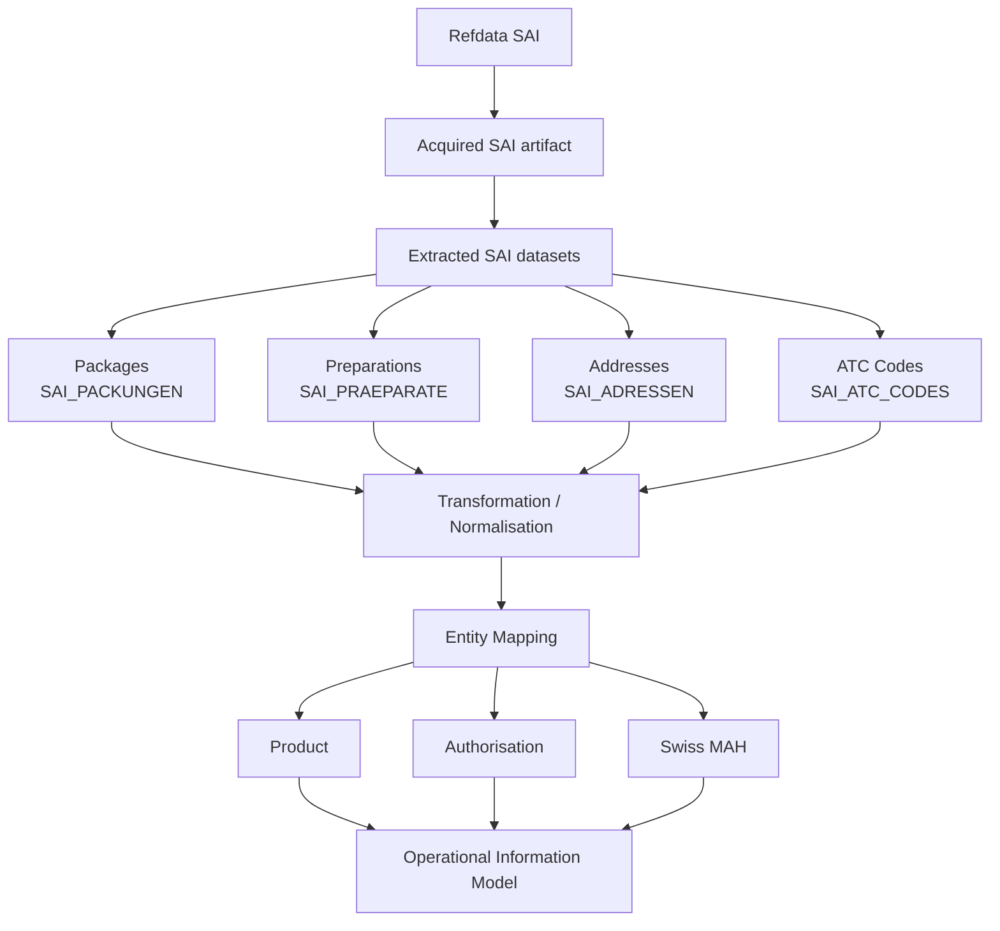

The exact physical staging schema is not designed by this analysis.

### 14.9 Pack Audit Trail and Investigation Timeline

**DRAFT / NOT YET APPROVED.** This subsection records initial design principles only. It does not define a complete normalization catalogue, implement timeline logic, create a physical Pack entity, or approve database structures.

#### Purpose and request context

A Pack Audit Trail is retrieved as investigation-specific evidence for a particular pack. The Pack Audit Trail Report is requested using:

- Product Code;
- Serial Number.

Alert ID is **not** the Pack Audit Trail request parameter. Where the resulting Pack Audit Trail contains an Alert ID, that value may be used to associate the retrieved evidence with the corresponding Alert or Investigation. Cases where no Serial Number is available are outside the current scope. Other NMVS reports may be required for those cases and will be analysed separately.

#### Evidence, normalized events and timeline presentation

The design distinguishes three layers:

```text
Pack Audit Trail evidence
    -> Normalized Pack Events
    -> Pack Investigation Timeline
```

**Pack Audit Trail evidence**

The original NMVS Pack Audit Trail Report is investigation evidence. Its source records must remain traceable, individually available and unaltered merely to simplify presentation. The evidence must retain its source delivery, request context, record reference and association with the investigated Product Code and Serial Number.

**Normalized Pack Events**

Technical audit records may be interpreted into normalized pack lifecycle, operation, state-change and alert-related events. Normalization must preserve traceability to every original audit record used in the interpretation. A complete normalization catalogue is intentionally not defined at this stage.

**Pack Investigation Timeline**

The timeline is a simplified chronological representation intended to answer:

> What happened to this pack before, at, and after the alert?

It is not intended to expose every technical NMVS audit record directly. Grouping, event naming and display selection belong to the future normalization and investigation design, while the evidence layer remains the authoritative traceability source.

#### Timeline start and mandatory event context

The Pack Investigation Timeline starts with creation of the pack in the EMVS. Pack creation is operationally relevant information and must not be omitted from the simplified timeline. The timeline then continues chronologically through relevant operations, state changes, the alert-triggering event and relevant subsequent events.

For every event displayed in the Pack Investigation Timeline, the following context is mandatory where supplied by the Pack Audit Trail:

- timestamp;
- event or operation;
- location.

Additional context should be retained and presented where relevant:

- previous and resulting pack state;
- Organisation;
- market or country;
- transaction identifier;
- Alert ID;
- alert/error code;
- source audit-record reference.

Location is a core investigation attribute, not merely an optional display detail. If the source audit record does not provide a Location, the system must not silently infer or copy a Location from another event. Any future derived Location must be explicitly identifiable as derived rather than source-provided.

#### Event grouping

Several technical Pack Audit Trail records may represent one business-relevant event. The Investigation Timeline may therefore group technical records only where a defined normalization rule establishes that they belong to the same business-relevant event. The underlying records must remain individually available as evidence. Generic grouping rules are intentionally not defined yet.

#### First observed A7 reference pattern

The supplied Pack Audit Trail is documented as the first reference example only. It represents a typical A7 situation in which an Export operation is attempted on a pack that has already been exported.

A7 must not be generalized as **double export**. It may occur in other operational contexts, for example:

- another actor subsequently attempts Export;
- an intermediary performs a later decommissioning operation;
- an end user attempts Supply on a pack whose previous state makes the operation incompatible.

The timeline should therefore represent, neutrally:

- previous pack state and history;
- attempted operation;
- Location for each event, where supplied;
- resulting Alert.

The timeline must not infer intent, error cause, legitimacy or responsibility from the A7 pattern alone.

#### Conceptual relationship to the Alert Investigation

The Pack Audit Trail extends the initial Alert Investigation as investigation evidence and derived context:

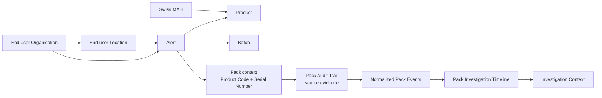

This relationship is conceptual only. It keeps the existing Swiss MAH, end-user Organisation and Location relationships visible while treating Pack Audit Trail, Normalized Pack Events and the Pack Investigation Timeline as distinct evidence and interpretation layers. It does not create a physical Pack entity or database schema.

The following principles remain outside this step: timeline code, A7 rules, tables or migrations, additional Pack Audit Trail examples, reports used when Serial Number is unavailable, and EMVO Best Practice investigation rules.

## 15. Revised Candidate Model Summary

**DRAFT / NOT YET APPROVED.** The current candidate working model starts with:

- **Alert/Event** from the NMVS Exceptions API, at one supplied alert record per source `uniqueAlertID` where the contract supports that interpretation.
- **Product** and **Batch** as conformed business concepts enriched from the NMVS Daily Snapshot Report and explicitly mapped to SAI reference data where required.
- **Swiss MAH** as a distinct Product-responsible business entity resolved primarily through the SAI package/product/holder path; NMVS-supplied MAH information remains separately attributed. Swissmedic is optional reference/validation context only.
- **End User** as a semantic concept involving separate conformed **Organisation** and **Location** dimensions; no single physical End User table is approved.
- **Product state** and **Batch state** facts for Daily Snapshot observations, explicitly treated as state/context rather than automatically as events.
- **Organisation Activity** as an aggregate report fact and **System Access** as a separate provisional audit/event fact, both reusing common dimensions where supported.
- **Source, channel, report/API delivery, import job and lineage** as mandatory provenance context across the staging and working layers.

This candidate model is an analytical direction only. It is not an approved physical schema, migration plan or implementation decision.
