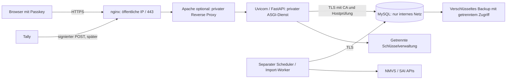

# Security Review — SMVS Operations

Datum: 2026-11-09, Europe/Zurich
Zielsystem: `https://operations.smvs-gmbh.ch`
Hosting: Infomaniak Jelastic; DNS: Cyon
Zugangsmodell: öffentliches Portal, authentifizierter Zugriff über Passkeys

## Beurteilung

**Die Anwendung hat eine brauchbare Sicherheitsgrundlage, ist im geprüften Stand jedoch noch nicht zur öffentlichen Produktion freigegeben.** Vor der Veröffentlichung sind insbesondere Datenbank- und Proxy-Absicherung, ein korrigiertes Benutzer-Audit, Login-/Sitzungsschutz sowie der Schutz aller Seriennummernkopien erforderlich.

Das ist eine Beurteilung des aktuellen Codes und lokaler Prüfungen. Es wurde kein Datenabfluss festgestellt. Weder das spätere Jelastic-System noch dessen nginx-/Apache-Konfiguration, Firewall, DNS-Konto, Datenträger oder Backups wurden untersucht. Eine fehlende Einstellung im Repository beweist nicht, dass sie beim Hosting-Anbieter fehlt.

Die Prüfung verändert weder die Anwendung noch produktive Daten, Zugangsdaten oder Abhängigkeiten. Die bestehenden, noch nicht committeten UI-Änderungen bleiben erhalten. Dieser Bericht und die Umsetzungsliste dokumentieren die Befunde; die nachfolgenden Massnahmen sind noch umzusetzen.

## Umfang und Nachweise

- Codeprüfung von Authentifizierung, Rollenprüfung, Formularen, Downloads, Datenbankzugriff, Importgrenzen, OpenAI-Datenfluss, Audit und persönlichen Views.
- Geprüft wurde der Arbeitsstand auf Basis von Git-Commit `bab222c` mit den vorhandenen uncommitteten Änderungen, nicht ausschliesslich dieser Commit.
- Vollständige Testsuite: **421 bestanden**. Davon wurden **51 Tests** zu Authentifizierung, Views und NMVS-Download-Sicherheit zusätzlich gezielt ausgeführt. Bestandene Funktionstests ersetzen keine Sicherheitsabnahme.
- Lokale, synthetische Prüfungen: Produktionsstart ohne Authentifizierung verweigert; Entwicklungszugriff mit lokalem Host/Peer zugelassen, mit öffentlichem Host verweigert; fremde Formular-Origin verweigert, passende HTTPS-Origin akzeptiert.
- Nur lesende Prüfung der lokalen MySQL-Verbindung und Rechte. Keine Geschäftsdatensätze abgefragt. Ergebnisse nicht auf die künftige Produktion übertragen.
- `pip-audit`: **50 installierte Python-Pakete geprüft, ein eindeutiges bekanntes Advisory in certifi**. Das Werkzeug meldete denselben Advisory-Eintrag doppelt; dies sind nicht zwei unterschiedliche Schwachstellen.
- `Bandit`: **16'780 Codezeilen**, sechs Hinweise niedriger Schwere, keine mittleren/hohen Werkzeugbefunde. Manuell geprüfte Hinweise: absichtlich unterdrückte Fehlerdiagnostik; Regex als vermeintliches Passwort; reiner XML-ParseError-Import bei tatsächlicher Verwendung von defusedxml; isoliertes Fixture-Geheimnis. Daraus wurde kein zusätzlicher bestätigter Exploit abgeleitet.
- Ein begrenzter Mustercheck der aktuell versionierten Dateien fand keine passenden privaten Schlüssel/OpenAI-Schlüssel. Dies ist **kein vollständiger Secret-Scan der Git-Historie**.

Scanner wurden in einer getrennten temporären Umgebung installiert. Für den Abhängigkeitsabgleich wurden Paketnamen und Versionsnummern übermittelt, keine NMVS-Daten, Seriennummern oder .env-Inhalte. Keine aktiven Tests gegen öffentliche SMVS-/Infomaniak-Systeme.

## Schutzbedarf und Datenkopien

Ein Zusammenhang aus Produktcode, Seriennummer, Charge und Status ist besonders schutzbedürftig: Eine Offenlegung kann Missbrauch unterstützen. Personendaten, Verträge und finanzielle Selbstdeklarationen erfordern ebenfalls eingeschränkten Zugriff. Ein Passkey schützt die Anmeldung, nicht automatisch die Datenbank, Backups oder eine bereits übernommene Sitzung.

Seriennummern liegen nicht nur in `nmvs_exceptions.serial_number`:

| Ort | Bedeutung für das Schutzkonzept |
| --- | --- |
| Exceptions und Pack-Audit-Anfragen/-Berichte | Identifikatoren, gespeicherte Ereignisse und Pack-Kontext |
| `evidence`/`events_json`, Staging-Zeilen | Kopien ursprünglicher JSON-/CSV-Felder |
| `artifact_contents.artifact_bytes` | Originaldateien als BLOB, einschliesslich Berichten und CRM-Exporten |
| RCA-Freitext und lokale Audit-Snapshots | Können vom Benutzer eingefügte Identifikatoren/Personendaten enthalten |
| Persönliche Views und Such-URLs | Suchbegriffe und Bedingungen können Seriennummern enthalten |
| Logs, Exporte, Backups, Wiederherstellungen | Können dieselben Daten erneut enthalten |
| OpenAI-Suchfrage | Aktuell möglicher ausgehender Datenpfad, wenn der Benutzer eine Seriennummer einfügt |

## Befunde und Prioritäten

**P0**: vor öffentlichem Betrieb schliessen. **P1**: vor Freigabe der jeweiligen Funktion bzw. als nächster Härtungsschritt. Eine Priorität bezeichnet den Handlungsbedarf; sie ist keine Behauptung eines bereits erfolgreichen Angriffs.

### SEC-01 — TLS-Vertrauensspeicher mit bekanntem Advisory · P0

**Bestätigt:** Installiert ist `certifi 2026.7.22`. Der aktuelle Abhängigkeitscheck meldet `GHSA-6q48-6c7w-9gw2` / `PYSEC-2026-4320`. Das Advisory beschreibt betroffene CA-Vertrauenseinträge und einen möglichen TLS-Mittelsmannangriff bei zusätzlicher Kontrolle des Netzwerkpfads. Der Advisory-Eintrag nennt eine korrigierte Version ab `2026.10.18`; sein Handlungstext empfiehlt `2026.10.19` oder neuer.

**Massnahme:** Auf eine geprüfte Version mindestens `2026.10.19` aktualisieren, transitive Abhängigkeiten reproduzierbar festschreiben und den Scan sowie HTTPS-/Integrationstests wiederholen. Keine automatische Paketaktualisierung wurde während dieser Prüfung vorgenommen. Ein neuer Build muss die korrigierte Version tatsächlich enthalten.

**Nachweis:** Installierte Paketmetadaten, pip-audit, verifiziertes GitHub-Advisory. Viele Anforderungen in `requirements.txt` sind noch nicht exakt versioniert; ein vollständiges Lock-/Hash-Verfahren fehlt.

### SEC-02 — Datenbank-TLS wird nicht verbindlich authentifiziert · P0

**Bestätigt:** `app/core/db/engine.py:26` erstellt die Engine ohne explizite CA-/Hostname-Prüfung. Die lokale Verbindung ist zwar TLS-verschlüsselt; ihr Client-Kontext hat jedoch `verify_mode=0` und `check_hostname=false`. Lokal ist `require_secure_transport` nicht aktiviert.

Damit ist die Aussage „Datenbankverbindung verschlüsselt“ allein nicht ausreichend. Für Produktion muss die Gegenstelle verifiziert und ein unverschlüsselter Fallback ausgeschlossen werden.

**Massnahme:** CA und erwarteten DB-Host konfigurieren, Zertifikat und Hostname prüfen; Verbindung bei fehlender/ungültiger Vertrauenskette verweigern. Auf dem DB-Server sichere Verbindungen erzwingen. Diese Anforderungen gelten für Portal, Scheduler, Importer, Migration und Backup-Zugriff. Die konkrete MySQL-Version und die Zertifikatsbereitstellung bei Infomaniak sind noch zu prüfen.

**Abnahme:** Passender Host/CA funktioniert. Falscher Host, fremde CA und unverschlüsselter Zugriff scheitern nachweislich.

### SEC-03 — Laufzeitkonto besitzt zu weitreichende Datenbankrechte · P0

**Bestätigt, lokal:** Kein Root-Konto, keine globalen ALL-Rechte, keine FILE- und keine GRANT-OPTION-Rechte festgestellt. Das Laufzeitkonto besitzt aber `ALL PRIVILEGES` auf dem Anwendungsschema. Das erlaubt mehr als den normalen Portalbetrieb, insbesondere Schemaänderungen.

**Massnahme:** Getrennte Konten für Anwendung, Import-/Worker-Aufgaben, Migration und Backup; nur benötigte Tabellen-/Operationsrechte. Keine DDL-/GRANT-/FILE-Rechte für das Portal. Den Zugriff auf Audit-Einträge soweit möglich auf INSERT/SELECT begrenzen. Rohartefakte nicht pauschal über jedes Konto lesbar machen. MySQL erhält keine öffentliche Erreichbarkeit; nur explizit berechtigte interne Dienste dürfen verbinden.

Die heutige Datenbanknamen-Prüfung verhindert versehentlichen Zugriff auf die falsche Datenbank. Sie ersetzt weder minimale Rechte noch eine Abwehr gegen Datenabfluss nach einer Anwendungskompromittierung.

### SEC-04 — Lesbare Seriennummern und Rohdaten in einem DB-Abzug · P0 Schutzentscheidung

**Bestätigt im Modell:** Seriennummern sind Strings; Evidence und Ereignisse sind JSON, Originaldateien BLOBs. Eine anwendungsseitige Verschlüsselung dieser Daten ist nicht implementiert. Ob der künftige Datenträger verschlüsselt ist, ist nicht geprüft.

**Massnahme:** Verschlüsselung von Datenträgern und Backups ist die Basis. Für das ausdrücklich genannte Risiko „gestohlener SQL-Dump“ empfehle ich zusätzlich eine anwendungsseitige Verschlüsselung der Seriennummern **und aller Rohkopien**. Nur die sichtbare Spalte zu verschlüsseln würde das Risiko nicht ausreichend reduzieren.

Für erforderliche Gleichheitssuchen kann ein separat geschlüsselter HMAC-Suchwert eingesetzt werden; die Klarwerte werden authentifiziert und mit zufälligem Nonce verschlüsselt. Verschlüsselungs- und Suchschlüssel gehören in eine getrennt verwaltete Schlüsselablage, nicht in dieselbe Datenbank oder deren Dump. Rotation, Versionskennzeichnung, Migration der Altbestände und Wiederherstellung gehören zum Entwurf. Prüfen, welcher getrennte Schlüsseldienst im gewählten Hosting tatsächlich verfügbar ist.

**Grenze:** Datenträgerverschlüsselung schützt nicht vor einem berechtigten SQL-SELECT. Anwendungsverschlüsselung schützt ebenfalls nicht umfassend, wenn ein Angreifer den laufenden Anwendungsprozess samt Schlüsselzugriff übernimmt. Rechte, Protokollierung und Netzsegmentierung bleiben nötig.

**Abnahme:** Eine definierte synthetische Test-Seriennummer ist in einem DB-Dump und entschlüsselten Backup-Export ohne separate Anwendungsschlüssel nicht im Klartext auffindbar, auch nicht in Artefakten/JSON/View-Konfigurationen. Vor Livegang muss diese Architektur umgesetzt oder eine ausdrücklich dokumentierte alternative Schutzentscheidung abgenommen sein.

### SEC-05 — Fehlkonfiguration des Entwicklungsmodus hinter Proxys · P0

**Positiv bestätigt:** Mit `environment != development` und ausgeschalteter Authentifizierung verweigert die App bereits den Start (`auth_access.py:35`). Im lokalen Entwicklungsmodus prüft sie Host und direkten Peer auf Loopback.

**Bedingtes Risiko:** Die Voreinstellungen sind `development` und Authentifizierung aus (`settings.py:9`). Ein Reverse Proxy auf demselben Host kann gegenüber Uvicorn als Loopback erscheinen. Wenn er zusätzlich den lokalen Upstream-Host weitergibt und der Entwicklungsmodus versehentlich übernommen wird, kann die lokale Vorschau öffentlich weitergereicht werden. Der synthetische Test bestätigt die Akzeptanz eines als lokal erscheinenden Requests; er ist kein nachgewiesener Zugriff auf eine öffentliche Installation.

**Massnahme:** Separates, verbindliches Produktionsprofil mit `ENVIRONMENT=production`, `PORTAL_AUTH_ENABLED=true`, `PORTAL_AUTH_ORIGIN=https://operations.smvs-gmbh.ch`. Startprüfung für HTTPS und erlaubten Host; produktiver Entry-Point darf kein Vorschauprofil laden. Entwicklungs-/Testserver dürfen nicht dieselben Produktivdaten ungeschützt zugänglich machen.

### SEC-06 — Login-/Ressourcen-Drosselung nicht in der App vorhanden · P0

Die öffentlichen Sign-in-Options erzeugen vor einer Anmeldung Datenbank-Challenges (`auth_routes.py:90`). Request-Grössen werden begrenzt, aber eine Drosselung für Authentifizierungsversuche ist im Code nicht implementiert. Eine spätere nginx-Drosselung ist noch nicht geprüft.

**Massnahme:** nginx-Limits pro Client und global; Anwendungsgrenzen pro Konto/Sitzung für teure Funktionen, Report-Anforderungen, Downloads und OpenAI-Aufrufe. IP-Adressen erst nach kontrollierter Proxy-Auswertung verwenden. NAT-/Gemeinschaftsadressen berücksichtigen. Herausforderungserzeugung und Hintergrundaufträge dürfen die Datenbank nicht unbegrenzt belasten. Grenzen prozessübergreifend umsetzen, nicht nur als Zähler eines einzelnen Python-Workers.

**Abnahme:** Kontrollierte Überschreitung ergibt 429, normale Passkey-Vorgänge bleiben möglich; gefälschte Forwarded-Header umgehen die Grenze nicht.

### SEC-07 — Audit identifiziert Resolve-Benutzer nicht · P0

**Bestätigt:** `app/domain/exceptions/review.py:58` schreibt weiterhin `Local operator (no authenticated identity)` für Review-/Resolve-/Reopen-Ereignisse. Zeit und Vorher-/Nachher-Werte werden gespeichert, die Person wird aber nicht zuverlässig zugeordnet. In den geprüften Auth-Routen gibt es ausserdem kein eigenes Sicherheitsereignisprotokoll für Anmeldung, fehlgeschlagene Anmeldung, Einladung, Rollenwechsel, Deaktivierung und Passkey-Erweiterung.

**Massnahme:** Authentifizierte Benutzer-ID serverseitig bis zur Geschäftsoperation weiterreichen; keine Übernahme einer vom Formular gelieferten Identität. Neue Audit-Ereignisse eindeutig mit Benutzer, Aktion, Objekt, UTC-Zeit, Ergebnis und Vorgangs-ID protokollieren. System-/Worker-Aktionen separat kennzeichnen. Vorhandene historische Ereignisse nicht nachträglich einem Benutzer zuschreiben.

Für Konto- und Rollenänderungen ein Sicherheits-Audit ergänzen; ergänzend Exporte/Downloads mit Objektbezug und Umfang erfassen. Keine kompletten Berichte, Seriennummern, Tokens oder unnötigen Personendaten in das Sicherheitslog kopieren. Logs gegen nachträgliche Änderung schützen und relevante Ereignisse ausserhalb der Anwendungsdatenbank sichern.

### SEC-08 — Sitzungen ohne Inaktivitätsablauf; Wiederherstellungsprozess offen · P0/P1

**Bestätigt:** Acht Stunden absolute Lebensdauer (`auth/service.py:16`), keine gespeicherte letzte Aktivität und kein serverseitiger Idle-Timeout im Modell. Ein übernommener Sitzungscookie kann bis zum Ablauf gültig bleiben. Passkeys verhindern diese Art des Missbrauchs nicht automatisch.

**Massnahme vor Livegang:** Serverseitiger Inaktivitätsablauf; Vorschlag 30 Minuten, zusätzlich acht Stunden absolute Grenze. Polling im Hintergrund soll den Idle-Timeout nicht unbegrenzt verlängern. Für hochriskante Kontoverwaltung eine frische Passkey-Bestätigung verlangen. Die bestehende Fünf-Minuten-Regel für **Add passkey** beibehalten und für Konto-/Rollenaktionen angemessen ergänzen. HTTPS-Cookies auf `__Host-`-Präfix umstellen, sofern kompatibel; Cookie-Domain nicht auf die gesamte `smvs-gmbh.ch` ausdehnen.

**Vor Freigabe verbindlich:** Zwei verantwortliche Administratoren mit unabhängigen Ersatz-Passkeys. Ein kontrolliertes Recovery-Verfahren festlegen. SMS soll später nicht unbemerkt zur schwächeren Umgehung des Passkey-Schutzes werden. Recovery-Codes wären nur gehasht, einmalig und auditierbar zu speichern; die konkrete Umsetzung bleibt separat.

### SEC-09 — Browser-Schutzheader fehlen als durchgängige Baseline · P0

`main.py` und die aktuelle Middleware setzen keine globale Content Security Policy, keinen Frame-Schutz und kein durchgängiges nosniff-/Referrer-/HSTS-Konzept. Auth-Seiten und einzelne Downloads haben bereits Teilregeln. Eine lokale synthetische Response hatte die genannten Header nicht; spätere Edge-Header sind nicht untersucht.

**Massnahme:** CSP mit eigenen Skripten, `frame-ancestors 'none'`, `object-src 'none'`, `base-uri 'none'` bzw. gezielt begrenzter Basis, `form-action 'self'`, dazu `X-Content-Type-Options: nosniff`, `Referrer-Policy: no-referrer` und geeignete Permissions-Policy. Die Logo-Quelle muss ausdrücklich berücksichtigt oder über einen lokalen Cache bedient werden. Zunächst CSP-Berichtsmodus testen, dann erzwingen. HSTS am HTTPS-Einstieg nach geprüftem Zertifikats-/Redirect-Betrieb aktivieren; `includeSubDomains`/Preload nicht pauschal für fremd betriebene Geschwisterdienste setzen.

Header sollen auch Fehler-/Login-Responses abdecken. Kein Proxy-/CDN-Cache für private Antworten; keine Veröffentlichung von Anwendungscode oder .env über Apache-DocumentRoot. Nur das tatsächlich benötigte statische Verzeichnis separat freigeben.

### SEC-10 — Such-URLs und Logs können Seriennummern enthalten · P0

Die Exceptions-Suche akzeptiert eine Seriennummer als GET-Suchbegriff (`exception_queries.py:219`). View-Bedingungen werden ebenfalls in URLs überführt und können gespeichert werden. Der aktuelle Uvicorn-Access-Logger protokolliert den Request-Pfad einschliesslich Query-String. Somit können Nummern auch bei korrekter Datenbankabsicherung in Betriebslogs gelangen. Serverinterne NMVS-Transportlogs werden in ausgewählten Pfaden bereits gezielt unterdrückt; das löst den Browser-URL-Pfad nicht.

**Massnahme:** nginx/Apache/Uvicorn und Fehlerdiagnostik gemeinsam prüfen. Keine Query-Strings, Cookies, Authorization-Header, Webhook-Bodys oder Form-Inhalte loggen. Sensible Suchen perspektivisch über kurzlebige serverseitige Suchreferenzen oder einen geeigneten POST-Flow führen. Persönliche Views mit solchen Suchwerten in das Datenkopien-/Verschlüsselungskonzept einbeziehen. Keine echten Identifikatoren in externe Fehler-/CSP-Dienste senden. Browser-Historie und URL-basierte Verweise berücksichtigen.

### SEC-11 — OpenAI-Freitext kann vertrauliche Eingaben übertragen · P0 für diese Funktion

**Bestätigt:** Die lokale Sprachsuche sendet die vom Operator eingegebene Frage an OpenAI; das Schema nennt ausdrücklich Seriennummern als mögliche Suchbegriffe (`list_search.py:22`, `responses.py:6`). Es werden keine ganzen Ergebnisdatensätze automatisch übermittelt. Eine vom Benutzer eingefügte Nummer ist dennoch bereits eine ausgehende Übermittlung. `store: false` verhindert diese Übermittlung nicht.

**Massnahme:** Für den ersten öffentlichen Betrieb diese Freitextfunktion deaktivieren, bis eine überprüfbare Datengrenze besteht. Vertrauliche Identifikatoren lokal erkennen/abtrennen und lokal filtern; an das Modell nur freigegebene Muster-/Filterfragen geben. Eine Warnung allein ist keine verlässliche Grenze. Company Research mit öffentlichen Firmennamen/Domains kann getrennt behandelt werden. Auch manuell eingegebene Feldinhalte und externe Vertragspartner-/Datenschutzvorgaben sind dabei zu berücksichtigen.

Das Modell kann aktuell keine beliebigen SQL-Befehle ausführen; strukturierte Ausgaben werden serverseitig validiert. Dies ist positiv, ersetzt aber keinen Schutz vor versehentlicher Eingabe vertraulicher Daten.

### SEC-12 — Secrets, Backups und personenbezogene Daten · P0/P1

**Bestätigt, lokal:** Die .env ist nicht versioniert, hat aber Dateimodus `0644`. Damit ist sie grundsätzlich für andere lokale Benutzer lesbar, sofern die übergeordneten Verzeichnisse deren Zugriff zulassen. DB-Passwort ist in Settings ein normaler String; andere API-Geheimnisse verwenden teilweise bereits `SecretStr`.

**Massnahme vor Deployment:** Secrets ausserhalb des öffentlich erreichbaren Dateibaums, nur für das Dienstkonto lesbar; keine Dump-/Config-Repräsentation in Fehlerausgaben. Hosting-/SSH-/Backup-/Cyon-DNS-Konten mit starker MFA, minimalen Rechten und nachvollziehbaren Änderungen. Schlüssel und Backup-Zugang getrennt verwalten. Zertifikatsausstellung, DNS-Änderungen und Zertifikatsablauf überwachen.

**Backups:** Verschlüsselt, getrennte Berechtigungen, Wiederherstellungsprobe, definiertes RPO/RTO und Löschzyklus. Kein unverschlüsselter SQL-Dump im Webroot. Lokale und produktive Backups nicht gleichsetzen. Für Jelastic sind die konkret eingerichteten Sicherungspläne zu prüfen; aus dem Hosting allein folgt kein bestätigtes Backup.

**Personendaten:** Archivieren ist nicht Löschen. Original-CSV/BLOBs, Staging, Empfängerlisten, Audit-Freitext und Backups müssen in das bestehende Retention-Konzept einbezogen werden. Automatische Löschung/Anonymisierung ist noch nicht implementiert. Zweck, Kategorie, Aufbewahrungsbedarf und Ausnahmen separat festlegen; dies ist keine rechtliche Einzelfallprüfung.

## Bereits vorhandene Schutzmechanismen

- Passkeys mit erforderlicher Benutzerverifikation, RP-/Origin-/Challenge-Prüfung und kurzen, einmalig verwendbaren Challenges.
- Serverseitig gespeicherte Sitzungstokens nur als SHA-256-Digest; ausreichend zufällige Bearer-Tokens. Passkey-Privatschlüssel werden nicht im Portal gespeichert.
- HTTPS-Cookies erhalten Secure, HttpOnly und SameSite=Strict; Sitzungen sind widerrufbar. Kontodeaktivierung/Rollenänderung widerruft Tokens.
- Rollen werden serverseitig auf direkten URLs und POSTs geprüft; Administrator/NMVO sind getrennt. Externer MAH-Zugriff ist noch nicht implementiert und wird nicht als verfügbar angenommen.
- HTML-Formulare prüfen Origin und Body-Grösse; JSON-Passkey-Endpoints verlangen die konfigurierte Origin. Kein weit geöffnetes CORS gefunden. Im Proxybetrieb muss das URL-Schema korrekt weitergegeben werden.
- SQLAlchemy-Ausdrücke und gebundene Werte für Suchbedingungen; die generischen Views verwenden ein serverseitiges Feldregister statt Modell-SQL. Es wurde keine bestätigte SQL-Injection gefunden; das ist keine Vollständigkeitsgarantie.
- Jinja-Autoescaping und DOM-Textzuweisung in geprüften Feldern; die einzige gefundene explizite HTML-Freigabe betrifft den lokalen, vertrauenswürdigen User Guide. Kein bestätigtes gespeichertes XSS in den geprüften Datenpfaden.
- NMVS-/SAI-Downloads haben Host-/Redirect-/Grössenregeln; SAI-XML verwendet defusedxml und Archivgrenzen. PDF-Uploads sind begrenzt, Dateinamen geprüft, Downloads als Anhang ausgeliefert. Eine reine PDF-Magic-Prüfung ist kein Malware-Scanner; bei späteren externen Uploads Quarantäne/Prüfung ergänzen.
- Keine öffentliche OpenAPI-/Swagger-Oberfläche in der Hauptanwendung.

## Zielarchitektur für Infomaniak/Cyon

FastAPI benötigt ASGI. Ein Apache-Python-Template mit mod_wsgi ist nicht direkt der passende Ausführungsweg. **Apache kann als Reverse Proxy beibehalten werden**; alternativ nginx direkt vor Uvicorn. Der konkrete ASGI-Prozess und dessen automatischer Neustart/Überwachung müssen im Infomaniak-Template eingerichtet werden. Nicht annehmen, dass das vorhandene Template dies bereits erledigt.

- Nur nginx bekommt die öffentliche IP. Keine öffentliche Datenbank-, Apache- oder Uvicorn-Umgehungsadresse, auch nicht über IPv6/alternative Jelastic-Hostnamen.
- Öffentliche Nutzung über HTTPS; HTTP nur für erforderliche Zertifikatsvalidierung und Redirect. Keine privaten Inhalte über HTTP.
- nginx überschreibt Host-/Forwarded-Informationen am Vertrauenseinstieg. Apache muss das äussere HTTPS-Schema erhalten; es darf nicht durch das interne HTTP-Schema ersetzt werden. Uvicorn vertraut nur dem tatsächlich vorgeschalteten Proxy, nicht pauschal beliebigen Absendern.
- Host bleibt `operations.smvs-gmbh.ch`; `Origin` bleibt die Browser-Origin. Kein pauschales Ersetzen des Origin-Headers, um abgewiesene Formulare zum Funktionieren zu bringen.
- Innerhalb desselben Hosts ist ein Unix-Socket/Loopback möglich. Für Verbindungen zwischen Nodes Verschlüsselung und Netzregeln konkret abnehmen.
- Scheduler als separater verwalteter Worker; Portal-Replikate dürfen nicht versehentlich zusätzliche Scheduler starten.
- Keine vollständigen Request-Logs, Debug-Seiten, Profiling-Tools, SQL-Dumps oder Konfigurationsdateien öffentlich.
- Cyon liefert DNS, transportiert dadurch nicht die Geschäftsdaten. Schutz des DNS-Kontos und der Zertifikatskontrolle ist trotzdem Teil der Vertrauenskette.

## Anforderungen an den nächsten Tally-Registrierungsworkflow

Dieser Workflow wird **nach** der Sicherheitsgrundlage implementiert. Er ist von internen Portal-Benutzerkonten zu unterscheiden: Eine End-User-Registrierung im CRM darf nicht automatisch eine interne NMVO-/Administratorberechtigung erzeugen.

1. Nur ein eng definierter öffentlicher POST-Endpunkt für Registrierungsereignisse, keine pauschale Ausnahme für CRM-/Workflow-Routen.
2. Signatur des unveränderten Bodys anhand des vom Anbieter dokumentierten Verfahrens prüfen, bevor Daten verarbeitet werden. Dabei Request-Grösse, Ereignistyp und erwartetes Formular begrenzen. Die konkrete aktuelle Tally-Schnittstelle beim Implementieren verifizieren.
3. Eindeutige Event-/Submission-ID, transaktionale Idempotenz, Wiederholungen und verspätete Ereignisse kontrollieren. Eine legitime Wiederholung darf keinen zweiten CRM-End-User erzeugen.
4. Daten zunächst als zu prüfende Anmeldung speichern; NMVS-Organisation später bewusst zuordnen. Keine erfundene automatische NMVS-Schreibschnittstelle.
5. Sicherheitsfrage/-antwort nur temporär und verschlüsselt, mit engem internen Zugriff und nachvollziehbarer Übernahme/Löschung. Nicht in allgemeine Raw-Webhook-Artefakte, Logs, OpenAI oder E-Mails kopieren. Lebenszyklus von lokalen Kopien, Tally-Speicherung und Backups gemeinsam festlegen.
6. Ein öffentlicher Receipt-/Status-Link darf keine übrigen CRM-Daten oder NMVS-Seriennummern freigeben. Zufällige, kurzlebige und zweckgebundene Tokens; Zugriff unabhängig von einer internen Sitzung eng begrenzen.
7. Lokale Simulation mit synthetischen Daten; anschliessend externer Smoke-Test des echten nginx-/Apache-/HTTPS-Pfads und der Signaturprüfung. Ein lokaler Funktionstest beweist nicht die sichere öffentliche Konfiguration.

## Umsetzung in überprüfbaren Paketen

| Paket | Inhalt | Abnahmekriterium |
| --- | --- | --- |
| A — Produktionsbasis | SEC-01, SEC-02, SEC-03, SEC-05; ASGI-Prozess und private Netzwerkpfade | Reproduzierbarer Build, verifiziertes DB-TLS, minimale Rechte, kein Vorschau-/Backend-Zugang |
| B — Web-/Kontoschutz | SEC-06, SEC-08, SEC-09 | Drosselung, Idle-Timeout, sichere Header, frische Verifikation für kritische Kontovorgänge |
| C — Audit und Datenabfluss | SEC-07, SEC-10, SEC-11 | Richtiger Actor, zentrale Sicherheitsereignisse, keine Nummern in Logs/LLM-Eingaben |
| D — Vertraulichkeit und Betrieb | SEC-04, SEC-12 | Abgenommene Seriennummern-/Schlüsselarchitektur, verschlüsselte getestete Backups, Retention-Verfahren |
| E — Tally | Enger öffentlicher Registrierungsworkflow | Signatur-/Wiederholungs-/Berechtigungs-/Löschtests bestanden |

A–D bilden die Freigabegrundlage für öffentliche NMVS-Echtdaten. Die technische Implementierung kann schrittweise parallel zur lokalen Weiterentwicklung erfolgen; öffentlich wird erst nach Abnahme freigeschaltet. Die Liste begründet keine bestehende Sicherheitszertifizierung.

## Sicherheitsabnahme am Zielsystem

- Ohne Session: sensible Seiten/Downloads verweigert; mit NMVO-Session: Admin-/Import-/Intelligence-Aktionen verweigert. Rollenänderung/Deaktivierung entwertet bestehende Sessions.
- Passkey-Challenge nicht wiederverwendbar; falsche Origin/RP, fremder Host und abgelaufene Sitzung werden abgewiesen.
- Direkter Apache/Uvicorn/MySQL-Zugriff und alternative öffentliche Hostnamen sind gesperrt. Manipulierte Forwarded-Header verleihen weder lokalen Zugang noch falsche IP-Identität.
- Formen/PDF-Upload funktionieren über das tatsächliche doppelte Proxy-Setup mit HTTPS. Fremde Origin bleibt abgewiesen.
- Sicherheitsheader, Cookieflags und No-Cache-Regeln auch auf Login, Fehlern und Downloads geprüft; Session läuft bei Inaktivität serverseitig aus.
- Drosselung und Uploadgrenzen geprüft; Limits bleiben bei mehreren Anwendungsprozessen wirksam.
- Resolve, Reopen, Benutzerverwaltung und Downloads hinterlassen das vorgesehene Audit ohne Geheimnisse.
- Definierte synthetische Seriennummer weder in Betriebslogs noch ungeschützten Rohkopien/Dumps auffindbar; Fremddienst-Aufrufe auf freigegebene Daten begrenzt.
- Backup erfolgreich wiederhergestellt; Schlüssel verfügbar, ohne mit jedem Dump zusammen ausgeliefert zu werden; Löschentscheidungen werden nach Restore erneut angewendet.
- Abhängigkeitsprüfung auf dem tatsächlich deployten Build erneut ausgeführt. Zusätzlich unabhängige Prüfung/Penetrationstest vor öffentlichem Echtdatenbetrieb einplanen.

## Quellen

- [FastAPI: ASGI-Serverbetrieb](https://fastapi.tiangolo.com/deployment/manually/)
- [FastAPI: vertrauenswürdige Proxy-Header](https://fastapi.tiangolo.com/advanced/behind-a-proxy/)
- [nginx: Request-Drosselung](https://nginx.org/en/docs/http/ngx_http_limit_req_module.html)
- [MySQL: verschlüsselte Verbindungen und require_secure_transport](https://dev.mysql.com/doc/refman/8.4/en/using-encrypted-connections.html)
- [OWASP: Session Management](https://cheatsheetseries.owasp.org/cheatsheets/Session_Management_Cheat_Sheet.html)
- [GitHub Advisory: certifi / GHSA-6q48-6c7w-9gw2](https://github.com/advisories/GHSA-6q48-6c7w-9gw2)
- [PyPA: pip-audit](https://github.com/pypa/pip-audit)
- [mod_wsgi: WSGI-Ausführungsmodell](https://www.modwsgi.org/en/master/index.html)
- [Infomaniak: Jelastic-Backup-Erweiterung](https://github.com/Infomaniak/addon-backup)

Hosting- und Datenbankeinstellungen sind beim konkreten Zielsystem zu verifizieren. Ein verlinktes Produktangebot ist kein Nachweis einer bereits eingerichteten Schutzmassnahme.

## Nachtrag: VPN-Kern und separate öffentliche Zusammenarbeit

Am 2026-11-09 hat der Product Owner eine Variante vorgeschlagen: Die empfohlenen
Sicherheitsmassnahmen bleiben bestehen; der Operations-Kern läuft zusätzlich
VPN-geschützt, nur eine separate RCA-Kommunikationsanwendung wird öffentlich.
Dies ist die empfohlene nächste Architekturvariante, noch keine implementierte
Netzwerktrennung. Siehe [Architekturvorschlag](../architecture/Operations-Core-and-Collaboration-Portal.md).
Die ursprünglichen Befunde bleiben gültig; die Annahme eines öffentlich
zugänglichen Operations-Kerns würde bei Umsetzung dieser Variante entfallen.
